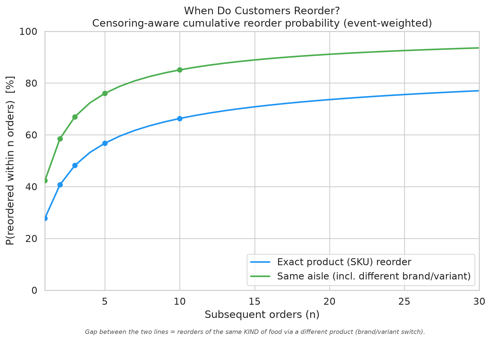
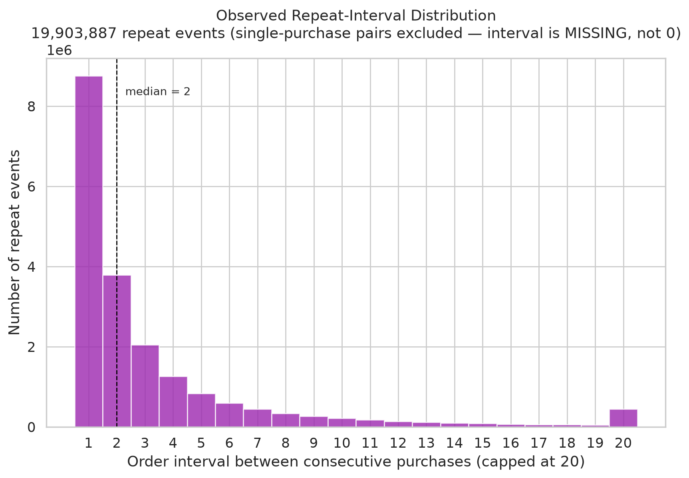
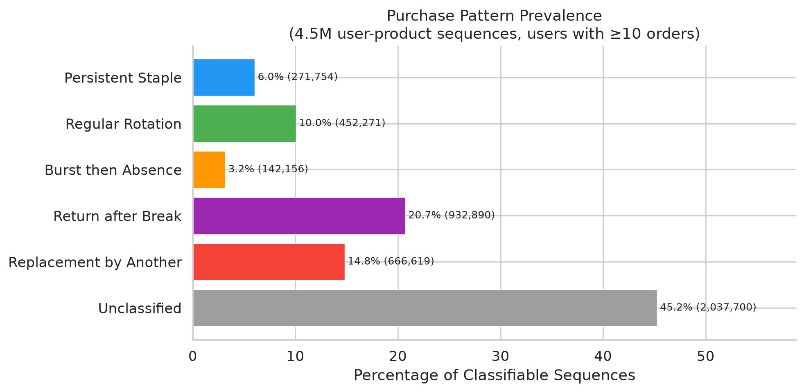

# Understanding Meal Selection, Variety, and Retention

**How do customers choose meals over time? What patterns of repetition, rotation, and novelty explain satisfaction and longevity?**

This project grew out of an effort to understand meal subscriptions — specifically, how services might better understand customer preferences, fatigue, novelty-seeking, and retention. Before we can analyze meal sequences or predict satisfaction, we need to represent what meals contain in a way that supports comparison and similarity analysis.

The work here uses grocery purchase data to build that foundation: classifying products into recipe-oriented ingredients, analyzing how people select and repeat foods, and preparing to study meal composition and variety.

---

## The Meal Subscription Challenge

Meal delivery services face a common challenge: **keeping customers engaged over time**.

Customers subscribe for convenience, variety, and quality. But after weeks or months, they may experience:
- **Meal fatigue:** ordering the same types of meals repeatedly
- **Lack of novelty:** not discovering new favorites
- **Insufficient variety:** menu doesn't match their preference for rotation vs. repetition

Understanding which customers prefer **repetition** (ordering the same few meals reliably) vs. **exploration** (trying new meals frequently) vs. **rotation** (cycling through a stable set) could inform menu curation, recommendations, and retention strategies.

But to study meal sequences, we need:
1. A way to represent what meals contain (ingredients, flavors, cuisines)
2. A taxonomy that preserves distinctions that matter to customers
3. Methods for measuring meal similarity, variety, and novelty

This project tackles the first two using grocery purchase data as a proxy for meal selection behavior.

---

## Dataset and Approach

**Instacart Online Grocery Shopping Dataset 2017:**
- 206,000 customers
- 3.4 million orders
- 49,688 unique products
- Sequential purchase history per customer

**Why grocery data?** While not identical to meal subscriptions, grocery purchases reveal selection patterns: repeat staples, rotated items, one-time experiments, and long gaps before returns. These patterns mirror meal subscription behavior.

**The classification challenge:** To analyze food at the *ingredient* level rather than the *product* level, we need to map products to recipe-oriented categories. "Organic 2% Milk" and "Whole Milk" should both be "milk" — brand and fat percentage don't matter for recipe comparisons. But "Yogurt" and "Ice Cream" should be distinct — recipes don't substitute one for the other.

---

## Classification: Products → Recipe Ingredients

We classified all 49,688 products into a **446-ingredient recipe taxonomy** grounded in how recipes actually use ingredients.

### Taxonomy Principles

**Recipe equivalence:** If recipes treat variations interchangeably, they're the same ingredient.
- All milk types (whole, 2%, skim, organic) → `milk`
- All pasta shapes (spaghetti, penne, rigatoni) → `pasta`

**Meaningful distinctions:** If recipes distinguish them, so do we.
- Pasta vs. filled pasta (ravioli) → different ingredients
- Fresh herbs vs. dried herbs → different ingredients
- Yogurt vs. ice cream → different ingredients

**Prepared dishes separate from base ingredients:**
- "Frozen Mac and Cheese" → `mac_and_cheese` (complete dish), not `pasta` or `cheese`
- "Canned Chicken Noodle Soup" → `soup`, not `chicken` or `noodles`

### Classification Methods

We compared three approaches:

| Method | How It Works | Strengths | Weaknesses |
|--------|--------------|-----------|------------|
| **TF-IDF + rules** | Cosine similarity to ingredient descriptions, then product-identity corrections | Good on product-type words (cookies, yogurt, pasta) | Misses short/unusual names |
| **Sentence embeddings** | all-MiniLM-L6-v2 semantic matching | Better semantic understanding (frozen meals, dressings) | Confused by flavor words |
| **LLM (Claude)** ✓ | Recipe-grounded reasoning via fabric CLI | **100% on spot checks**, combines semantic + product-identity | Slow (~8 hours for full dataset) |

**Final result:** 49,688 products classified using the LLM approach. [See detailed method comparison →](analysis/classification/methods_compared/README.md)

### Classification Results

- **38,529 food items** (77.5%)
- **8,278 prepared dishes** (frozen meals, meal kits, canned soups)
- **2,807 unclassified** (5.6%) — LLM declined to guess rather than forcing low-confidence assignments
- **Top 25 ingredients** represent 41% of all products
- **632 unique ingredients** used (vs. 446 defined — LLM introduced additional distinctions)

**Example classifications:**
- "Chocolate Sandwich Cookies" → `cookies` ✓
- "Light Strawberry Blueberry Yogurt" → `yogurt` ✓ (not `strawberry`)
- "Smart Ones Mini Rigatoni" → `frozen_meal` ✓ (not `pasta`)
- "Organic Spaghetti" → `pasta` ✓
- "T Bone Steak" → `steak` ✓

[Full classification analysis with statistics, distribution, and examples →](analysis/classification/CLASSIFICATION_ANALYSIS.md)

---

## Purchase Patterns: Repetition, Rotation, and Return

Using the Instacart dataset, we analyzed how customers select and reorder foods over time.

### Delayed Reordering Is Common

Using Instacart's `reordered` field and full-history repeat intervals, **reordering is frequent but mostly delayed:**

- Only **27.8%** of product reorders happen in the *immediately next* order
- **66.3%** of reorders happen within 10 subsequent orders
- **Delayed reorders (35.3%) outnumber immediate repeats (27.7%)** of basket contents
- **Median gap between reorders:** 2 orders



The **green line (aisle)** sits above the **blue line (exact product)**: customers return to the same *type* of food (85% within 10 orders) more often than the exact SKU (66%). That gap is brand/variant switching.



### Most Items Are Not Staples

Of 4.5 million user-product sequences (users with 10+ orders who bought a product at least twice), only **6% are persistent staples** — items bought in more than half of orders with runs of 3+ consecutive purchases.

The most common pattern is **return after a break (21%)**: customers stop buying something for 5+ orders, then resume. Another 15% show **replacement** by another product in the same aisle. Nearly half (45%) don't fit clean patterns.



**Pattern examples:**


- **Persistent Staple:** Organic Bananas bought in 88% of orders
- **Regular Rotation:** Sliced Black Olives appearing every few orders
- **Burst then Absence:** Mediterranean Crusted Salmon bought 3 times, then never again
- **Return after Break:** Chicken Nuggets purchased regularly, absent 10+ orders, then resumed

### Prepared Foods Behave Like Everything Else

Prepared foods (frozen meals, deli items, frozen pizza — 5,839 products) show almost **identical patterns** to other groceries. Selection frequency, consecutive purchase runs, and gap lengths differ by less than 3%.

This suggests meal subscriptions may see similar behavior: some customers order the same meals reliably (staples), others rotate through a set, others try once and stop.

---

## What This Enables for Meal Analysis

### Current Foundation

✓ **49,688 products classified** into recipe-oriented ingredients  
✓ **Ingredient taxonomy** preserving cooking-relevant distinctions  
✓ **Prepared dishes separated** from base ingredients  
✓ **Purchase sequence patterns** identified (repeat, rotate, return)

### Next Steps

**Recipe similarity:**
- Compare ingredient lists to measure meal overlap
- Identify substitution patterns (meals differing by one ingredient)
- Cluster meals by ingredient composition

**Meal variety analysis:**
- Track ingredient composition changes across sequential orders
- Measure novelty: how many new ingredients per order?
- Quantify variety: ingredient diversity within a time window

**Customer segmentation:**
- Identify repetition-preferring vs. exploration-seeking customers
- Predict churn risk from declining variety or stagnant selections
- Recommend meals that balance familiarity and novelty

**Limitations to address:**
- Current data is product-level, not recipe-level
- Need ingredient decomposition for complex prepared items
- Taxonomy refinement (clarify category boundaries, validate singleton ingredients)

---

## Repository Structure

```
analysis/
  classification/
    food_classification.csv              # Final ingredient classification (49,688 products)
    INGREDIENT_TAXONOMY.md               # 446-ingredient taxonomy
    CLASSIFICATION_ANALYSIS.md           # Detailed statistical analysis ← Start here
    methods_compared/                    # TF-IDF vs. embeddings vs. LLM
    archived/                            # Historical work
  
  figures/                               # Reorder analysis visualizations
  outputs/                               # Other analysis outputs

scripts/
  data_pipeline/                         # Kaggle → Parquet ingestion
  classification/                        # TF-IDF, embeddings, LLM classifiers
  sequence_analysis/                     # Reorder and pattern analysis

docs/
  CLASSIFICATION_METHODOLOGY.md          # Recipe-to-ingredient reasoning
  DATA_AUDIT.md                         # Data quality validation
```

---

## Reproducing the Analysis

**Install dependencies:**
```bash
uv sync
```

**Download Instacart dataset:**
```bash
# Requires Kaggle API credentials
python scripts/data_pipeline/ingest_data.py
```

**Run classification analysis:**
```bash
# Generate statistics and figures
python scripts/classification/analyze_classification.py
```

**Reproduce classifications** (requires ~8 hours):
```bash
# TF-IDF approach
python scripts/classification/classify_tfidf.py
python scripts/classification/refine_tfidf.py

# Embeddings approach
python scripts/classification/classify_embeddings.py

# LLM approach (requires fabric CLI)
python scripts/classification/classify_fabric.py
```

---

## References and Context

**Original research question:** How customers repeat, rotate, and return to foods in grocery purchases.

**Extension for meal subscriptions:** Understanding meal composition and variety patterns that may inform retention strategies.

**Dataset:** [Instacart Market Basket Analysis](https://www.kaggle.com/datasets/psparks/instacart-market-basket-analysis) (2017)

**Classification grounding:** 1,000+ recipes across diverse cuisines (knowledge-based, not extracted from a specific recipe corpus).

**Methodological note:** This analysis separates descriptive patterns from predictive modeling. When sequence features don't outperform baselines, we report that honestly rather than overfitting.

---

*For detailed classification statistics, taxonomy analysis, and method comparisons, see [CLASSIFICATION_ANALYSIS.md](analysis/classification/CLASSIFICATION_ANALYSIS.md).*
