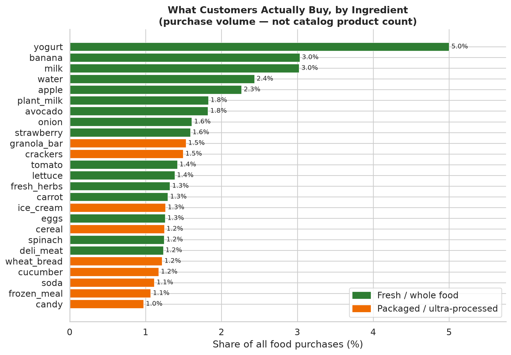
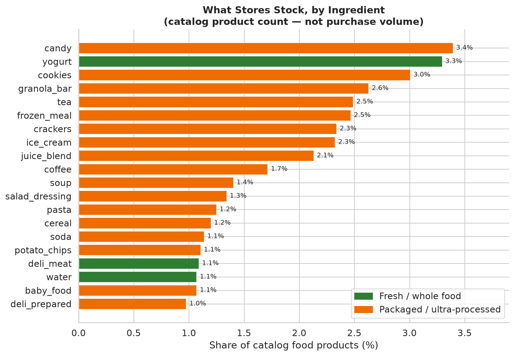
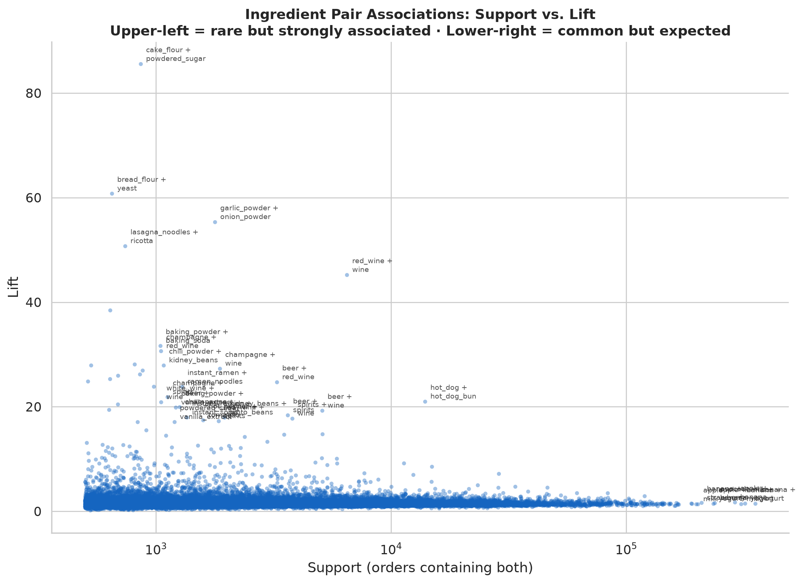
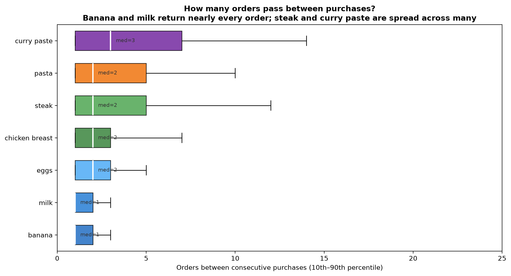
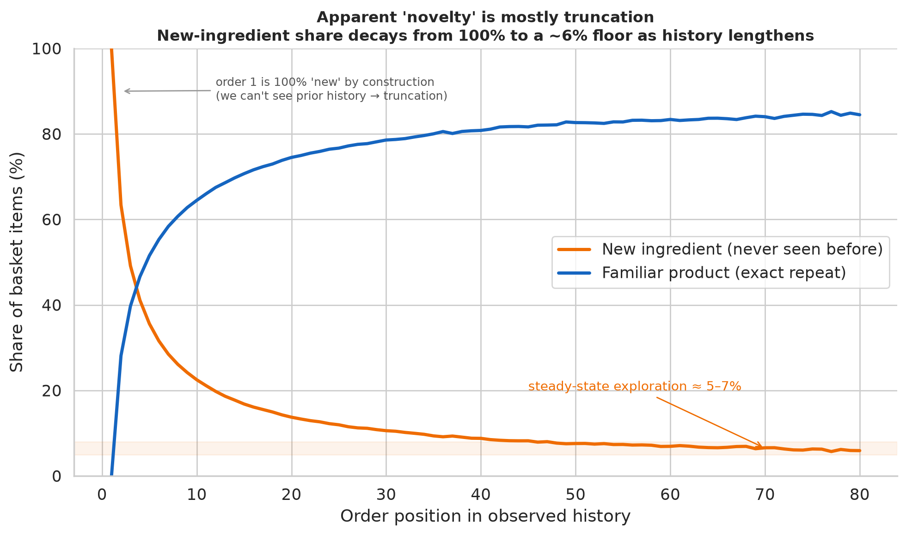
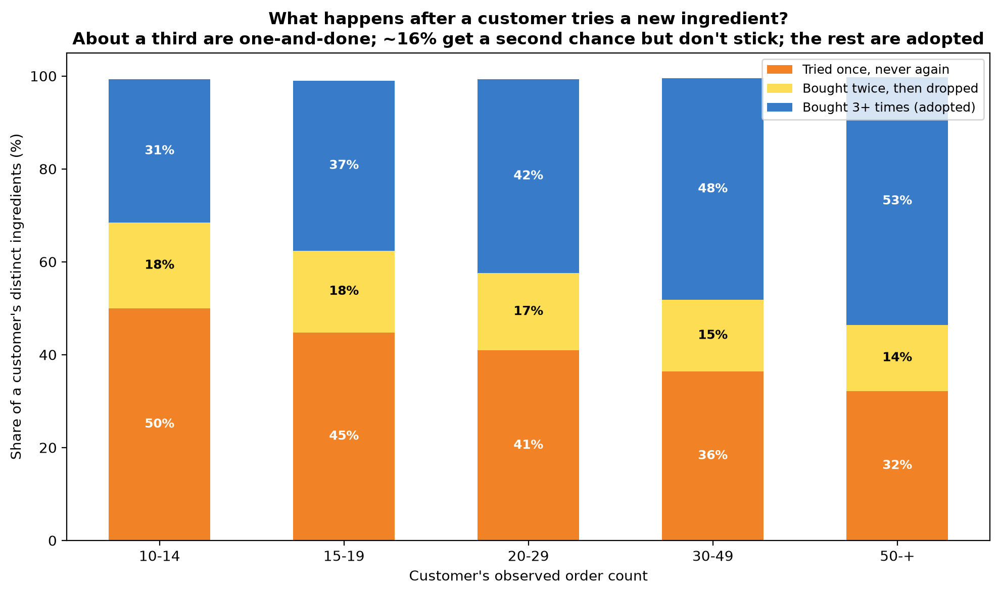
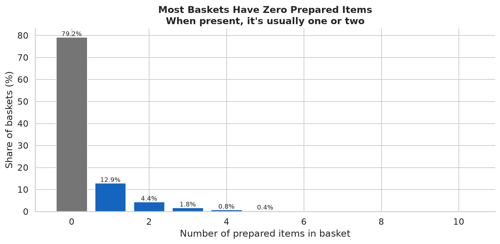
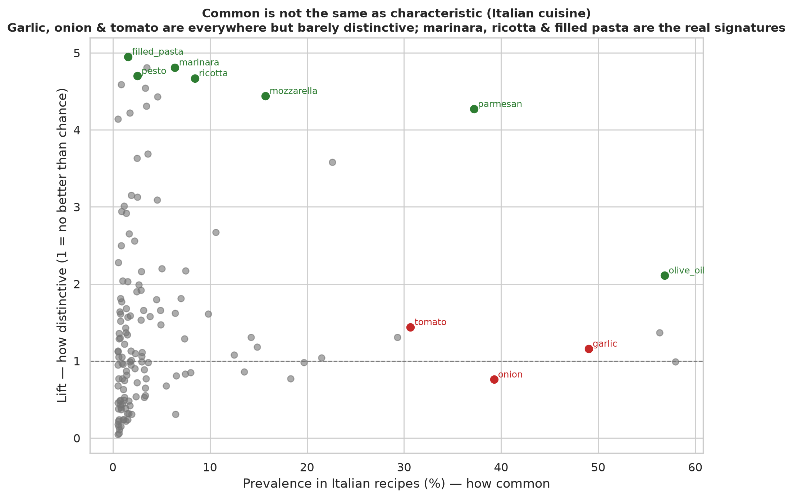
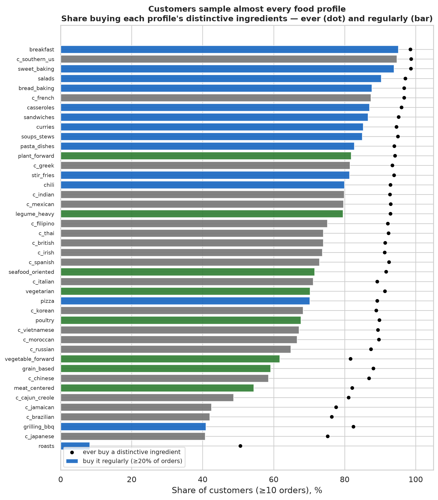
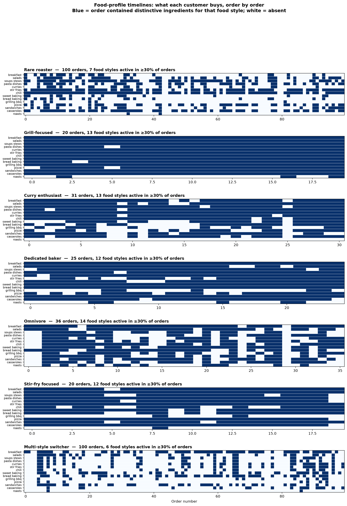

# Understanding Food Customers Through Grocery Purchase Data

Grocery transaction data records what people put in their carts — not what they say
they eat, not what nutritionists recommend, just what gets purchased, trip after trip.
This project reads 3.4 million orders from 206,000 customers to understand how people
choose, repeat, and explore food.

The data is the [Instacart Online Grocery Shopping Dataset 2017](https://www.kaggle.com/datasets/psparks/instacart-market-basket-analysis):
3.4 million orders from 206,000 customers, with the full sequence of products in each
order — one of the few large public datasets where you can follow individual customers
across dozens of shopping trips.

The dataset has 49,688 products, but products are a poor unit for understanding food. A
store carries 277 kinds of milk and 1,177 yogurts — organic, conventional, whole, skim,
Greek, flavored, plain — and most of that variation is branding, not food. So the first
step was collapsing every product into an **ingredient**: the recipe-level role it
plays. "Organic 2% Milk," "Whole Milk," and a store-brand gallon all become `milk`;
"Chobani Blueberry" and "Fage Plain" both become `yogurt`. That turns 49,688 products
into 543 ingredients across 21 food categories, and everything downstream works there.
([Classification methodology →](docs/FOOD_CLASSIFICATION.md))

One theme kept surfacing: reading food choice from purchase data means constantly
separating what a customer genuinely prefers from what they happened to do for a while,
which brand they reached for, and what is an artifact of seeing only a slice of their
history.

Seven analyses, each with its own detailed report:

- **What do people buy?** How does the catalog compare with actual demand?
- **What goes together?** Which ingredients share a basket more than chance predicts?
- **What repeats?** How often do customers repurchase each ingredient, and is there
  information in the order of purchases beyond frequency?
- **What's new?** How much of shopping is trying something unfamiliar, and where?
- **Where do prepared meals fit?** How much shopping is ready-to-eat, and what's in the
  rest of the cart?
- **What kinds of food can the ingredients signal?** Which food styles — curries, salads,
  baking — are detectable from ingredient purchases?
- **Who are the customers, and what do they cook?** How broadly do customers sample food
  styles, how many do they buy consistently, and which differences between customers
  hold up under scrutiny?

---

## What customers buy vs. what stores stock

### [Ingredients →](analysis/ingredients/)





Rank ingredients by how much customers buy, then by how many products the catalog
carries, and the two orderings barely agree. Fresh foods — produce, dairy, meat — are
**57% of what customers buy but only 25% of the products on offer.** Packaged foods are
the mirror image: 45% of the catalog, 25% of purchases. The catalog is widest where
branding does the differentiating (1,212 candy products, 939 granola bars); the cart is
deepest where the food itself is the product (18 banana SKUs are 3% of all purchases).

**Product variety and food variety are not the same thing.** Just **19% of the food
catalog captures 80% of purchase volume** — yogurt needs 190 of its 1,177 products to
reach 80% of its own sales, while banana needs 2 of 18. The median customer buys 45
distinct products but only 34 distinct ingredients, so about a quarter of their apparent
variety is the same food in different packaging. ("Organic" products are 12% of the food
catalog but **33.5% of purchases** — far above the ~6% US grocery average, reflecting
this platform's customer base rather than groceries generally.)

## What customers buy together

### [Basket contents →](analysis/basket/)



The median basket holds 8 items spanning 7 ingredients. Which ingredients travel
together splits into two kinds, and *lift* — how many times more often a pair co-occurs
than their individual popularity would predict (1.0 = chance) — tells them apart.
**High-support pairs** are staples that share a cart because both are everywhere
(banana + yogurt, 354k orders, lift ~1.4). **High-lift pairs** are specialists that
almost always appear together: cake flour + powdered sugar (85×), bread flour + yeast
(61×), lasagna noodles + ricotta (51×).

High-lift pairs are co-purchasing signatures — baking projects, spice blends, specific
dishes. Three-ingredient combinations surface cooking contexts: fresh herbs + garlic +
onion (28k baskets, 12×), cucumber + lettuce + tomato (salad), avocado + garlic + onion
(guacamole). These are things bought in the same order, not proof of a single recipe:
one basket can hold several meals and a week of restocking.

## What customers buy again

### [Sequences →](analysis/sequences/)



How many orders pass between purchases varies by ingredient. Banana and milk return
nearly every order; chicken breast every 2–3; curry paste is spread across many. These
repurchase rhythms are simple — but they turn out to be the strongest signal in the data.

A customer's **long-run purchase frequency predicts the next order better than any
recency rule tested.** What someone bought recently does not beat how often they buy it.
To test whether there's anything in the *sequence* beyond frequency, each customer's
orders are compared against a shuffle that preserves their purchase rates but scrambles
the order — and most named "patterns" (staples, returns, rotations) occur at the same
rate in the shuffle. They are frequency in disguise. [Full analysis →](analysis/sequences/)

## How customers try unfamiliar foods

### [Novelty & exploration →](analysis/novelty/)



"New" means the first time an ingredient appears in a customer's observed history. Pool
every order and about 22% of items look new — but that number is inflated by
truncation. The data starts mid-history, so a customer's first observed order is 100%
"new" by construction, and apparent novelty decays as the window lengthens. By order 50
it has fallen to **~5–7%** and is still drifting down.



A more truncation-resistant way to measure exploration: of the distinct ingredients a
customer tries, **about a third are bought exactly once and never again** — they don't
become part of the customer's purchasing. The rest are adopted (bought 3+ times). This
tried-and-dropped rate is more stable across observation lengths than the raw novelty
rate: it moves from 50% to 32% as history length increases (vs. novelty's 100% to 6%).
Discoveries tilt toward the long tail (the top 20 ingredients are 37% of purchases but
only 24% of first-time discoveries), and people differ in how much they explore (p10 =
6%, p90 = 41% at matched history length).

## Where prepared dishes fit

### [Prepared dishes →](analysis/prepared/)



Prepared food — frozen meals, pizza, soup, deli items — is a minority, occasional
behavior. **79% of baskets contain none.** 60% of customers buy one at some point, but
for the median buyer it's about 4% of their items across ~30% of their orders. Reliance
doesn't rise with how much someone shops (slightly negative, r = −0.21).

Baskets with prepared food are larger (median 12 items vs. 7). The non-prepared portion
of those baskets shifts measurably: **vegetables and fruit are 4 and 2.5 percentage
points lower**, while snacks and frozen foods are each ~1–2 points higher. This is not
the "nearly identical" composition sometimes claimed for these comparisons, but it also
doesn't establish causation — prepared-food buyers may simply differ from non-buyers in
ways not visible in the basket. Whether prepared meals displace fresh cooking or ride
alongside it remains an open question this data frames but cannot settle.

## What kinds of food can the ingredients signal?

### [Food Profiles →](analysis/food_profiles/)

What *kind* of food do those ingredients add up to — a curry, a salad, a baking project?
Using two public recipe corpora (231k Food.com recipes, 40k labeled by cuisine), each
ingredient is scored for how distinctively it signals a food style, measured as *lift*.
The result is validated on held-out recipes.



The figure above captures the core principle. In Italian recipes, garlic and olive oil
appear constantly — but they appear in *most* cuisines, so they signal nothing specific
(lift near 1). The ingredients that actually identify Italian cooking — ricotta,
marinara, filled pasta, pesto — are less common but far more distinctive. Ranking by
frequency would surface garlic and miss ricotta. This applies to every food style: the
ingredients that define it are not the ingredients that sell the most.



Applied to Instacart customers (using only strongly distinctive ingredients — lift ≥ 5,
so baking powder doesn't count as "baking"): sandwiches (90% of customers), salads
(82%), and casseroles (81%) are the most widely purchased food styles. Bread baking
(28%), grilling (18%), and roasts (3%) are genuine minority pursuits — their distinctive
ingredients (bread flour, steak, roast cuts) are specific enough to identify who
actually buys them.

## Who are the customers, and what do they cook?

### [Customers →](analysis/customers/)

The median customer places **10 orders** over ~5 months, **8 items** per trip, every
~13 days. Basket size is stable across all engagement levels — **frequency is what
varies**, not trip size.

Scored against food-profile signatures, customers are moderately broad: the median
samples **8–11 of 14 meal styles** but buys only **~4 regularly**. **34% have zero
food styles they buy consistently** (in ≥50% of orders), and the median customer's
strongest style appears in only **20% of their orders**.



The timelines make this concrete. Each row is a food style; each column is an order;
blue means that order contained the style's distinctive ingredients. The grill-focused
customer has one dense band and white everywhere else. The narrow buyer has casseroles
and nothing else across 100 orders. The broad sampler has dots across many rows. Most
customers look more like the multi-style panel — scattered, diffuse purchasing — than
like any of the focused ones.

A customer's unique ingredient count (how many distinct ingredients they've purchased)
predicts food-style variety: 13 ingredients → 3 styles sampled; 91 → 12. But even the
broadest shoppers typically buy only 2 styles consistently. The minorities who do
specialize — the 28% who buy bread-baking ingredients, the 18% who grill — are
identifiable from their distinctive ingredients. [Full analysis →](analysis/customers/)

---

## What we learned

1. **Product variety is not food variety.** A quarter of apparent product diversity
   disappears at the ingredient level, and 19% of the catalog covers 80% of volume.
   Most "assortment" is brand and package choice over a smaller set of foods.

2. **Purchase frequency is a strong baseline.** A customer's long-run rate for each
   ingredient is a well-calibrated predictor of their next order, and simple recency
   rules don't improve on it. Most named sequence "patterns" match their
   frequency-preserving baselines.

3. **Exploration is ~5–7% after correcting for truncation, not ~22%.** People keep
   trying new things, slowly, tilted toward the catalog's long tail. They differ in how
   much — but the headline number is inflated by where the observation window starts.

4. **Within-customer variation rivals between-customer differences.** Several
   "personality" metrics (repeater vs. explorer) encode observation length rather than
   behavior. Genuine individual signal exists but is narrower than segment language
   implies.

5. **Prepared food is a minority behavior with a measurably different basket.** 79% of
   baskets contain none. Baskets with prepared food have less produce and more snacks —
   but cross-sectional comparisons can't establish whether prepared meals displace
   cooking or simply co-occur with different shopping patterns.

6. **The ingredients that define a food style are not the ones that sell the most.**
   Garlic is common but not distinctive; ricotta, curry paste, and bread flour are
   distinctive but not common. 22 ingredients (salt, onion, garlic, olive oil, butter,
   eggs, pepper) appear in every food style and signal nothing specific — they are 12%
   of purchase volume and the noise floor for any personalization. Among those, salt
   (57% of recipes, 0.12% of grocery purchases) and olive oil (23% of recipes, 0.32%)
   are in every kitchen but rarely appear on a grocery list — purchase frequency and
   importance to cooking are different measures.

7. **Most customers sample broadly but specialize in little.** 34% have zero food styles
   bought consistently; the median customer's strongest style is in 20% of orders. But
   the minorities who do specialize — the bakers, the grillers, the curry buyers — are
   identifiable from their distinctive ingredients, and a customer's unique ingredient
   count is a usable proxy for cooking engagement (13 ingredients → 3 styles, 91 → 12).

These patterns are from one delivery platform in 2017. Whether they hold on current,
broader data is an open question.

Questions worth more or better data:

- Would exploration keep declining with a longer observation window, or does it reach a
  floor?
- Does buying prepared food displace cooking, or sit alongside it? (The basket
  composition differences suggest it might, but can't prove it.)
- Which individual differences survive once observation length is held constant?
- Can food styles be recognized in real grocery baskets — partial and multi-meal —
  rather than the complete recipes the reference was validated on?
- Do a customer's food styles shift over time beyond what stable purchase frequencies
  produce?

---

## Dataset and methodology

**Instacart Online Grocery Shopping Dataset 2017** — 206k customers, 3.4M orders,
49,688 products. Public on Kaggle:
[source](https://www.kaggle.com/datasets/psparks/instacart-market-basket-analysis).
Anonymized integer IDs; no absolute dates; inter-order gaps capped at 30 days.

**Classification:** 49,688 products → 543 ingredients via LLM classification
(Claude, ~8h). A deterministic lookup table
([`product_ingredient_lookup.csv`](data/product_ingredient_lookup.csv)) reproduces the
mapping without an LLM.
[Taxonomy →](data/INGREDIENT_TAXONOMY.md) ·
[Method →](docs/FOOD_CLASSIFICATION.md)

**What limits the conclusions:** No absolute dates (nothing speaks to seasons);
inter-order gaps capped at 30 days; test-set orders lack item labels. Each customer's
history is observed only in part — it begins mid-stream and ends at the data cutoff —
which is why novelty and several per-customer metrics must be read against that
truncation. This is Instacart's customer base: urban, convenience-oriented,
over-indexing on organic (33.5% of purchases) and plant milk (38% of milk), none of it
nationally representative.

## Repository structure

```
data/
  INGREDIENT_TAXONOMY.md        # recipe-ingredient taxonomy (parsed by the pipeline)
  food_classification.csv       # product → ingredient map (key derived dataset)
  product_ingredient_lookup.csv # deterministic lookup table (reproduce without an LLM)
  affinity/                     # Food Profiles reference data (associations, combinations)
  raw/ processed/               # Kaggle CSVs → Parquet
analysis/
  ingredients/      # demand vs assortment, concentration, organic penetration
  basket/           # basket composition, co-occurrence, triplets
  sequences/        # reorder, patterns, substitution, prediction
  novelty/          # novelty classification, repertoire growth, categories
  prepared/         # reach, dish types, basket composition
  customers/        # profiles, segments, behavioral correlations
  food_profiles/    # food-style/cuisine signatures from ingredients + validation
  figures/          # all figures (PNG/SVG)
docs/
  FOOD_CLASSIFICATION.md        # how the classification was built
  AFFINITY_REFERENCE.md         # Food Profiles reference methodology
  classification/               # method comparison, figures, archived attempts
scripts/
  config.py         # shared paths and schemas
  data_pipeline/    # Kaggle → Parquet ingestion + audit
  classification/   # LLM classifier, lookup table, taxonomy corrections
  affinity/         # Food Profiles: ingredient mapping, associations, evaluation, figures
  sequence_analysis/# one script per analysis; analyze_reorder.py is the shared core
```

## Reproducing

```bash
uv sync
python scripts/data_pipeline/ingest_data.py
python scripts/classification/classify_fabric.py     # ~8h; CSV already committed
python scripts/classification/apply_corrections.py
for s in analyze_reorder analyze_patterns analyze_substitution analyze_calendar_time \
         analyze_lift_decomposition analyze_novelty analyze_exploration \
         analyze_basket_contents analyze_prepared_foods \
         analyze_ingredient_lens analyze_customer_profile analyze_customer_behavior \
         analyze_sequences analyze_novelty_extended; do
  python scripts/sequence_analysis/$s.py
done
for v in visualize_ingredient_lens visualize_basket visualize_sequences \
         visualize_novelty visualize_prepared visualize_customers visualize_audit \
         generate_pattern_gallery; do
  python scripts/sequence_analysis/$v.py
done

# Food Profiles (uses external recipe corpora, not the Instacart data).
# Download first into data/external/ (git-ignored; redistribution-restricted):
#   kaggle datasets download -d kaggle/recipe-ingredients-dataset -p data/external/whats_cooking --unzip
#   kaggle datasets download -d shuyangli94/food-com-recipes-and-user-interactions -p data/external/food_com --unzip
for s in build_associations validate evaluate visualize_profiles; do
  python scripts/affinity/$s.py          # map recipes→ingredients, measure, validate, plot
done
```
