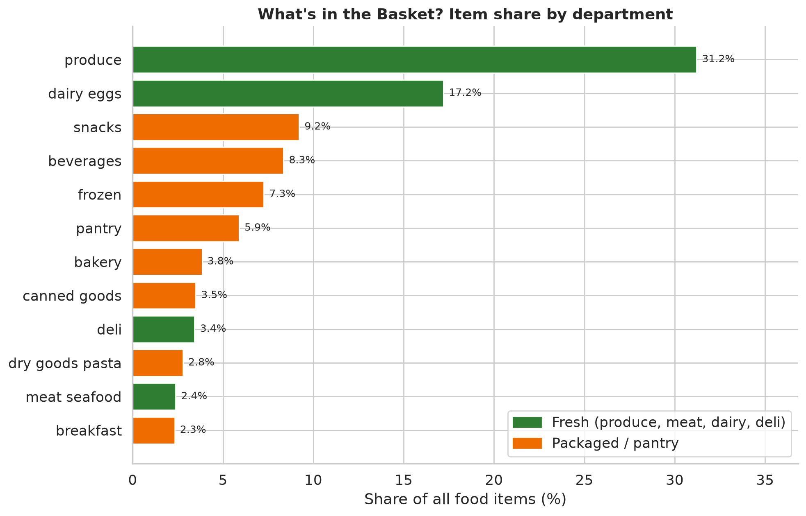
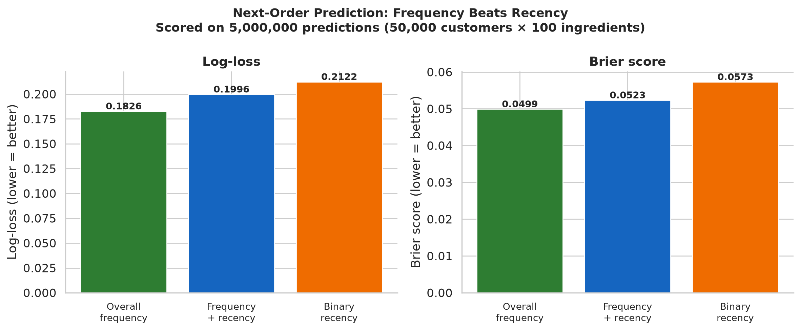
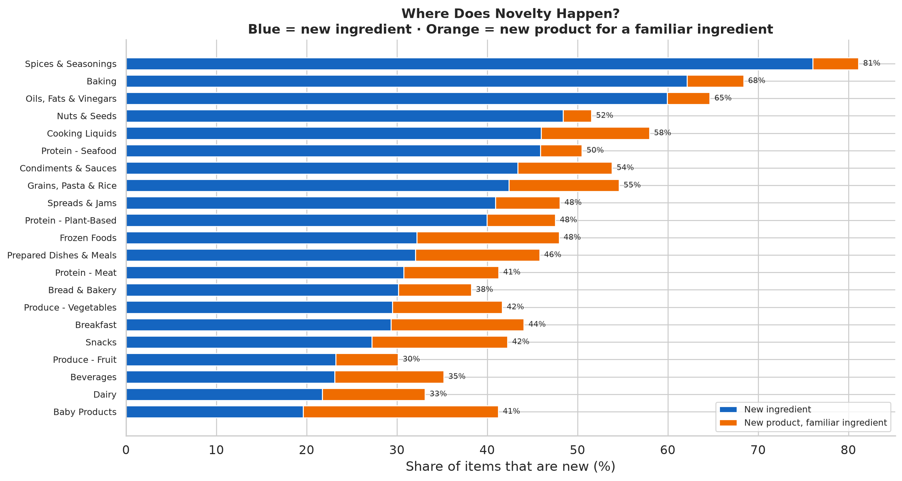
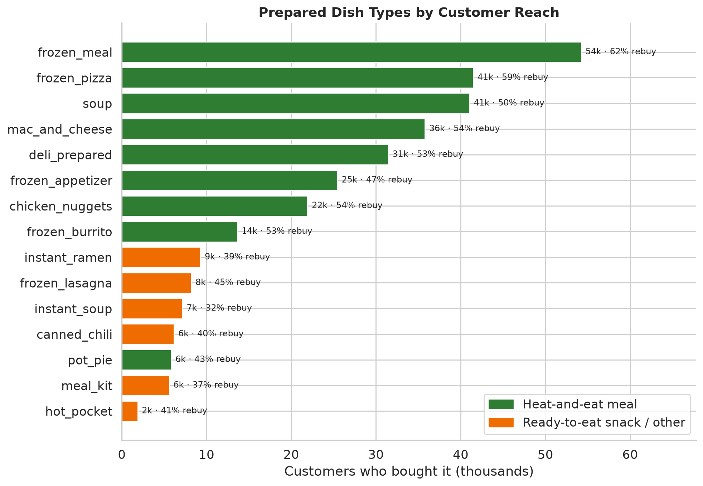
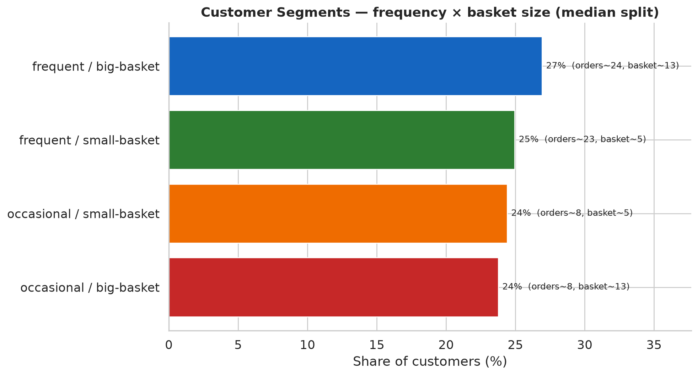

# Meal Selection, Variety, and Retention in Grocery Purchasing

How do customers choose foods over time — what they repeat, rotate, and try once —
and what might that suggest for a meal-subscription service? Grocery data can't answer
subscription questions directly, but it shows the underlying selection patterns.

The project classifies 49,688 Instacart products into recipe ingredients, then
analyzes purchasing at the ingredient level across each customer's order history.

Each result below is a full analysis with its own report (click through for detail,
tables, and methods); the README is the overview.

---

## Dataset & data

**Instacart Online Grocery Shopping Dataset 2017** — 206,000 customers, 3.4M orders,
49,688 products, sequential purchase history per customer (anonymized integer IDs; no
absolute dates; inter-order gaps capped at 30 days). Public on Kaggle:
[source](https://www.kaggle.com/datasets/psparks/instacart-market-basket-analysis).

- **Inputs** are the public Instacart parquet tables; regenerate them with
  `python scripts/data_pipeline/ingest_data.py` (not re-hosted here — they're the
  public source, and one file exceeds GitHub's size limit). See [data/](data/).
- **What we created** and publish: the ingredient classification
  ([`analysis/classification/food_classification.csv`](analysis/classification/food_classification.csv),
  49,688 products → 632 ingredients, with `is_food` / `is_prepared_dish`), the
  [recipe taxonomy](analysis/classification/INGREDIENT_TAXONOMY.md), and every
  aggregate result table under `analysis/<topic>/`.

Prepared *dishes* are defined by the taxonomy's "Prepared Dishes & Meals" section (17
meal types), not the raw per-product flag. The full purchase table is ~30M rows;
every analysis streams it in customer-id bursts to stay within memory
([docs/PROCESSING.md](docs/PROCESSING.md)).

---

## Results

### [Ingredients →](analysis/ingredients/)

Analyzing by ingredient (a recipe role) instead of product (a SKU) is the project's
premise. 35,722 food products → 543 ingredients across 24 categories.


- **Fresh foods are 57% of purchases but only 25% of the catalog.** Packaged foods
  are the opposite: 45% of the catalog, 25% of purchases. The catalog is wide where
  branding is the product; the cart is deep where the food is.
- **19% of products capture 80% of all purchase volume.** Demand concentration varies
  from banana (1 product = 53% of sales) to yogurt (you need 190 of 1,177 products
  to reach 80%).
- **A third of "variety" is packaging** — the median customer buys 45 products but 34
  ingredients (1.33×).

### [Basket contents →](analysis/basket/)



- **Baskets are small and fresh:** median 8 food items, 7 distinct ingredients;
  produce is 31% of items. Small baskets are quick pickups; large baskets are weekly
  shops with broader category coverage.
- **Co-purchasing signals are real:** baking ingredients (cake flour + powdered sugar,
  85× lift), spice blends (garlic_powder + onion_powder, 55×), dish kits (lasagna
  noodles + ricotta, 51×). Three-ingredient combinations surface cooking aromatics
  (herbs + garlic + onion, 12× lift in 28k baskets) and salad (cucumber + lettuce +
  tomato).
- **Garlic predicts cooking from scratch** — its companions are bay leaves,
  tomatillo, cumin, ginger, fish sauce. Pasta predicts sauce (pasta_sauce 5.6×).

### [Sequences →](analysis/sequences/)



- **Recent history predicts the next order 33% better than overall frequency** —
  knowing what someone bought in the last 2 orders carries real information that
  their lifetime rate misses (tested on 549k held-out items).
- **Product-level temporal concentration is real but small** — reorder lift 1.28×,
  consecutive-purchase runs 5–10% longer than a frequency-preserving shuffle.
  Most apparent "patterns" (staples, returns) match their random-baseline rates;
  burst-then-absence is the exception.
- **Repurchase timing is bursty, not periodic** — inter-purchase gap CV is 1.41
  (median across ingredients), well above the 1.0 of random spacing.
  "Regular rotation" is rare; irregular bursts are the norm.

### [Novelty & exploration →](analysis/novelty/)



- **Steady-state exploration is ~6%, not ~22%** — the pooled number is inflated by
  truncation. Spices and baking have 75–81% novelty (bought rarely); dairy and fruit
  have 30–33% (bought every order). Snacks and frozen add the most *product-only*
  novelty (new brands for familiar ingredients).
- **Discoveries are spread toward the long tail** — the top 20 ingredients are 37%
  of purchases but only 24% of first-time discoveries. Customer variation is wide
  (p10=6% to p90=41%) even at comparable history positions.

### [Prepared dishes →](analysis/prepared/)



- **60% of customers buy a prepared meal**; for the typical buyer they're ~4% of items
  and ~30% of orders — a convenience, not a base — and reliance doesn't rise with
  volume.
- Frozen dominates (frozen_meal → 54k customers; then pizza, soup, mac & cheese). Down
  to the product: top frozen_meals are Mac & Cheese and Pad Thai; top soups are
  chicken noodle and creamy tomato. Prepared dishes recur slightly less regularly than
  staples (26.9% vs 28.7% next-order) but more relative to their own frequency.

### [Customers →](analysis/customers/)



- The median customer places 10 orders over ~5 observed months, baskets of ~8,
  shopping every ~13 days. Four balanced segments on frequency × basket size;
  frequency, not basket size, drives order volume.
- Behavioral traits are stable within a customer (r 0.73–0.82 across halves) but
  mostly track purchase volume — **except within-ingredient product-switching**, the
  one volume-independent trait worth segmenting on.

---

## What it might mean for meal subscriptions

Grocery patterns, offered as hypotheses rather than demonstrated subscription results:

1. Read demand at the ingredient level — product data overweights packaged variety.
2. Specific products are concentrated in time — reordered ~29% above a frequency baseline; broader grains add little beyond arithmetic.
3. A third of apparent variety is packaging, not diet.
4. Within-ingredient commitment is mild; variety-seeking concentrates in flavored/discretionary categories.
5. Exploration is low (~6%) and falling; the repertoire grows slowly.
6. Customer "type" is mostly purchase volume — product-switching is the exception worth segmenting on.
7. "Returns" and "rotation" mostly track frequency; burst-then-absence stands out but, without post-window data, isn't evidence of churn.
8. Order-gaps are not calendar time.
9. Prepared-meal demand is a minority, occasional behavior (60% reach, ~4% of items).

---

## Repository structure

```
analysis/
  classification/   # ingredient classification (our input) + taxonomy + method comparison
  ingredients/      # README.md + aggregate CSVs  (one directory per result)
  basket/           # README.md + CSVs (basket size, composition, co-occurrence)
  sequences/        # README.md + CSVs (reorder, patterns, substitution, calendar)
  novelty/          # README.md + CSVs (novelty, repertoire growth)
  prepared/         # README.md + CSVs (reach, dish types, products, reorder)
  customers/        # README.md + CSVs (profile, segments, behavior)
  figures/          # all figures (png/svg)
docs/               # PROCESSING.md, DATA_AUDIT.md
scripts/
  config.py         # shared paths, schemas, keywords
  data_pipeline/    # Kaggle → Parquet ingestion + audit
  classification/   # classifiers + taxonomy corrections
  sequence_analysis/# one script per result; analyze_reorder.py is the shared core
data/               # processed inputs (regenerate via ingest_data.py; see data/README.md)
```

## Reproducing

```bash
uv sync
python scripts/data_pipeline/ingest_data.py                 # Kaggle → data/processed/
python scripts/classification/classify_fabric.py            # LLM classification (~8h; CSV committed)
python scripts/classification/apply_corrections.py          # taxonomy fixes (condensed_soup)
# results (memory-safe, full dataset) — each writes to its analysis/<topic>/ directory
for s in analyze_reorder analyze_patterns analyze_substitution analyze_calendar_time \
         analyze_lift_decomposition analyze_novelty analyze_exploration \
         analyze_basket_contents analyze_prepared_foods \
         analyze_ingredient_lens analyze_customer_profile analyze_customer_behavior \
         analyze_sequences analyze_novelty_extended; do
  python scripts/sequence_analysis/$s.py
done
python scripts/sequence_analysis/visualize_ingredient_lens.py   # ingredient figures
python scripts/sequence_analysis/visualize_basket.py            # basket figures
python scripts/sequence_analysis/visualize_sequences.py         # sequence figures
python scripts/sequence_analysis/visualize_novelty.py           # novelty figures
python scripts/sequence_analysis/visualize_audit.py
python scripts/sequence_analysis/generate_pattern_gallery.py
```

**Method note:** descriptive patterns are kept separate from prediction; when a
sequence feature doesn't beat a frequency baseline, that is reported rather than
overfit.
