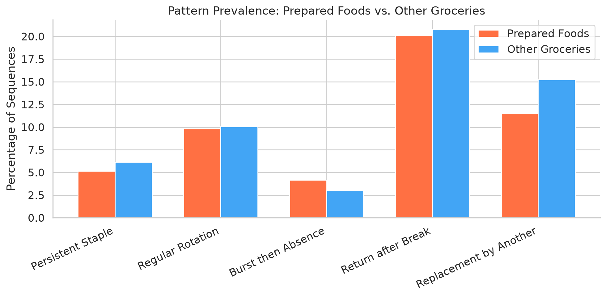
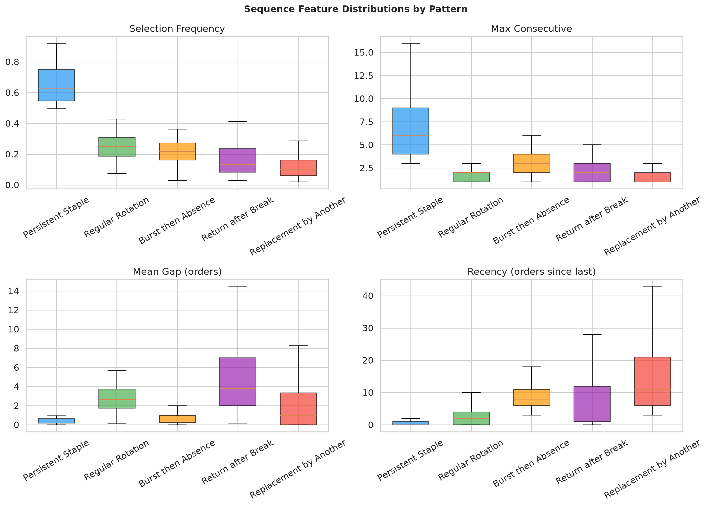
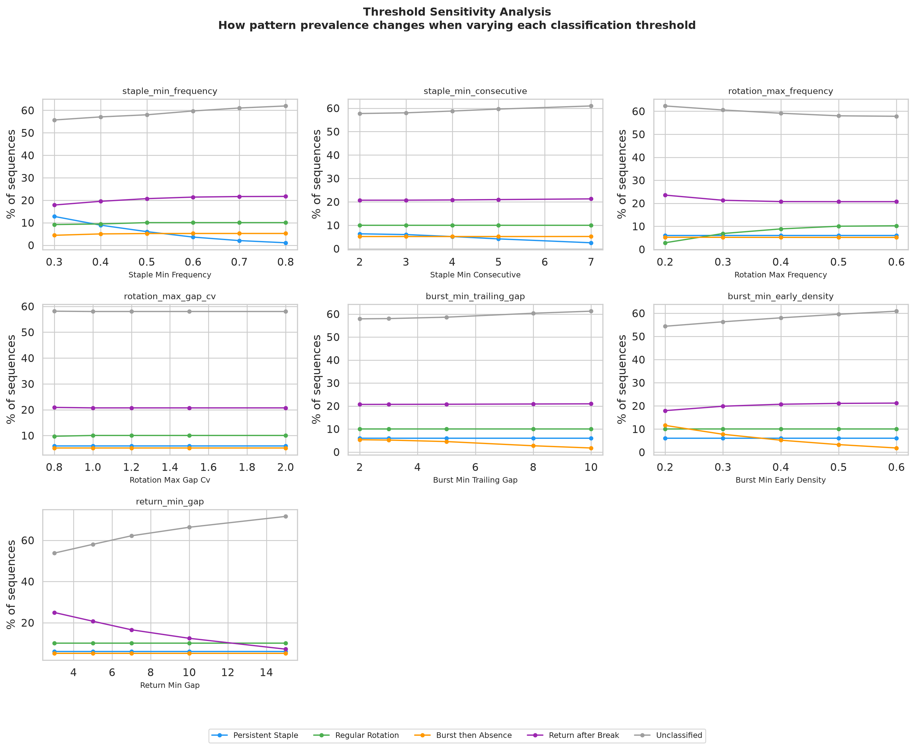

# Food Selection Sequences: How Customers Repeat, Rotate, and Return to Foods

Study of food selection patterns in sequential grocery purchases using the Instacart Online Grocery Shopping Dataset 2017.

## Question

How do customers repeat and rotate foods, and can their past selections predict when a previously purchased food will disappear from — or return to — their subsequent orders?

This project uses real purchase data from 206,000 customers across 3.4 million orders to study the structure of repeat purchasing behavior. It examines exact products, food categories, and prepared foods specifically. The analysis separates descriptive patterns from predictive modeling, and reports honestly when sequence features do not outperform simple baselines.

## Key Findings

> **⚠️ Under revision (2026-10).** This analysis is being corrected after a methodological review. Two issues affect the findings below: (1) reordering was mis-measured using adjacent-basket overlap instead of Instacart's `reordered` field and full-history reorder intervals; (2) the pattern classifier used mutually-exclusive labels, evaluated only the single largest gap, and an absolute `max_gap ≤ 10` cap that wrongly excluded long regular cycles. The reorder measurement has been recalculated (see Reorder Measurement); the classification numbers (staple/rotation/return percentages) are pending a rewrite to overlapping flags and should be read as provisional. A reconciliation table at the bottom tracks what changed.

### Most grocery items are not staples — they come and go

Of 4.5 million classifiable user-product sequences (users with 10+ orders who bought a product at least twice), only **6% are persistent staples** — products bought in more than half of orders with runs of 3+ consecutive purchases. The most common classified pattern is **return after a break** (21%): customers stop buying something for 5+ orders, then resume. Another 15% show **replacement by another product** in the same aisle. Nearly half (45%) of sequences don't fit any clean pattern.


### What the patterns look like

Each row below shows one customer's purchase history for one product. Colored squares mark orders where the product was purchased; gray dots mark orders where it was not.


- **Persistent Staple**: Bag of Organic Bananas bought in 88% of orders, with only occasional gaps. These are the minority.
- **Regular Rotation**: Sliced Black Olives appearing every few orders with consistent spacing — the customer returns to it periodically.
- **Burst then Absence**: Mediterranean Crusted Salmon bought 3 times in quick succession, then never again.
- **Return after Break**: Naturals Chicken Nuggets purchased regularly, then absent for 10+ orders, then bought again.
- **Replacement by Another**: Garlic bought twice early on, then stops — another product in the same aisle starts around the same time.

### Prepared foods behave like everything else

One of the more striking findings: prepared foods (frozen meals, deli items, frozen pizza — 5,839 products) show almost identical sequence patterns to other groceries. Selection frequency, consecutive purchase runs, and gap lengths differ by less than 3%.



The one difference is at the basket level: orders containing prepared foods are nearly 2× larger (13.2 vs 6.8 products). This is a selection effect — bigger baskets are more likely to include at least one prepared item — not evidence that prepared food buyers behave differently.

### Patterns have distinct feature signatures

The classification rules produce patterns with separated feature distributions. Note this is **descriptive, not validation**: patterns necessarily separate on the features used to define them, so this plot illustrates the rules rather than confirming them.



- Staples have high frequency (median 0.62) and long consecutive runs (median 5)
- Rotations have moderate frequency with consistent, short gaps
- Burst-then-absence shows low recency (recently active) but concentrated early
- Returns have the largest mean gaps (median 5 orders between purchases)
- Replacements have high recency (long since last purchase) — the product has not been bought for a while (terminal absence in the observed window; this does not establish abandonment, since follow-up is censored and off-platform purchases are unobserved)

### Classification rules are transparent, with documented threshold sensitivity

All pattern thresholds were defined before examining examples. Sensitivity analysis shows gradual prevalence changes when thresholds are varied — no cliff edges or unstable boundaries:



The most sensitive parameter is `return_min_gap`: lowering it from 5 to 3 orders increases return-after-break from 21% to 25%, while raising it to 15 drops it to 7%. The `staple_min_frequency` threshold also matters — relaxing from 0.5 to 0.3 doubles the staple category from 6% to 13%. All other parameters shift prevalence by less than 5 percentage points across their full range.

## Data

**Source**: [Instacart Market Basket Analysis Dataset](https://www.kaggle.com/datasets/psparks/instacart-market-basket-analysis) (2017)

| Table | Rows | Description |
|---|---|---|
| orders | 3,421,083 | Order metadata with user, sequence, timing |
| order_products_prior | 32,434,489 | Historical order contents |
| order_products_train | 1,384,617 | Training set order contents |
| products | 49,688 | Product catalog |
| aisles | 134 | Aisle taxonomy |
| departments | 21 | Department taxonomy |

Data validation confirmed 100% join coverage between orders and purchase records, no duplicate primary keys, and `days_since_prior_order` null only for first orders (expected). See [`docs/DATA_AUDIT.md`](docs/DATA_AUDIT.md) for the full quality report.

### Key data constraints

- **No absolute dates**: Only customer-relative order numbers and inter-order days (capped at 30)
- **Test orders excluded**: 75,000 test-set orders have no published item labels and cannot be used
- **30-day ceiling**: Inter-purchase intervals longer than 30 days are censored
- **"Prepared food" is taxonomy-based**: Defined by aisle/department keywords (frozen meals, deli, etc.), not human review of every product

## Sequence Measurement (Phase 1)

### Product-level sequences

For each (customer, product) pair, we extract:

| Feature | Description | Full Dataset Mean |
|---|---|---|
| selection_frequency | Purchases ÷ total orders | 0.145 |
| max_consecutive | Longest run of consecutive orders with this product | 1.46 |
| mean_gap | Average orders between purchases | 1.55 |
| recent_frequency | Purchase rate in last 5 orders | 0.148 |
| longterm_frequency | Purchase rate in all earlier orders | 0.114 |
| recency | Orders since last purchase | 9.67 |

**13.7 million** user-product sequences across 197,523 users and 49,683 products.

### Basket overlap

Consecutive baskets share only **17.7%** of products (Jaccard similarity); on average 28.6% of the previous order's items reappear in the *immediately following* order.

> **Correction in progress.** An earlier version of this README read adjacent-basket overlap as a measure of reordering and concluded "repeat purchasing is the exception." That inference is wrong: a product skipped for several orders and bought again is still a reorder, which adjacent-basket overlap cannot see. The correct measure uses Instacart's `reordered` field and a history-based "seen before" indicator across the full history. The reorder and repeat-interval results are being recalculated — see the Reorder Measurement section.

### Category-level sequences

Aisle-level (134 categories) and department-level (21 categories) sequences are also extracted. At the aisle level, repeat rates are much higher than at the product level — customers return to the same *aisles* even when they pick different *products*.

### Prepared food comparison

| Metric | Prepared Foods | Other Groceries | Difference |
|---|---|---|---|
| Selection frequency | 0.143 | 0.145 | -1.3% |
| Max consecutive | 1.43 | 1.46 | -2.5% |
| Mean gap | 1.41 | 1.58 | -10.7% |
| Basket size (when present) | 13.2 products | 6.8 products | +94% |
| Basket-to-basket Jaccard | 0.175 | 0.178 | -1.7% |

At the individual product level, prepared foods are repurchased at nearly the same rate as other groceries. The slightly shorter mean gap (-10.7%) hints at tighter repeat cycles, but the difference is small.

## Pattern Classification (Phase 2)

### Rules (defined before examining examples)

| Pattern | Rule | Prevalence |
|---|---|---|
| **Persistent Staple** | Frequency ≥ 50%, consecutive run ≥ 3 | 6.0% (272K) |
| **Regular Rotation** | 3+ purchases, frequency < 50%, spread ≥ 50% of history, gap CV < 1.5, no single gap > 10 orders or > 3× mean | 10.0% (452K) |
| **Burst then Absence** | 3+ purchases, dense in first half, sparse in second half, ≥ 3 orders since last purchase | 3.2% (142K) |
| **Return after Break** | Gap of ≥ 5 orders with ≥ 2 purchases before and ≥ 1 after | 20.7% (933K) |
| **Replacement by Another** | Burst/unclassified + same-aisle product starts within 3 orders of this one stopping | 14.8% (667K) |
| **Unclassified** | No pattern matched | 45.2% (2.04M) |

Patterns are mutually exclusive (first match wins in priority order: staple > rotation > burst > return). Replacement is detected via a cross-product merge after initial classification. Sequences with fewer than 2 purchases or from users with fewer than 10 orders are excluded from classification.

## Methodology

### Memory-efficient processing

The Instacart dataset's `order_products_prior` table (32.4M rows, ~1 GB in memory) makes naive joins crash on machines with limited RAM. All processing uses a **batched approach**: users are split into groups of 10,000, each batch processes independently, and results are concatenated. This keeps peak memory under 2 GB.

### Pattern classification algorithm

Rather than row-by-row Python iteration (which would take hours on 4.5M sequences), the classifier uses a **two-phase approach**:

1. **Precompute**: Extract scalar features from the `order_numbers` list column in a single batched pass (~2.5 minutes). This produces `gap_cv`, `max_gap`, `early_density`, `late_density`, etc.
2. **Classify**: Apply vectorized boolean masks using the precomputed scalars (~0.25 seconds for all 4.5M rows). Threshold sensitivity re-runs are subsecond.

Replacement detection uses a merge-join on `(user_id, aisle)` rather than nested per-user loops, completing in ~2.5 seconds.

## Reproducibility

### Prerequisites

- Python 3.12+
- [uv](https://docs.astral.sh/uv/) package manager
- Kaggle account with API credentials

### Commands

```bash
# Install dependencies
uv sync

# Download, extract, convert data to Parquet
python scripts/ingest_data.py

# Validate data quality
python scripts/audit_data.py

# Build product sequences (batched, ~5 min)
python scripts/build_sequences_batched.py

# Build basket overlap and category sequences (~10 min)
python scripts/build_phase1_remaining.py

# Classify patterns and run sensitivity analysis (~3 min)
python scripts/analyze_patterns.py

# Generate figures
python scripts/generate_phase2_figures.py
```

### Kaggle authentication

The Kaggle API requires token-based authentication:

1. Go to https://www.kaggle.com/settings/account
2. Generate a token (format: `KGAT_...`)
3. Either:
   - `export KAGGLE_API_TOKEN=KGAT_your_token_here`, or
   - Save to `~/.kaggle/access_token` and `chmod 600` it

### Project structure

```
food-sequences/
├── analysis/
│   ├── outputs/           # Parquet files with computed features and classifications
│   └── figures/           # PNG + SVG figures
├── data/
│   ├── raw/               # Downloaded CSV files (gitignored)
│   └── processed/         # Parquet files (gitignored)
├── docs/
│   └── DATA_AUDIT.md      # Data quality report
├── scripts/
│   ├── ingest_data.py     # Download and convert data
│   ├── audit_data.py      # Validate data quality
│   ├── build_sequences_batched.py    # Extract product sequences
│   ├── build_phase1_remaining.py     # Basket overlap + category sequences
│   ├── analyze_patterns.py           # Pattern classification
│   └── generate_phase2_figures.py    # Figure generation
├── src/food_sequences/
│   ├── config.py          # Centralized paths and configuration
│   ├── patterns.py        # Pattern classification rules
│   └── sequences.py       # Sequence extraction functions
└── README.md
```

## Limitations and Caveats

- **Non-selection is not boredom.** A customer who stops buying frozen pizza may have found it at a different store, changed their diet, or simply not needed it that week. Availability, price, household needs, and off-platform purchases are unobserved.
- **An alternative is not a proven substitution.** When product A stops and product B starts in the same aisle, we flag it as a *potential* replacement. It could be coincidence, a new household member's preference, or a seasonal shift.
- **This analysis does not establish subscriber longevity.** The Instacart dataset has no subscription model. Patterns observed here may not transfer to subscription meal services.
- **Order-number time is not calendar time.** Customer-relative order sequences have no global alignment. "Order 10" for one customer may be 3 months of history; for another, 3 years.
- **Category boundaries are approximate.** "Prepared food" is defined by aisle/department keyword matching, not human review of all 49,688 products. Edge cases (frozen pizza dough vs. frozen pizza) follow the taxonomy's classification.

## Source Attribution

**Dataset**: "The Instacart Online Grocery Shopping Dataset 2017", accessed via [Kaggle](https://www.kaggle.com/datasets/psparks/instacart-market-basket-analysis). This project uses the data under Kaggle's published terms. Raw purchase histories and customer identifiers are not redistributed.

## License

This is a portfolio project. Code is available for review. Raw data files are not distributed with this repository.
