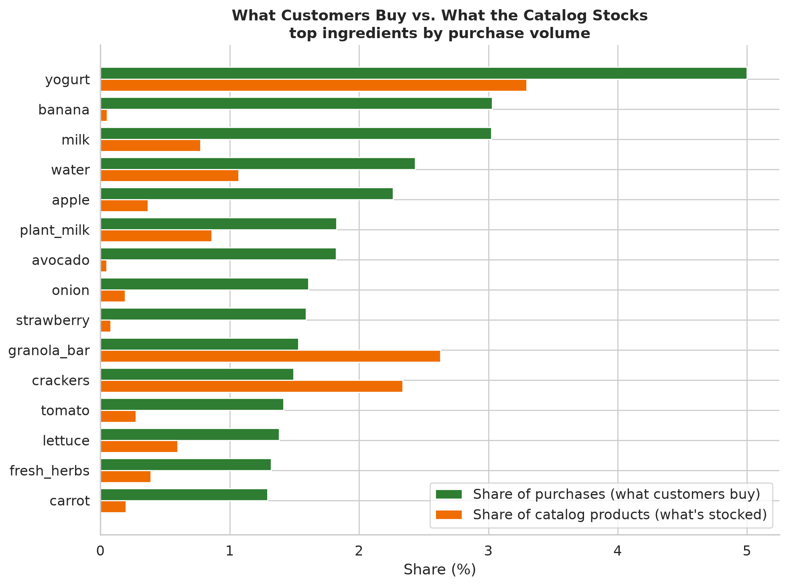

# Meal Selection, Variety, and Retention in Grocery Purchasing

How do customers choose foods over time — what they repeat, rotate, and try once —
and what might that suggest for a meal-subscription service? Grocery data can't answer
subscription questions directly, but it shows the underlying selection patterns.

The project classifies 49,688 Instacart products into recipe ingredients, then
analyzes purchasing at the ingredient level across each customer's order history.

Each result below is a full analysis with its own report (click through for detail,
tables, and methods); the README is the overview.

---

## Dataset & data

**Instacart Online Grocery Shopping Dataset 2017** — 206,000 customers, 3.4M orders,
49,688 products, sequential purchase history per customer (anonymized integer IDs; no
absolute dates; inter-order gaps capped at 30 days). Public on Kaggle:
[source](https://www.kaggle.com/datasets/psparks/instacart-market-basket-analysis).

- **Inputs** are the public Instacart parquet tables; regenerate them with
  `python scripts/data_pipeline/ingest_data.py` (not re-hosted here — they're the
  public source, and one file exceeds GitHub's size limit). See [data/](data/).
- **What we created** and publish: the ingredient classification
  ([`analysis/classification/food_classification.csv`](analysis/classification/food_classification.csv),
  49,688 products → 632 ingredients, with `is_food` / `is_prepared_dish`), the
  [recipe taxonomy](analysis/classification/INGREDIENT_TAXONOMY.md), and every
  aggregate result table under `analysis/<topic>/`.

Prepared *dishes* are defined by the taxonomy's "Prepared Dishes & Meals" section (17
meal types), not the raw per-product flag. The full purchase table is ~30M rows;
every analysis streams it in customer-id bursts to stay within memory
([docs/PROCESSING.md](docs/PROCESSING.md)).

---

## Results

### [Ingredients →](analysis/ingredients/)

Analyzing by ingredient (a recipe role) instead of product (a SKU) is the project's
premise.



- **What customers buy ≠ what the catalog stocks.** Bananas are 3% of all food
  purchases from **18 products**; candy is 1% of purchases from **1,212**. 16 of the
  top 20 ingredients by volume are fresh whole foods; the catalog is wide where
  branding is the product, the cart is deep where the food is.
- **A third of "variety" is packaging** — the median customer buys 45 products but 34
  ingredients (1.33×).
- An ingredient collapses anywhere from 18 (`banana`) to 1,177 (`yogurt`) products;
  the report shows the actual products people buy for each.

### [Basket contents →](analysis/basket/)


- A basket is small and fresh: median 8 food items, 7 distinct ingredients; produce
  is 31% of items, fresh departments over half. Prepared meals are 3.9% of items.
- **What travels together** splits two ways: high-*support* pairs are staples
  (banana+yogurt, 354k orders); high-*lift* pairs are intact recipes — cake flour +
  powdered sugar (85×), bread flour + yeast (61×), lasagna noodles + ricotta (51×), a
  cumin/chili/paprika spice cluster.

### [Sequences →](analysis/sequences/)


- **Reordering is a real habit at the specific-product level** — a product is
  reordered ~29% above a customer's own frequency baseline.
- **Within an ingredient, commitment is mild; variety-seeking is category-specific**
  (yogurt alternates *below* chance; staples stay because there's one product).
- **Most named "patterns" are frequency in disguise** — staples, rotation, and
  "returns" sit at or below a frequency-preserving null; the one real signal is early
  abandonment (burst-then-absence, 5× above chance).
- **An order-gap is not a clock** — a 5-order gap spans 15–88 days depending on the
  customer (median cadence 13 days).

### [Novelty & exploration →](analysis/novelty/)


- **Steady-state exploration is ~6%, not the ~22% pooled figure** — the pooled number
  is inflated by short observed histories. Once established, about one item in fifteen
  is a new ingredient.
- The repertoire keeps growing (40 ingredients by order 10, 101 by order 100) but
  baskets don't get more varied (~8 throughout); 97.7% of customers explore less later
  than earlier, though exploration is a stable individual trait.

### [Prepared dishes →](analysis/prepared/)


- **60% of customers buy a prepared meal**; for the typical buyer they're ~4% of items
  and ~30% of orders — a convenience, not a base — and reliance doesn't rise with
  volume.
- Frozen dominates (frozen_meal → 54k customers; then pizza, soup, mac & cheese). Down
  to the product: top frozen_meals are Mac & Cheese and Pad Thai; top soups are
  chicken noodle and creamy tomato. Buyers lock onto specific dishes but rotate across
  the menu within a type.

### [Customers →](analysis/customers/)


- The median customer places 10 orders over ~5 observed months, baskets of ~8,
  shopping every ~13 days. Four balanced segments on frequency × basket size;
  frequency, not basket size, drives order volume.
- Behavioral traits are stable within a customer (r 0.73–0.82 across halves) but
  mostly track purchase volume — **except within-ingredient product-switching**, the
  one volume-independent trait worth segmenting on.

---

## What it might mean for meal subscriptions

Grocery patterns, offered as hypotheses rather than demonstrated subscription results:

1. Read demand at the ingredient level — product data overweights packaged variety.
2. Reordering is a real habit at the specific-product level (~29% above a baseline).
3. A third of apparent variety is packaging, not diet.
4. Within-ingredient commitment is mild; variety-seeking concentrates in flavored/discretionary categories.
5. Exploration is low (~6%) and falling; the repertoire grows slowly.
6. Customer "type" is mostly purchase volume — product-switching is the exception worth segmenting on.
7. "Returns" and "rotation" track frequency; the real signal is early abandonment, a possible churn cue.
8. Order-gaps are not calendar time.
9. Prepared-meal demand is a minority, occasional behavior (60% reach, ~4% of items).

---

## Repository structure

```
analysis/
  classification/   # ingredient classification (our input) + taxonomy + method comparison
  ingredients/      # README.md + aggregate CSVs  (one directory per result)
  basket/           # README.md + CSVs (basket size, composition, co-occurrence)
  sequences/        # README.md + CSVs (reorder, patterns, substitution, calendar)
  novelty/          # README.md + CSVs (novelty, repertoire growth)
  prepared/         # README.md + CSVs (reach, dish types, products, reorder)
  customers/        # README.md + CSVs (profile, segments, behavior)
  figures/          # all figures (png/svg)
docs/               # PROCESSING.md, DATA_AUDIT.md
scripts/
  data_pipeline/    # Kaggle → Parquet ingestion + audit
  classification/   # classifiers + taxonomy corrections
  sequence_analysis/# one script per result; analyze_reorder.py is the shared core
data/               # processed inputs (regenerate via ingest_data.py; see data/README.md)
```

## Reproducing

```bash
uv sync
python scripts/data_pipeline/ingest_data.py                 # Kaggle → data/processed/
python scripts/classification/classify_fabric.py            # LLM classification (~8h; CSV committed)
python scripts/classification/apply_corrections.py          # taxonomy fixes (condensed_soup)
# results (memory-safe, full dataset) — each writes to its analysis/<topic>/ directory
for s in analyze_reorder analyze_patterns analyze_substitution analyze_calendar_time \
         analyze_lift_decomposition analyze_novelty analyze_exploration \
         analyze_cooccurrence analyze_basket_contents analyze_prepared_foods \
         analyze_ingredient_lens analyze_customer_profile analyze_customer_behavior; do
  python scripts/sequence_analysis/$s.py
done
python scripts/sequence_analysis/visualize_ingredient_lens.py   # figures
python scripts/sequence_analysis/visualize_audit.py
python scripts/sequence_analysis/generate_pattern_gallery.py
```

**Method note:** descriptive patterns are kept separate from prediction; when a
sequence feature doesn't beat a frequency baseline, that is reported rather than
overfit.
