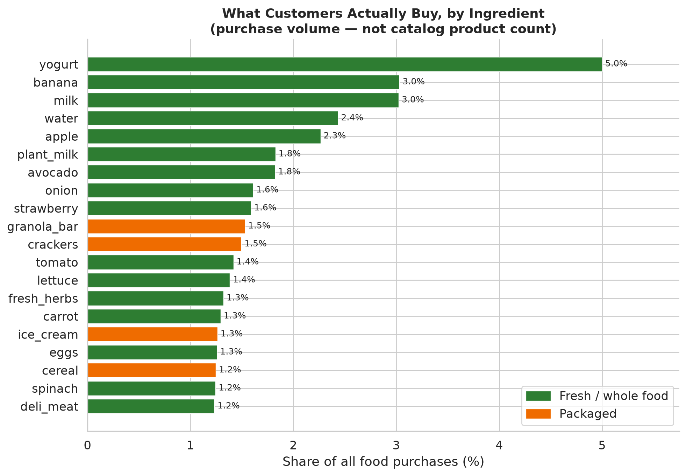
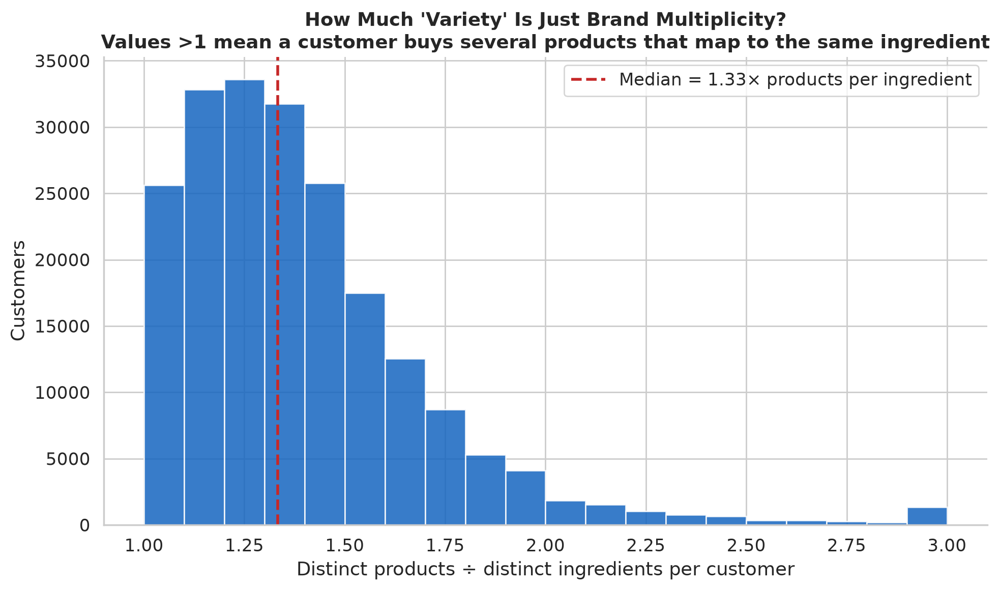
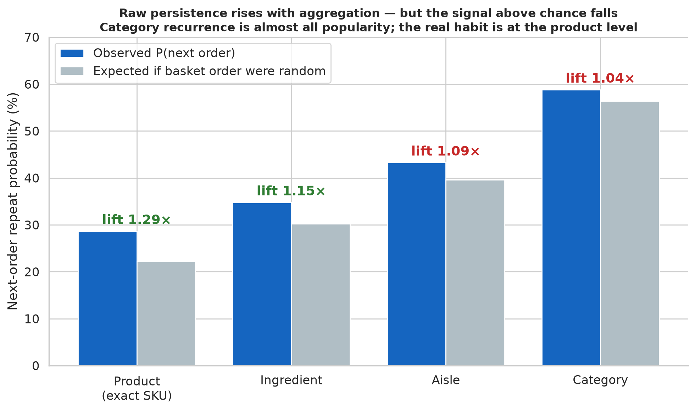
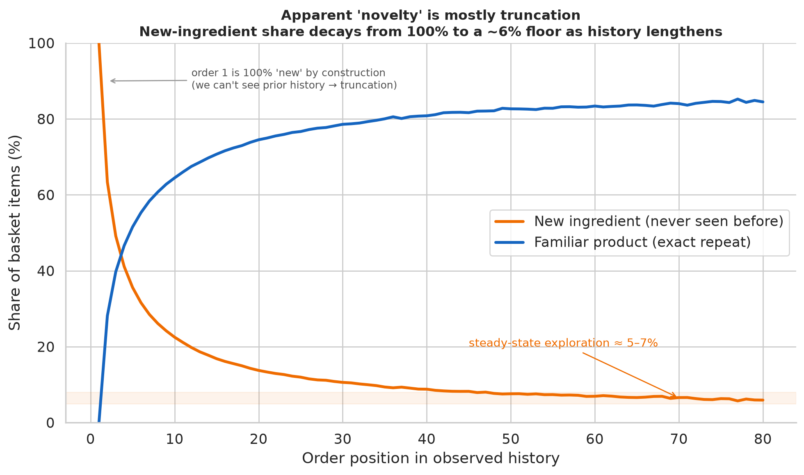
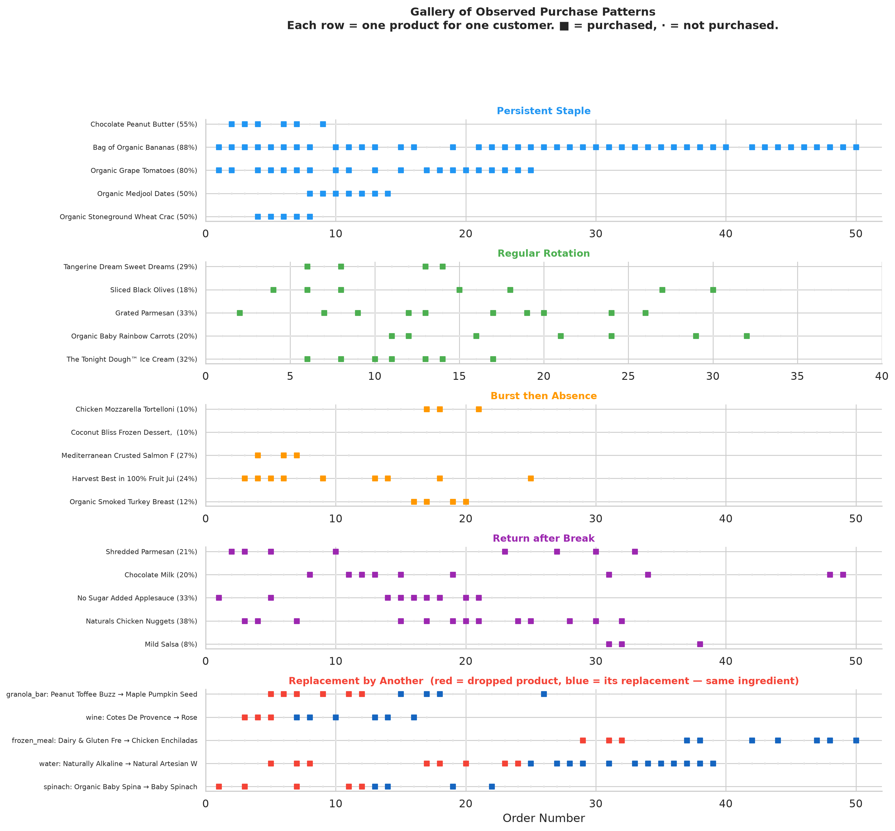

# Understanding Meal Selection, Variety, and Retention

**How do customers choose meals over time? What patterns of repetition, rotation, and novelty explain satisfaction and longevity?**

This project explores questions relevant to meal subscriptions: How do customers choose foods over time? Do they prefer repetition, rotation, or exploration? What drives variety-seeking versus loyalty? When do they return to familiar foods after trying something new?

To study these questions at the *ingredient* level (not just product brands), we need to classify products into recipe-oriented categories. That classification enables analysis of whether customers are changing brands, substituting ingredients, or genuinely shifting food preferences.

**The approach:** Use grocery purchase data (Instacart) as a proxy for meal selection patterns. Classify 49,688 products into recipe ingredients using LLM-based taxonomy. Analyze purchasing sequences at multiple levels: exact products, recipe ingredients, ingredient categories, and retail aisles.

**The motivation:** Meal subscription services likely face questions about menu variety, customer retention, and balancing familiarity with novelty. Grocery data won't answer those questions directly, but it can reveal patterns in how people select and repeat foods over time.

---

## Dataset and Approach

**Instacart Online Grocery Shopping Dataset 2017:**
- 206,000 customers
- 3.4 million orders
- 49,688 unique products
- Sequential purchase history per customer

**Why grocery data?** While not identical to meal subscriptions, grocery purchases reveal selection patterns: repeat staples, rotated items, one-time experiments, and long gaps before returns. These patterns mirror meal subscription behavior.

**The classification challenge:** To analyze food at the *ingredient* level rather than the *product* level, we need to map products to recipe-oriented categories. "Organic 2% Milk" and "Whole Milk" should both be "milk" — brand and fat percentage don't matter for recipe comparisons. But "Yogurt" and "Ice Cream" should be distinct — recipes don't substitute one for the other.

---

## Classification: Products → Recipe Ingredients

We classified all 49,688 products into a **446-ingredient recipe taxonomy** grounded in how recipes actually use ingredients.

### Taxonomy Principles

**Recipe equivalence:** If recipes treat variations interchangeably, they're the same ingredient.
- All milk types (whole, 2%, skim, organic) → `milk`
- All pasta shapes (spaghetti, penne, rigatoni) → `pasta`

**Meaningful distinctions:** If recipes distinguish them, so do we.
- Pasta vs. filled pasta (ravioli) → different ingredients
- Fresh herbs vs. dried herbs → different ingredients
- Yogurt vs. ice cream → different ingredients

**Prepared dishes separate from base ingredients:**
- "Frozen Mac and Cheese" → `mac_and_cheese` (complete dish), not `pasta` or `cheese`
- "Canned Chicken Noodle Soup" → `soup`, not `chicken` or `noodles`

### Classification Methods

We compared three approaches:

| Method | How It Works | Strengths | Weaknesses |
|--------|--------------|-----------|------------|
| **TF-IDF + rules** | Cosine similarity to ingredient descriptions, then product-identity corrections | Good on product-type words (cookies, yogurt, pasta) | Misses short/unusual names |
| **Sentence embeddings** | all-MiniLM-L6-v2 semantic matching | Better semantic understanding (frozen meals, dressings) | Confused by flavor words |
| **LLM (Claude)** ✓ | Recipe-grounded reasoning via fabric CLI | **100% on spot checks**, combines semantic + product-identity | Slow (~8 hours for full dataset) |

**Final result:** 49,688 products classified using the LLM approach. [See detailed method comparison →](analysis/classification/methods_compared/README.md)

### Classification Results

- **38,529 food items** (77.5%)
- **8,278 prepared dishes** (frozen meals, meal kits, canned soups)
- **2,807 unclassified** (5.6%) — LLM declined to guess rather than forcing low-confidence assignments
- **Top 25 ingredients** represent 41% of all products
- **632 unique ingredients** used (vs. 446 defined — LLM introduced additional distinctions)

**Example classifications:**
- "Chocolate Sandwich Cookies" → `cookies` ✓
- "Light Strawberry Blueberry Yogurt" → `yogurt` ✓ (not `strawberry`)
- "Smart Ones Mini Rigatoni" → `frozen_meal` ✓ (not `pasta`)
- "Organic Spaghetti" → `pasta` ✓
- "T Bone Steak" → `steak` ✓

[Full classification analysis with statistics, distribution, and examples →](analysis/classification/CLASSIFICATION_ANALYSIS.md)

---

## The Ingredient Lens

The whole point of this project is to stop analyzing *products* and start analyzing *ingredients*. A product ID tells you someone bought "Chobani Blueberry Greek 5.3oz." An ingredient tells you they bought yogurt. Recipes, meals, and preferences live at the ingredient level — so that is where we look. Two findings only become visible once you apply this lens.

### What Customers Buy ≠ What the Catalog Stocks

Counting *products*, the catalog is dominated by packaged goods — thousands of candy, vitamin, and cracker SKUs. That tells you how sellers stock shelves, not what people eat. Re-rank by **actual purchase volume at the ingredient level** and the picture inverts:



Sixteen of the top twenty ingredients by volume are fresh, whole foods — yogurt, bananas, milk, apples, avocados, onions, tomatoes, spinach. Only granola bars, crackers, ice cream, and cereal represent packaged goods. The catalog is wide on packaged variety; the cart is deep on fresh staples. **You cannot see this without collapsing brands into ingredients** — at the product level, no single banana SKU outranks the sea of snack brands.

### A Third of "Variety" Is Just the Same Ingredient in a Different Package

The median customer buys **45 distinct products but only 34 distinct ingredients** — a 1.33× brand multiplier. A quarter of their apparent product variety dissolves the moment you look at ingredients:



Someone cycling through four yogurt brands and three kinds of milk looks like an explorer in product data and a creature of habit in ingredient data. The ingredient lens separates genuine dietary variety from packaging churn — a distinction product IDs physically cannot express.

---

## Understanding Food Selection Patterns

With that lens in place, we analyzed how customers select and reorder foods at multiple levels: exact products, recipe ingredients, ingredient categories, and retail aisles.

### The Real Loyalty Is at the Product Level, Not the Category

A broad category like DAIRY reappears in a customer's next order 59% of the time; an exact product only 29%. Read directly, that looks like category loyalty. But a broad bucket recurs often simply because it holds hundreds of products — the signal is **how much more** a value recurs than its popularity alone would produce.

We measure the next-order repeat probability (deduplicated to one event per customer/order/value) against a baseline that shuffles each customer's basket order — preserving what and how much they buy, destroying *when*. The ratio is lift.



**Lift runs opposite to the raw rates.** Exact-product repurchase is 29% above chance — a genuine habit. Category recurrence is 4% above chance — a mathematical consequence of aggregating many products, not loyalty to the family. Customers return to *specific things they like*.

The finer grain carrying the stronger signal is a substitution signature, not a preference for SKUs over ingredients: when a customer uses several products for one ingredient, they tend to hold one product for a run of orders, then switch. The ingredient persists smoothly; each product arrives in bursts. [Full decomposition →](analysis/sequence_analysis/REORDER_PROBABILITY.md)

### Exploration Is a Falling Rate Over a Still-Growing Repertoire

Novelty share depends sharply on how long a customer has been observed. Because the data starts mid-history, a customer's first observed order is 100% "new" by construction; the new-ingredient share then decays and settles at a **~6% floor** by order 50+:



Steady-state exploration — once a repertoire is established — is about **one item in fifteen**. Yet a customer's personal repertoire never saturates: the average customer has bought 40 distinct ingredients by their 10th order, 56 by their 20th, and 101 by their 100th, still climbing (out of 542 distinct ingredients in the catalog). Basket diversity stays flat at ~8 distinct ingredients per order throughout. The repertoire grows by accumulation, not by more adventurous baskets, and **97.7% of customers explore less in the second half** of their history than the first. ([Novelty audit](analysis/sequence_analysis/NOVELTY.md), [exploration report](analysis/sequence_analysis/EXPLORATION.md).)

### Most "Patterns" Are Just Frequency and History Length

Sorting customer-ingredient pairs into staples, rotation, returns, and bursts, then comparing against a baseline that scatters each customer's purchases at random — preserving how often they buy each thing, destroying *when* — shows most of the taxonomy is frequency in disguise:

| Pattern | Observed | Random baseline | Verdict |
|---------|---------:|----------------:|---------|
| Persistent staple | 9.2% | 9.2% | at chance |
| Regular rotation | 4.6% | 5.5% | below chance |
| Return after break | 58% | 69% | **below chance** |
| Burst then absence | 1.6% | 0.3% | **5× above chance** |

Staples, rotation, and "returns" occur at or *below* their random rates — they re-describe purchase frequency and how long the customer was observed (returns rise from 27% to 85% as history grows). The one pattern that survives is **burst-then-absence** — an ingredient tried a few times then dropped — at 5× above chance, and not a window artifact (99% of bursts end well before the customer's last order). That is genuine early abandonment. ([Pattern audit](analysis/sequence_analysis/PATTERN_ANALYSIS.md).)

### Prepared Foods Behave Like Everything Else

Comparing prepared dishes (the 8,019 products flagged `is_prepared_dish`) to base ingredients at the exact-product grain:

| Group | P(next order) | Lift above chance |
|-------|--------------:|------------------:|
| **Prepared dishes** | 27.9% | 1.39× |
| **Base ingredients** | 28.9% | 1.28× |

Prepared dishes and staples reorder at essentially the same rate, and a specific frozen meal someone likes is held slightly *more* tightly than a brand of milk. No evidence of distinctive prepared-food fatigue. ([Prepared-food audit](analysis/sequence_analysis/PREPARED_FOODS.md).)

### Within an Ingredient, Replacement Is Weak and Variety-Seeking Is the Exception

When a customer uses more than one product for the same ingredient, do they hold one for a run of orders (serial commitment) or alternate? Against a null that shuffles each ingredient's product labels, observed runs are only slightly more run-like than chance (lift 1.04–1.09 for most ingredients). The commitment tendency is real but mild. The clearer finding is the exception: **yogurt alternates more than chance** (lift 0.96 — active flavor variety-seeking), and discretionary categories like ice cream and pasta have the lowest stay rates (32%, 42%). Staples (banana 92%, bread 97%) stay because the customer simply has one product for them. ([Substitution report](analysis/sequence_analysis/SUBSTITUTION.md).)

### What Goes in the Cart Together

Within an order, the highest-*support* pairings are produce-and-dairy staples — banana+yogurt (354k orders), milk+yogurt, apple+banana — common because each item is in so many baskets. The highest-*lift* pairings (together far more than their popularity predicts) are intact recipe signatures: cake_flour+powdered_sugar (85×), bread_flour+yeast (61×), lasagna_noodles+ricotta (51×), and a cumin spice cluster (paprika, chili powder, turmeric) that is the makings of chili and curry. Support shows what fills carts; lift shows which recipe a customer is assembling. ([Co-occurrence report](analysis/sequence_analysis/COOCCURRENCE.md).)

### Customers Differ Consistently — But Mostly by Volume

Per-customer measures (107,257 customers with ≥10 orders) are stable across each customer's history: first-half values predict second-half with correlation 0.73–0.82. But most axes — repeat rate, novelty, diversity — correlate ±0.5–0.6 with sheer purchase volume, so "repeater vs. explorer" is largely "high-volume vs. low-volume." The one trait independent of volume is **product-switching within an ingredient** (correlation −0.06 with order count): some customers lock onto one product per ingredient, others rotate, regardless of how much they buy. ([Customer-behavior report](analysis/sequence_analysis/CUSTOMER_BEHAVIOR.md).)

### An Order-Gap Is Not a Clock

Gaps measured in orders are not fixed amounts of time: shopping cadence ranges from a median of 5 days between orders (p10) to 30 (p90), median 13. A 1-order repurchase gap is ~8 days; a 5-order gap is ~37 days but spans 15–88 days (p10–p90) across customers. Any order-space pattern is partly a statement about shopping frequency, so order-space and calendar-space must not be conflated. ([Calendar-time report](analysis/sequence_analysis/CALENDAR_TIME.md).)

### Example Sequences

Real customer purchasing patterns across order histories:



Each row is one product for one customer. ■ = purchased, · = not purchased. Patterns reveal staples (frequent consecutive purchases), rotation (consistent gaps), bursts (early clustering), returns (long gaps then resumption), and replacements (switching to different products).

---

## What This Might Mean for Meal Subscriptions

These are patterns in grocery purchasing. Whether they generalize to meal subscriptions is an open question, but they suggest some possibilities:

**1. The ingredient lens changes the headline:** Ranked by catalog product count, snacks and packaged goods dominate; ranked by what customers actually buy, fresh produce and dairy dominate. A meal service reading product-level data would badly misread demand. Ingredient-level volume is the signal that matters.

**2. Repetition dominates, and real loyalty is to specific products:** 64% of purchases are exact product repeats, and exact products are the only grain that reorders well above chance (29% vs. a 4% category lift). Loyalty attaches to specific things, not food families.

**3. A third of "variety" is packaging, not diet:** The median customer touches 45 products but only 34 ingredients (1.33×). Product-level churn overstates real dietary variety — a distinction only the ingredient lens can make.

**4. Within-ingredient commitment is mild; variety-seeking is category-specific:** Holding one product for a run before switching is only slightly above chance (lift 1.04–1.09). Where variety-seeking is real, it is concentrated in discretionary, flavored categories (yogurt alternates *below* chance; ice cream and pasta have the lowest stay rates), not staples.

**5. Exploration is a falling rate over a growing repertoire:** Steady-state novelty is ~6% (one item in fifteen), not the ~22% raw figure, which is inflated by short observed histories. A customer's personal repertoire keeps growing (101 distinct ingredients by their 100th order, of 542 in the catalog) but baskets do not get more varied, and 97.7% of customers slow their exploration over time.

**6. Customer "type" is mostly volume — except switching:** Behavioral measures are stable within a customer (r 0.73–0.82 across halves) but correlate ±0.5–0.6 with purchase volume. The one volume-independent trait is within-ingredient product-switching — the cleanest axis for segmentation.

**7. "Returns" and "rotation" track frequency, not behavior:** Against a frequency-preserving baseline, those patterns occur at or below chance. The real pattern is *early abandonment* — an ingredient tried a few times then dropped — a possible early-churn signal.

**8. Order-gaps are not time:** Cadence ranges from weekly to monthly (median 13 days), so a fixed order-gap spans weeks to months depending on the customer. Sequence-based patterns must not be read as calendar behavior.

### Current Foundation

✓ **49,688 products classified** into recipe-oriented ingredients  
✓ **Ingredient-lens views** (purchase volume vs catalog count, brand multiplier)  
✓ **Reorder probability** with shuffle-baseline lift at four grains  
✓ **Novelty and exploration** by order position (repertoire growth, slowdown)  
✓ **Pattern analysis** against a frequency-preserving null  
✓ **Prepared vs base ingredients** at the product grain  
✓ **Substitution** within an ingredient (commitment vs variety-seeking)  
✓ **Ingredient co-occurrence** (support vs lift within orders)  
✓ **Customer-level behavior** (stability, volume confounds)  
✓ **Calendar time vs order sequence** (cadence, day-gaps)

### Future Work

- Recipe decomposition for prepared foods (what's actually *in* a frozen meal?)
- Integration with actual meal subscription data and retention outcomes

---

## Repository Structure

```
analysis/
  classification/
    food_classification.csv              # Final ingredient classification (49,688 products)
    INGREDIENT_TAXONOMY.md               # 446-ingredient taxonomy
    CLASSIFICATION_ANALYSIS.md           # Detailed statistical analysis ← Start here
    methods_compared/                    # TF-IDF vs. embeddings vs. LLM
    archived/                            # Historical work
  
  figures/                               # Reorder analysis visualizations
  outputs/                               # Other analysis outputs

scripts/
  data_pipeline/                         # Kaggle → Parquet ingestion
  classification/                        # TF-IDF, embeddings, LLM classifiers
  sequence_analysis/                     # Reorder and pattern analysis

docs/
  CLASSIFICATION_METHODOLOGY.md          # Recipe-to-ingredient reasoning
  DATA_AUDIT.md                         # Data quality validation
```

---

## Reproducing the Analysis

**Install dependencies:**
```bash
uv sync
```

**Download Instacart dataset:**
```bash
# Requires Kaggle API credentials
python scripts/data_pipeline/ingest_data.py
```

**Run classification analysis:**
```bash
# Generate statistics and figures
python scripts/classification/analyze_classification.py
```

**Reproduce classifications** (requires ~8 hours):
```bash
# TF-IDF approach
python scripts/classification/classify_tfidf.py
python scripts/classification/refine_tfidf.py

# Embeddings approach
python scripts/classification/classify_embeddings.py

# LLM approach (requires fabric CLI)
python scripts/classification/classify_fabric.py
```

---

## References and Context

**Original research question:** How customers repeat, rotate, and return to foods in grocery purchases.

**Extension for meal subscriptions:** Understanding meal composition and variety patterns that may inform retention strategies.

**Dataset:** [Instacart Market Basket Analysis](https://www.kaggle.com/datasets/psparks/instacart-market-basket-analysis) (2017)

**Classification grounding:** 1,000+ recipes across diverse cuisines (knowledge-based, not extracted from a specific recipe corpus).

**Methodological note:** This analysis separates descriptive patterns from predictive modeling. When sequence features don't outperform baselines, we report that honestly rather than overfitting.

---

*For detailed classification statistics, taxonomy analysis, and method comparisons, see [CLASSIFICATION_ANALYSIS.md](analysis/classification/CLASSIFICATION_ANALYSIS.md).*
