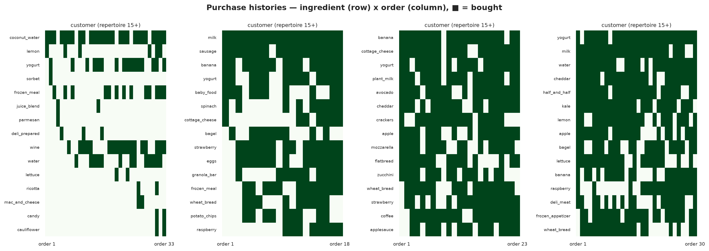

# What Grocery Purchases Reveal About Food Choice

Grocery transaction data records what people actually put in their carts — not what
they say they eat, not what nutritionists recommend, just what gets purchased week
after week. This project explores that record to see what's in it.

The data is the [Instacart Online Grocery Shopping Dataset 2017](https://www.kaggle.com/datasets/psparks/instacart-market-basket-analysis):
3.4 million orders from 206,000 customers, with the full sequence of products in each
order. It's one of the few large public datasets where you can follow individual
customers across dozens of shopping trips and see how their choices change.

The dataset has 49,688 products, but products are a poor unit of analysis for
understanding food. A grocery store carries 277 kinds of milk and 1,177 yogurts —
organic, conventional, whole, skim, Greek, Icelandic, flavored, plain — and most of
that variation is branding, not food. So the first step was classifying every product
into an **ingredient**: the recipe-level role the food plays. "Organic 2% Milk,"
"Whole Milk," and a store-brand gallon all become `milk`. "Chobani Blueberry" and
"Fage Plain" both become `yogurt`. This collapses 49,688 products into 543 ingredients
across 21 food categories (24 taxonomy categories in all, three of them non-food —
household, personal care, and pet), and everything downstream works at that level.
([Classification methodology →](docs/FOOD_CLASSIFICATION.md))

The project then asks six questions, each its own analysis with a detailed report:

- **What do people buy?** How does the grocery catalog compare with actual demand?
- **What goes together?** Which ingredients appear in the same basket, and which
  combinations are more common than their individual popularity predicts?
- **What repeats?** How much of purchasing is the same foods reappearing, and does
  the sequence contain information beyond purchase frequency?
- **What's new?** How much of each order involves foods the customer hasn't bought
  before, and where does that exploration happen?
- **Where do prepared meals fit?** How much grocery shopping involves ready-to-eat
  food, and what does the rest of the basket look like?
- **How do customers differ?** Which differences between shoppers are real and
  persistent, and which are artifacts of how much we observe?

Each question led somewhere interesting — often not where expected. The results are
below; click through any section header for the full analysis, data tables, and
methodology.

---

## What customers buy vs. what stores stock

### [Ingredients →](analysis/ingredients/)


Fresh foods — produce, dairy, meat — are **57% of what customers buy but only 25% of
the products the catalog offers**. Packaged foods are the opposite: 45% of the catalog,
25% of purchases. The catalog is wide where branding differentiates (1,212 candy
products, 939 granola bars); the cart is deep where the food itself is the product
(18 banana SKUs account for 3% of all purchases).

Only **19% of products capture 80% of purchase volume.** Banana needs 2 products to
reach 80% of its sales; yogurt needs 190 of 1,177. Products labeled "organic" are
12% of the food catalog but account for **33.5% of food purchases** — far above the
~6% US grocery average, reflecting this platform's customer base.

## What customers buy together

### [Basket contents →](analysis/basket/)


The median basket is 8 food items spanning 7 distinct ingredients. Two kinds of
ingredient associations emerge. **High-support pairs** — banana + yogurt (354k orders),
milk + yogurt (320k) — are staples that fill most carts, barely above chance. **High-
lift pairs** are ingredients that rarely appear alone but almost always appear together:
cake flour + powdered sugar (85×), bread flour + yeast (61×), lasagna noodles + ricotta
(51×). These are co-purchasing signatures — baking projects, spice blends, specific
dishes.

Lift measures how much more often two ingredients co-occur than their individual
popularity would predict. A lift of 85× means the pair appears 85 times more often
than independence. Three-ingredient combinations surface recognizable cooking contexts:
fresh herbs + garlic + onion (28k baskets, 12× lift), cucumber + lettuce + tomato
(salad), avocado + garlic + onion (guacamole). These are co-purchasing patterns, not
confirmed recipes.

## What customers buy again

### [Sequences →](analysis/sequences/)



A specific product recurs in the next order **28% more often** than a
frequency-preserving shuffle of the same customer's baskets (lift 1.28×). The excess
shrinks as the grain broadens — at the category level it's 4%, mostly arithmetic.
Purchase runs are slightly longer than shuffled (5–10%), and repurchase timing is
**bursty, not periodic** — gap CV of 1.41 across ingredients, well above random.

When properly scored against both present and absent ingredients, **overall purchase
frequency is the best simple predictor** of the next order. Adding recency makes
predictions worse under the models tested. More sophisticated models might extract
value from recency, but the simple frequency baseline is hard to beat.
Most named "patterns" (staples, returns, rotation) match their random-baseline rates.
The exception is burst-then-absence: ingredients bought in an early cluster then
absent for the rest of the observed window (3.4% of ingredient histories vs 0.3%
random).

## How customers introduce variety

### [Novelty & exploration →](analysis/novelty/)


A new yogurt flavor and a first purchase of lentils are different kinds of novelty. The
blue bars are **new ingredients** (never before in this customer's observed history);
orange bars are **new products for a familiar ingredient** (a different brand or
flavor). Spices and baking have 75–81% novelty because they're bought rarely — each
purchase is likely the first observed. Dairy and fruit have 30–33% because staples
repeat almost every order.

The pooled new-ingredient rate (~22%) is inflated by truncation — the dataset starts
mid-history, so early orders are mechanically "new." By order 50+, the rate is ~6%
and still declining. Discoveries tilt toward the catalog's long tail: the top 20
ingredients are 37% of purchases but only 24% of first-time discoveries. Customer
exploration rates vary widely (p10 = 6%, p90 = 41%) even at comparable history
positions.

## Where prepared dishes fit

### [Prepared dishes →](analysis/prepared/)


**79% of baskets contain zero prepared items.** 60% of customers buy a prepared dish
at some point, but it's typically 4% of their food items, in about 30% of their
orders. Frozen meals (54k customers), pizza (42k), and soup (41k) dominate. Chicken
nuggets have the most concentrated demand: 1,055 purchases per product from just 66
catalog items.

Baskets with prepared food are larger (median 12 vs 7 items), but the composition of
the rest of the basket is nearly identical — produce, dairy, and fruit shares within
±0.5%. Cross-sectional comparisons cannot establish whether prepared items replace or
supplement home cooking.

## How customers differ

### [Customers →](analysis/customers/)


The median customer places **10 orders** over ~5 observed months, in baskets of **8
food items**, shopping every **13 days**. Every measure is right-skewed — a heavy tail
shops weekly with 37+ orders. Shopping frequency and basket size vary independently,
creating genuine variety in how customers use the platform.

Much of what looks like a difference between customers is actually variation within
a single customer's orders. The intraclass correlation is 0.60 for basket size and
0.53 for prepared-food share — meaning order-to-order noise within a customer accounts
for roughly half the total variation. Behavioral metrics like repeat rate and novelty
correlate strongly with purchase volume (r = 0.5–0.6), so apparent "types" often
reflect how much we observe, not how someone shops.

---

## What this suggests about food selection

These are descriptive patterns from a grocery delivery platform, not demonstrated
results about meal subscriptions, cooking behavior, or dietary preferences.

1. **Read demand at the ingredient level.** Product data overstates variety — about a
   quarter of apparent product diversity collapses when viewed by ingredient (different
   brands, sizes, flavors, and formulations of the same food).
2. **Frequency is a strong baseline.** A customer's long-run purchase rate for each
   ingredient is well-calibrated. Simple recency adjustments don't improve on it;
   most named sequence "patterns" match their frequency-preserving baselines.
3. **Prepared-meal demand is occasional and minority.** 60% of customers participate,
   but baskets are overwhelmingly raw ingredients and staples.

---

## Dataset and methodology

**Instacart Online Grocery Shopping Dataset 2017** — 206k customers, 3.4M orders,
49,688 products. Public on Kaggle:
[source](https://www.kaggle.com/datasets/psparks/instacart-market-basket-analysis).
Anonymized integer IDs; no absolute dates; inter-order gaps capped at 30 days.

**Classification:** 49,688 products → 543 ingredients via LLM classification
(Claude, ~8h). A deterministic lookup table
([`product_ingredient_lookup.csv`](data/product_ingredient_lookup.csv))
reproduces the mapping without an LLM.
[Taxonomy →](data/INGREDIENT_TAXONOMY.md) ·
[Method →](docs/FOOD_CLASSIFICATION.md)

**Key limitations:** No absolute timestamps or seasonal patterns. 30-day cap on
inter-order gaps. Test-set orders lack item labels. The dataset begins mid-history
for each customer. Instacart's customer base skews urban and convenience-oriented;
organic penetration (33.5%) and plant-milk share (38% of milk purchases) are
platform-specific, not nationally representative.

## Repository structure

```
data/
  INGREDIENT_TAXONOMY.md        # recipe-ingredient taxonomy (parsed by the pipeline)
  food_classification.csv       # product → ingredient map (key derived dataset)
  product_ingredient_lookup.csv # deterministic lookup table (reproduce without an LLM)
  raw/ processed/               # Kaggle CSVs → Parquet
analysis/
  ingredients/      # demand vs assortment, concentration, organic penetration
  basket/           # basket composition, co-occurrence, triplets
  sequences/        # reorder, patterns, substitution, prediction
  novelty/          # novelty classification, repertoire growth, categories
  prepared/         # reach, dish types, basket composition
  customers/        # profiles, segments, behavioral correlations
  figures/          # all figures (PNG/SVG)
docs/
  FOOD_CLASSIFICATION.md        # how the classification was built
  classification/               # method comparison, figures, archived attempts
scripts/
  config.py         # shared paths and schemas
  data_pipeline/    # Kaggle → Parquet ingestion + audit
  classification/   # LLM classifier, lookup table, taxonomy corrections
  sequence_analysis/# one script per analysis; analyze_reorder.py is the shared core
```

## Reproducing

```bash
uv sync
python scripts/data_pipeline/ingest_data.py
python scripts/classification/classify_fabric.py     # ~8h; CSV already committed
python scripts/classification/apply_corrections.py
for s in analyze_reorder analyze_patterns analyze_substitution analyze_calendar_time \
         analyze_lift_decomposition analyze_novelty analyze_exploration \
         analyze_basket_contents analyze_prepared_foods \
         analyze_ingredient_lens analyze_customer_profile analyze_customer_behavior \
         analyze_sequences analyze_novelty_extended; do
  python scripts/sequence_analysis/$s.py
done
for v in visualize_ingredient_lens visualize_basket visualize_sequences \
         visualize_novelty visualize_prepared visualize_customers visualize_audit \
         generate_pattern_gallery; do
  python scripts/sequence_analysis/$v.py
done
```
