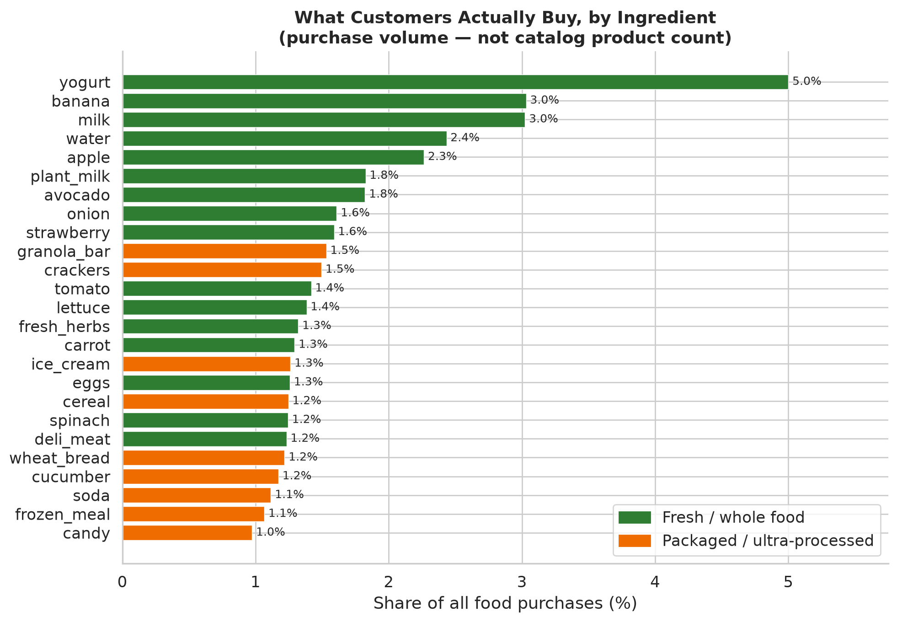
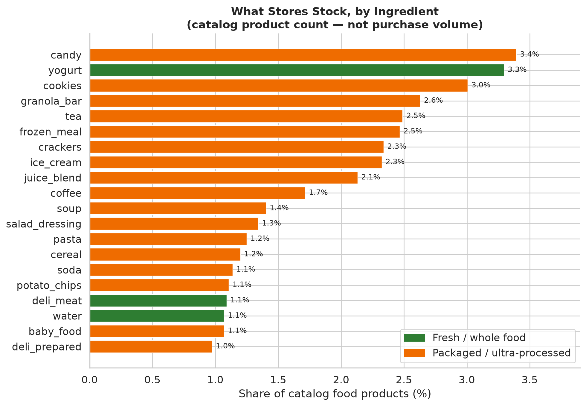
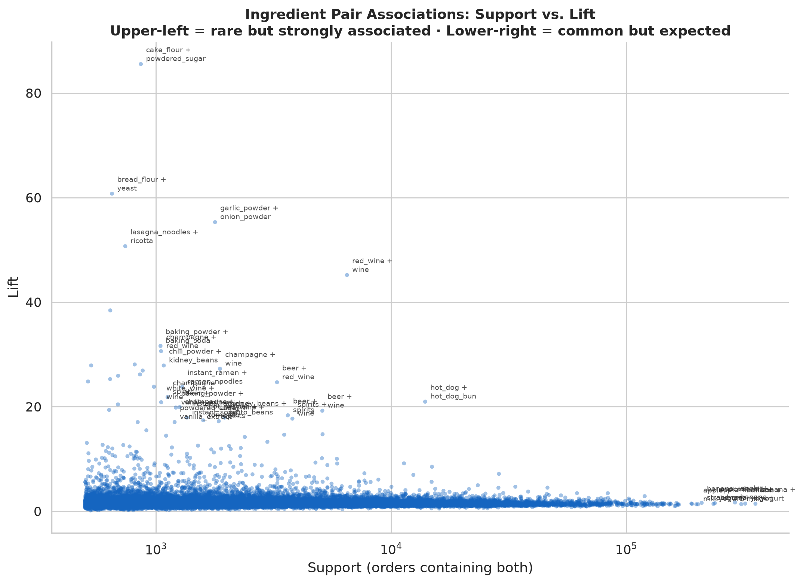
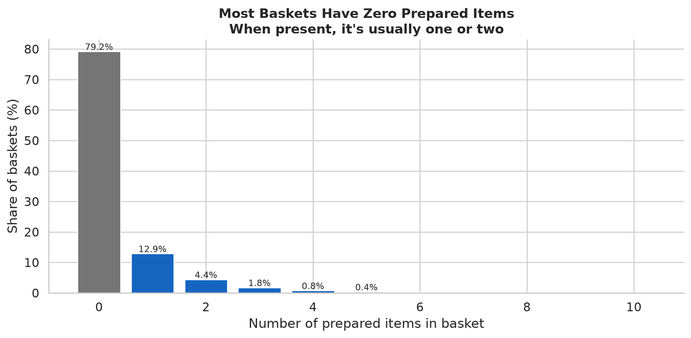
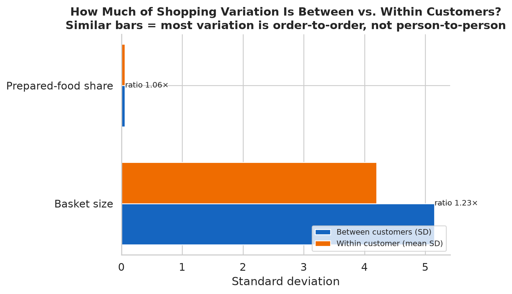

# What Grocery Purchases Reveal About Food Choice

Grocery transaction data records what people actually put in their carts — not what
they say they eat, not what nutritionists recommend, just what gets purchased, trip
after trip. This project reads 3.4 million such orders to ask a deceptively simple
question: when you watch people buy food over time, what can you actually learn about
how they choose it?

The data is the [Instacart Online Grocery Shopping Dataset 2017](https://www.kaggle.com/datasets/psparks/instacart-market-basket-analysis):
3.4 million orders from 206,000 customers, with the full sequence of products in each
order. It's one of the few large public datasets where you can follow individual
customers across dozens of shopping trips and watch their choices change.

The dataset has 49,688 products, but products are a poor unit for understanding food. A
store carries 277 kinds of milk and 1,177 yogurts — organic, conventional, whole, skim,
Greek, flavored, plain — and most of that variation is branding, not food. So the first
step was collapsing every product into an **ingredient**: the recipe-level role it
plays. "Organic 2% Milk," "Whole Milk," and a store-brand gallon all become `milk`;
"Chobani Blueberry" and "Fage Plain" both become `yogurt`. That turns 49,688 products
into 543 ingredients across 21 food categories, and everything downstream works there.
([Classification methodology →](docs/FOOD_CLASSIFICATION.md))

One theme kept surfacing across all six analyses below. Reading food choice from
purchase data means constantly separating four things that look identical in the raw
numbers:

- what a customer genuinely **prefers** (stable),
- what they happened to do **for a while** (temporary),
- which **brand or package** they reached for (product-level, not food-level), and
- what is just an **artifact** of seeing only a slice of their history.

Several of the most-assumed shopping "patterns" turn out to be one of the last three
wearing the costume of the first. The findings that survive that scrutiny are the
interesting ones.

The six questions, each with its own detailed report (click any section header):

- **What do people buy?** How does the catalog compare with actual demand?
- **What goes together?** Which ingredients share a basket more than chance predicts?
- **What repeats?** Is there information in the *order* of purchases beyond how often
  someone buys a thing?
- **What's new?** How much of shopping is trying something unfamiliar, and where?
- **Where do prepared meals fit?** How much shopping is ready-to-eat, and what else is
  in that cart?
- **How do customers differ?** Which differences are real and persistent, and which are
  artifacts of how much we observe?

---

## What customers buy vs. what stores stock

### [Ingredients →](analysis/ingredients/)





Rank ingredients by how much customers buy, then by how many products the catalog
carries, and the two orderings barely agree. Fresh foods — produce, dairy, meat — are
**57% of what customers buy but only 25% of the products on offer.** Packaged foods are
the mirror image: 45% of the catalog, 25% of purchases. The catalog is widest where
branding does the differentiating (1,212 candy products, 939 granola bars); the cart is
deepest where the food itself is the product (18 banana SKUs are 3% of all purchases).

The practical lesson is that **product variety and food variety are not the same
thing.** Just **19% of the food catalog captures 80% of purchase volume** — yogurt
needs 190 of its 1,177 products to reach 80% of its own sales, while banana needs 2 of
18. The median customer buys 45 distinct products but only 34 distinct ingredients, so
about a quarter of their apparent variety is the same food in different packaging. (One
platform-specific signal stands out: "organic" products are 12% of the food catalog but
**33.5% of purchases**, far above the ~6% US grocery average — a statement about who
shops here, not about groceries generally.)

## What customers buy together

### [Basket contents →](analysis/basket/)



The median basket holds 8 items spanning 7 ingredients. Which ingredients travel
together splits cleanly into two kinds, and *lift* — how many times more often a pair
co-occurs than their individual popularity would predict, where 1.0 is pure chance —
tells them apart. **High-support pairs** are staples that share a cart simply because
both are everywhere (banana + yogurt, 354k orders, lift ~1.4 — barely above chance).
**High-lift pairs** are specialists that are rare alone but almost always appear
together: cake flour + powdered sugar (85×), bread flour + yeast (61×), lasagna noodles
+ ricotta (51×).

The second kind are co-purchasing signatures — you can see baking projects, spice
blends, and specific dishes in them. Three-ingredient combinations make the cooking
contexts even clearer: fresh herbs + garlic + onion (28k baskets, 12×), cucumber +
lettuce + tomato (salad), avocado + garlic + onion (guacamole). The real structure
lives in that rare, high-lift corner — not in the staples that dominate volume. These
are things bought in the same order, though, not proof of a recipe: one basket can hold
several meals and a week of restocking.

## What customers buy again

### [Sequences →](analysis/sequences/)


This is where separating signal from noise matters most. To isolate whatever is
genuinely about *timing* — rather than just how often someone buys something — each
customer's orders are compared against a **frequency-preserving shuffle**: the same
baskets and the same purchase rates, with the order scrambled. Anything that shows up
above the shuffle is real sequence structure; anything that doesn't was just frequency.

A specific product returns in the very next order **28% more often than the shuffle**
(lift 1.28×) — a real effect. But it shrinks fast as you zoom out: ingredient 1.15×,
aisle 1.09×, category 1.04×. A broad category refills often mostly because it holds many
products, which is arithmetic, not behavior. The genuine timing signal is narrow and
product-level: individual products arrive in bunches within a stable ingredient (someone
buys the same yogurt for a month, then switches brands).

The headline is a negative result worth stating plainly. Scored honestly against *every*
ingredient a customer might buy — present and absent from the next order — their
**long-run purchase frequency predicts the next order better than any recency rule
tested.** What someone bought most recently does not beat how often they buy it. And
most named "patterns" — staples, returns, rotations — occur at or below the rate a
reshuffle produces; they are frequency in disguise. The one pattern clearly above
chance is *burst-then-absence* (an ingredient bought a few times early, then gone for
the rest of the window: 3.4% of histories vs. 0.3% by chance).

## How customers try unfamiliar foods

### [Novelty & exploration →](analysis/novelty/)


"New" means the first time an ingredient appears in a customer's observed history. Pool
every order and about 22% of items look new — but that number is mostly a mirage. The
data starts mid-history, so a customer's first observed order is 100% "new" by
construction, and apparent novelty decays as the window lengthens. By order 50 it has
fallen to **~5–7%** and is still drifting down. Most of the "exploration" in the pooled
figure is an artifact of where our observation happens to begin.

What survives is more interesting than the headline rate:

- **Discovery happens at the edges.** The 20 most-popular ingredients are 37% of
  purchases but only 24% of first-time discoveries — people branch out into the long
  tail, not the core.
- **Repertoires grow slowly and never saturate.** Among customers observed to 50
  orders, the median has tried 71 of 543 ingredients — a trickle of new items into
  otherwise familiar baskets, rather than baskets themselves becoming more varied.
- **People differ, and the difference persists.** Exploration slows for nearly everyone
  (34% of items in the first half of a history, 15% in the second), yet those who
  explore more early stay relatively more exploratory later. At matched history length,
  the 90th-percentile explorer hits a new ingredient about seven times as often as the
  10th (41% vs. 6%).

The open question the data can't settle: is that low late-history rate a true floor, or
would it keep falling with a longer window?

## Where prepared dishes fit

### [Prepared dishes →](analysis/prepared/)



Prepared food — frozen meals, pizza, soup, deli items — is a minority, occasional
behavior. **79% of baskets contain none.** 60% of customers buy one at some point, but
for the median buyer it's about 4% of their items across ~30% of their orders, and
reliance doesn't rise with how much someone shops (slightly negative, r = −0.21). Heavy
grocery shoppers don't lean on prepared meals more.

The more revealing result is what the data *can't* establish. Baskets with prepared food
are larger (median 12 items vs. 7), but the rest of the basket looks almost identical in
composition — produce, dairy, and fruit shares barely move. There's no visible
"prepared food crowds out fresh cooking" signature. But a single snapshot of orders
can't rule one out either, because the same person shops differently on different days
and prepared-food buyers may simply differ from non-buyers. Whether prepared meals
substitute for or ride alongside fresh cooking is a question this data frames cleanly
and then leaves open.

## How much of a customer is a "type"

### [Customers →](analysis/customers/)



The median customer places 10 orders over ~5 observed months, 8 items at a time, every
~13 days, with a heavy tail that shops weekly. Shopping frequency and basket size vary
independently, so there's real variety in how people use the platform.

But much of what looks like a difference *between* customers is actually variation
*within* one customer across their own orders. For both basket size and prepared-food
share, the order-to-order swing inside a single customer is nearly as large as the gap
between customers (it accounts for roughly half of all variation). And the familiar
"repeater vs. explorer" axis turns out to track something mundane: repeat rate, novelty,
and diversity move together and correlate 0.5–0.6 with *how many orders we happen to
observe* — so an apparent "type" is often just history length. The one behavior that
doesn't follow observation length is product-switching within an ingredient — the
cleanest candidate for a genuine individual trait, though this data can't confirm it's
stable. Customer differences are real, but more modest than the raw metrics suggest.

---

## What we learned

Across the six analyses, a few conclusions hold up — several of them by dissolving a
tempting story rather than confirming one.

1. **Product variety is not food variety.** A quarter of a customer's apparent product
   diversity disappears at the ingredient level, and 19% of the catalog covers 80% of
   volume. Most "assortment" is brand and package choice layered over a much smaller set
   of foods people actually eat.

2. **How often beats what's next.** A customer's long-run rate for each ingredient is a
   well-calibrated predictor of their next order, and simple recency rules don't improve
   on it. Order and timing add a small, genuine, product-level effect — the 1.28×
   next-order bump, bursty repurchase timing — but not a dominant one. Much of what gets
   called a shopping "pattern" is frequency in disguise. (A richer sequence model might
   extract more; the point is that the crude ones don't, and the frequency baseline is
   hard to beat.)

3. **Exploration is real but small, and easy to overstate.** Correct for only seeing
   part of each history and steady-state novelty is ~5–7%, not ~22%, tilted toward the
   catalog's long tail. People keep trying new things, slowly, and differ markedly in
   how much — but the eye-catching novelty number is mostly an observation artifact.

4. **Customers differ less than they first appear.** Variation within a person rivals
   the differences between people, and several "personality" metrics mostly encode how
   long we watched. Genuine, observation-independent individual signal exists, but it's
   narrower than segment language implies.

5. **Prepared food is a minority behavior with a genuinely ambiguous role.** It's
   occasional even for its users, and its baskets differ from others mainly in size, not
   shape. Whether it substitutes for or supplements fresh cooking is a real question this
   data cannot settle.

The connecting thread: reading food choice from purchase records means continually
separating stable preference from temporary behavior, food from packaging, and signal
from the shape of the observation window. The strongest results here are often the ones
that take a confident-sounding pattern apart — a "pattern" that's really frequency, a
"segment" that's really history length, an "exploration rate" that's really truncation.

Questions worth more or better data:

- Would exploration keep declining with a longer observation window, or does it reach a
  floor?
- Does buying prepared food displace cooking, or sit alongside it?
- Which individual differences survive once observation length is held constant — is
  there a stable "explorer" at all?
- How much of co-purchase structure reflects planned meals versus routine restocking?

---

## Dataset and methodology

**Instacart Online Grocery Shopping Dataset 2017** — 206k customers, 3.4M orders,
49,688 products. Public on Kaggle:
[source](https://www.kaggle.com/datasets/psparks/instacart-market-basket-analysis).
Anonymized integer IDs; no absolute dates; inter-order gaps capped at 30 days.

**Classification:** 49,688 products → 543 ingredients via LLM classification
(Claude, ~8h). A deterministic lookup table
([`product_ingredient_lookup.csv`](data/product_ingredient_lookup.csv)) reproduces the
mapping without an LLM.
[Taxonomy →](data/INGREDIENT_TAXONOMY.md) ·
[Method →](docs/FOOD_CLASSIFICATION.md)

**What limits the conclusions:** There are no absolute dates, so nothing here speaks to
seasons; inter-order gaps are capped at 30 days; test-set orders lack item labels. Most
importantly, each customer's history is observed only in part — it begins mid-stream and
ends at the data cutoff — which is why novelty and several per-customer metrics have to
be read against that truncation rather than at face value. And this is Instacart's
customer base: urban, convenience-oriented, over-indexing on organic (33.5% of
purchases) and plant milk (38% of milk), none of it nationally representative.

## Repository structure

```
data/
  INGREDIENT_TAXONOMY.md        # recipe-ingredient taxonomy (parsed by the pipeline)
  food_classification.csv       # product → ingredient map (key derived dataset)
  product_ingredient_lookup.csv # deterministic lookup table (reproduce without an LLM)
  raw/ processed/               # Kaggle CSVs → Parquet
analysis/
  ingredients/      # demand vs assortment, concentration, organic penetration
  basket/           # basket composition, co-occurrence, triplets
  sequences/        # reorder, patterns, substitution, prediction
  novelty/          # novelty classification, repertoire growth, categories
  prepared/         # reach, dish types, basket composition
  customers/        # profiles, segments, behavioral correlations
  figures/          # all figures (PNG/SVG)
docs/
  FOOD_CLASSIFICATION.md        # how the classification was built
  classification/               # method comparison, figures, archived attempts
scripts/
  config.py         # shared paths and schemas
  data_pipeline/    # Kaggle → Parquet ingestion + audit
  classification/   # LLM classifier, lookup table, taxonomy corrections
  sequence_analysis/# one script per analysis; analyze_reorder.py is the shared core
```

## Reproducing

```bash
uv sync
python scripts/data_pipeline/ingest_data.py
python scripts/classification/classify_fabric.py     # ~8h; CSV already committed
python scripts/classification/apply_corrections.py
for s in analyze_reorder analyze_patterns analyze_substitution analyze_calendar_time \
         analyze_lift_decomposition analyze_novelty analyze_exploration \
         analyze_basket_contents analyze_prepared_foods \
         analyze_ingredient_lens analyze_customer_profile analyze_customer_behavior \
         analyze_sequences analyze_novelty_extended; do
  python scripts/sequence_analysis/$s.py
done
for v in visualize_ingredient_lens visualize_basket visualize_sequences \
         visualize_novelty visualize_prepared visualize_customers visualize_audit \
         generate_pattern_gallery; do
  python scripts/sequence_analysis/$v.py
done
```
