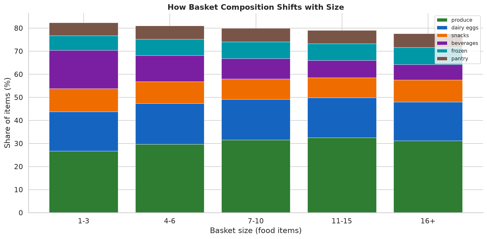
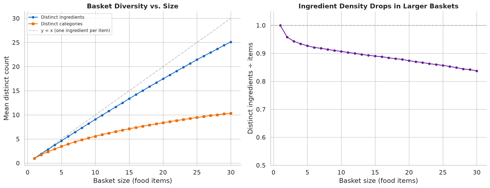
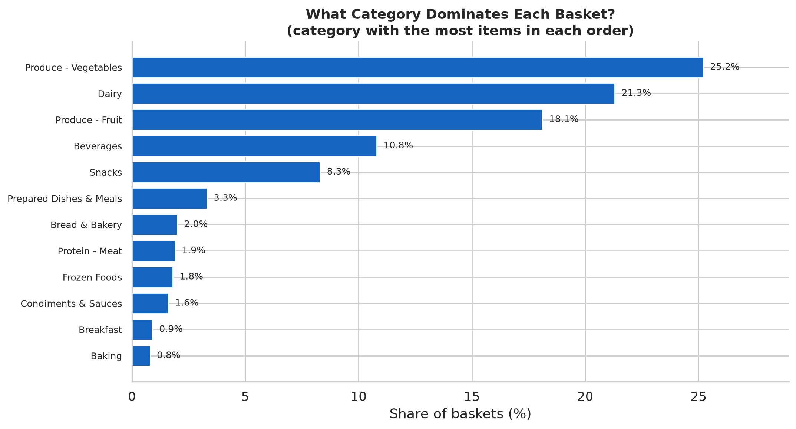
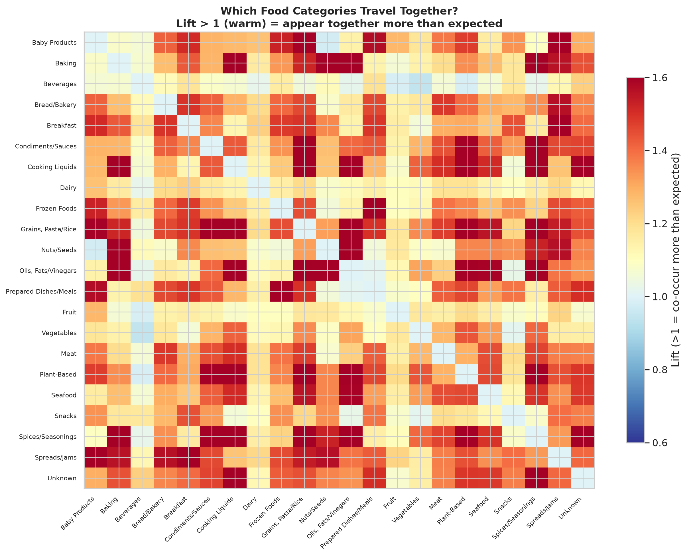
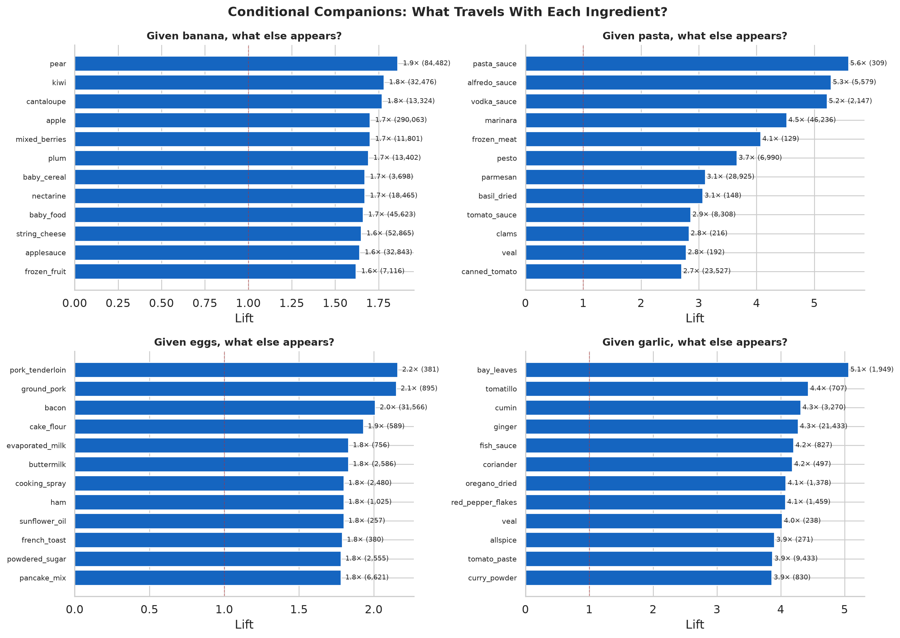
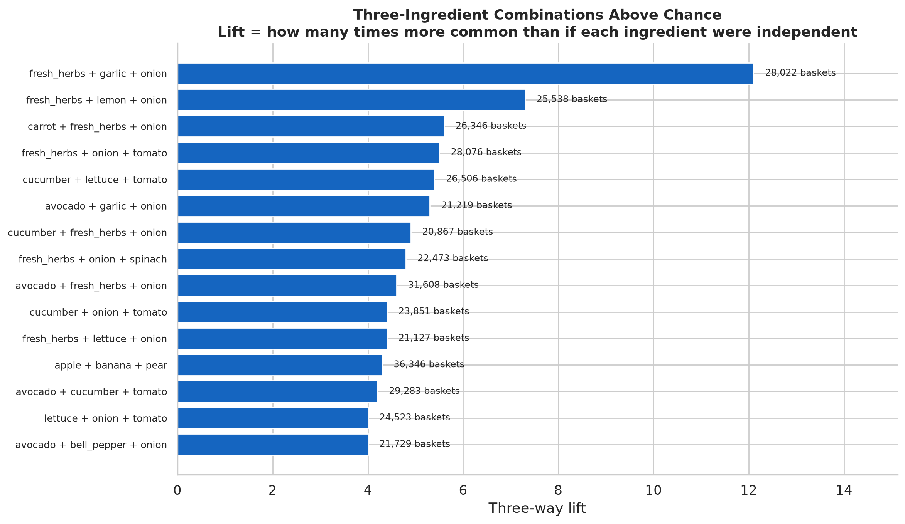

# Basket Contents

What do grocery baskets contain, and what meaningful relationships exist among the
items purchased together?

This is within-basket analysis: what co-occurs in a single order. It does not cover
reorder behavior, sequences across orders, or customer segments — those belong to
their own reports.

- Sources: `analyze_basket_contents.py`, `visualize_basket.py`
- Scope: 3,309,682 orders, 30,376,625 food item-events, 543 ingredients.

---

## How big is a basket?

- **Median 8 food items** per order (mean 9.2; p10–p90: 2–18).
- **Median 7 distinct ingredients** per order (mean 8.2).

Items and ingredients track closely — customers rarely buy the same ingredient twice
in one order.

## What's in the basket?

**Fresh dominates.** Produce is nearly a third of every basket; produce + dairy +
meat/seafood + deli exceed half. Packaged categories (snacks, beverages, frozen,
pantry) fill most of the remainder. Prepared meals are 3.9% of items; 20.8% of
baskets contain at least one — but 60% of *customers* buy a prepared dish at some
point, just not in most orders ([prepared dishes →](../prepared/)).

### How composition shifts with basket size

Small and large baskets are not the same trip scaled up. Small baskets (1–3 items)
are disproportionately beverages and single-category pickups. As baskets grow,
produce and dairy increase their share while beverages and snacks shrink. The largest
baskets (16+) look like weekly shops: heavy on produce, dairy, and proteins, with
snacks and frozen as minor additions.

## Basket diversity and density

Distinct ingredients grow roughly linearly with basket size — but not quite 1:1. The
ingredient-per-item ratio falls from 1.0 (a 1-item basket is always 1 ingredient) to
0.84 at 30 items: larger baskets include more duplicate-ingredient items (e.g.,
multiple yogurt flavors, several produce items mapping to one ingredient). Categories
saturate faster: a 30-item basket covers about 10 of 22 food categories, not 30.

Larger baskets are broader, not just bigger — but the breadth gain decelerates. A
10-item basket spans 5.6 categories; doubling to 20 items only adds 2.8 more.

## What category dominates each basket?

The plurality of items in 25% of baskets is vegetables, 21% dairy, 18% fruit. Only 3%
are dominated by prepared dishes. Most baskets are fresh-food-centered even when they
contain packaged items.

---

## What travels together: ingredient pairs

28,264 ingredient pairs appear in at least 500 orders. Two different questions get
two different answers.

**High support (what fills carts):** popular staples that appear together because each
is in a huge share of baskets. Lift near 1 — barely above chance.

| Pair | Orders (support) | Lift |
|------|-----------------:|-----:|
| banana + yogurt | 354,386 | 1.44 |
| milk + yogurt | 320,475 | 1.47 |
| apple + banana | 290,063 | 1.70 |
| avocado + banana | 238,192 | 1.56 |

**High lift (what actually goes together):** specialty ingredients that rarely appear
alone but almost always appear together. These are co-purchasing signatures — baking
runs, spice blends, specific dishes.

| Pair | Lift | Support |
|------|-----:|--------:|
| cake_flour + powdered_sugar | 85.5 | 862 |
| bread_flour + yeast | 60.8 | 650 |
| garlic_powder + onion_powder | 55.3 | 1,783 |
| lasagna_noodles + ricotta | 50.7 | 740 |
| red_wine + wine | 45.2 | 6,491 |
| baking_powder + baking_soda | 31.6 | 1,045 |
| chili_powder + kidney_beans | 27.9 | 1,079 |
| cumin + paprika | 26.9 | 878 |

These resolve into recognizable contexts: **baking** (cake flour + powdered sugar,
bread flour + yeast, baking powder + soda), **spice blends** (cumin / chili / paprika
— the makings of chili and curry), **specific dishes** (lasagna noodles + ricotta),
and **alcohol runs** (red wine + wine, champagne + wine).

The scatterplot shows the trade-off: the upper-left holds rare-but-strongly-associated
pairs (baking, specialty dishes); the lower-right holds common-but-expected staple
combinations. Hot dog + hot dog bun sits interestingly in the middle — common enough
to have real support (20k+ orders) and strongly associated (lift ~21).

**Important caveat:** high lift with low support can be misleading. Cake flour +
powdered sugar appears in only 862 of 3.3M orders. The lift is real (these ingredients
genuinely co-occur far above chance), but its rarity means it describes a specific
behavior (baking projects) rather than a general shopping pattern.

## Category co-occurrence

The heatmap shows which food categories appear together more (warm) or less (cool)
than expected.

Strongest positive associations:
- **Cooking clusters:** vegetables + cooking liquids, vegetables + spices, vegetables +
  oils, grains/pasta + condiments/sauces — the building blocks of cooking from scratch.
- **Protein + cooking ingredients:** meat and seafood associate with vegetables, grains,
  and spices more than with other categories.
- **Baking cluster:** baking + dairy, baking + spreads/jams — flour, sugar, butter,
  eggs travel together.

Weaker or negative:
- **Snacks** show weak association with spices, cooking liquids, and oils.
- **Prepared meals** weakly associate with vegetables and spices in the category
  heatmap, though direct basket comparison shows nearly identical composition
  (see [prepared dishes](../prepared/) for the controlled comparison).
- **Beverages** are near-neutral with most categories — they appear in every kind of
  basket.

## Conditional companions

Given that a basket contains a specific ingredient, what else is more likely to
appear? Four examples:

**Banana** companions are other fruit (pear 1.9×, kiwi 1.8×, cantaloupe 1.8×, apple
1.7×) plus kid-friendly items (baby food, applesauce, string cheese). Banana is a
fruit-basket anchor.

**Pasta** companions are sauces: pasta_sauce 5.6×, alfredo_sauce 5.3×, vodka_sauce
5.2×, marinara 4.5×, pesto 3.7×, parmesan 3.1×. Pasta is the clearest recipe signal
in the data — when someone buys pasta, they're assembling a pasta dinner.

**Eggs** companions split between breakfast (pancake_mix 1.8×, french_toast 1.8×) and
baking (cake_flour 1.9×, buttermilk 1.8×, powdered_sugar 1.8×). Eggs serve two
distinct cooking contexts.

**Garlic** companions are aromatic/cooking ingredients: bay_leaves 5.1×, tomatillo
4.4×, cumin 4.3×, ginger 4.3×, fish_sauce 4.2×, coriander 4.2×. Garlic is a
strong co-purchasing signal — its presence predicts other aromatic and cooking
ingredients.

## Three-ingredient combinations

The top triplets (among the 60 most-purchased ingredients, support ≥ 300 baskets) are
dominated by cooking aromatics and produce:

- **fresh_herbs + garlic + onion** (28k baskets, lift 12×): the classic aromatic base
  — appears 12 times more often than if each ingredient were purchased independently.
- **fresh_herbs + lemon + onion** (26k baskets, lift 7×): Mediterranean cooking base.
- **cucumber + lettuce + tomato** (27k baskets, lift 5×): salad.
- **avocado + garlic + onion** (21k baskets, lift 5×): guacamole ingredients.
- **apple + banana + pear** (36k baskets, lift 4×): the fruit-basket core.

These are *co-purchasing patterns*, not confirmed recipes. A basket containing herbs,
garlic, and onion is consistent with cooking from scratch, but we cannot see what was
actually cooked. The triplet lift measures how much more common the combination is
than independence would predict, not whether the ingredients were used together.

## Limitations

- Co-occurrence is within an order, not within a recipe or a meal. One order can mix
  several meals and household needs. A basket containing pasta + chicken + ice cream
  does not mean these were cooked together.
- Pair lift can be misleading for very rare ingredients: two ingredients that each
  appear in 0.1% of baskets will have high lift if they co-occur in even a few hundred
  baskets. Support counts are always reported alongside lift.
- Three-way lift uses a simple independence baseline (P(a)·P(b)·P(c)). This
  overstates the significance of triplets whose pairwise associations are already
  strong — herbs+garlic+onion has high three-way lift partly because each *pair* is
  already associated. A more rigorous test would condition on pairwise rates.
- Triplets are restricted to the top 60 ingredients by purchase volume, so rare
  specialty combinations (baking triplets, ethnic cuisine signatures) are not captured.
- "Dominant category" uses plurality of items; a basket with 3 vegetables, 2 dairy,
  and 2 snacks is labeled "vegetable-dominant" even though it's mixed.
- Fresh/packaged coloring in the bar charts is based on department, not nutrition
  labeling.
