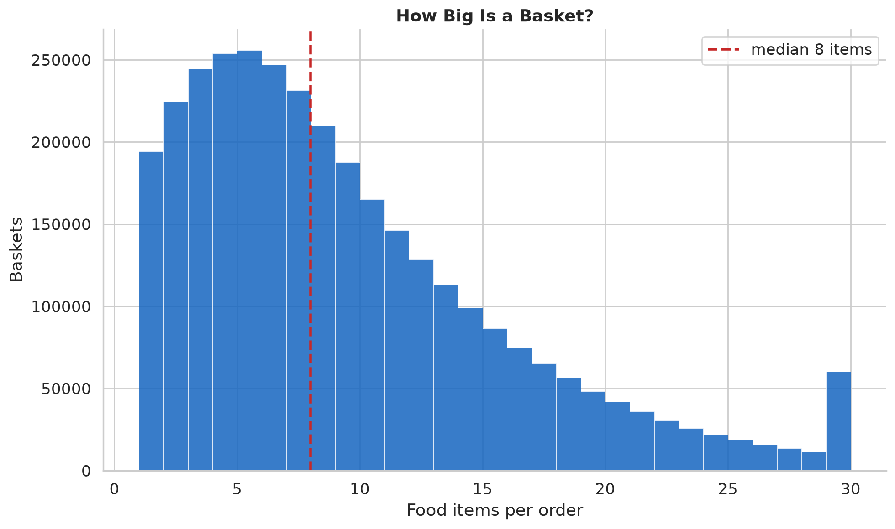

# Basket Contents

What a single order looks like: how big it is, how varied, what departments fill it,
and which ingredients travel together.

- Source: `analyze_basket_contents.py` → `basket_contents_summary.csv`;
  `analyze_cooccurrence.py` → `cooccurrence_pairs.csv`
- Scope: 3,309,682 orders, 30,376,625 food item-events.

## How big is a basket?

- **Median 8 food items** per order (mean 9.2; p10–p90: 2–18).
- **Median 7 distinct ingredients** per order (mean 8.2).

Within a single basket, item count and distinct-ingredient count track each other
closely (8 vs 7) — customers rarely buy the same ingredient twice in one order. And
basket variety is flat across a customer's lifetime: ~8 distinct ingredients per order
at order 1 and at order 50 alike (the repertoire grows across orders, not within them;
see [novelty & exploration](../novelty/)).

## What's in the basket?

Share of all food items by department:

| Department | Share | | Department | Share |
|------------|------:|-|------------|------:|
| produce | **31.2%** | | canned goods | 3.5% |
| dairy eggs | 17.2% | | deli | 3.4% |
| snacks | 9.2% | | dry goods pasta | 2.8% |
| beverages | 8.3% | | meat seafood | 2.4% |
| frozen | 7.3% | | breakfast | 2.3% |
| pantry | 5.9% | | bakery | 3.8% |

**Fresh dominates.** Produce alone is nearly a third of every basket; produce + dairy
+ meat/seafood + deli (the fresh departments) are over half. Packaged categories —
snacks, beverages, frozen, pantry — fill most of the remainder. Prepared meals are a
small slice: **3.9% of items, and 20.8% of baskets contain at least one** (see
[prepared dishes](../prepared/)).

## What travels together

Deduplicate to one (order, ingredient), count orders containing each pair, and compare
to independence: `lift = P(a,b) / P(a)·P(b)`. Two different questions get two
different answers.

**Highest support (what fills carts):** produce-and-dairy staples, common because each
item is in a huge share of baskets — and only modestly above chance.

| Pair | Orders (support) | Lift |
|------|-----------------:|-----:|
| banana + yogurt | 354,386 | 1.44 |
| milk + yogurt | 320,475 | 1.47 |
| apple + banana | 290,063 | 1.70 |
| avocado + banana | 238,192 | 1.56 |

**Highest lift (what actually goes together):** intact recipe signatures — specialty
ingredients that are individually uncommon but almost never bought except together.

| Pair | Lift | Support |
|------|-----:|--------:|
| cake_flour + powdered_sugar | 85.5 | 862 |
| bread_flour + yeast | 60.8 | 650 |
| garlic_powder + onion_powder | 55.3 | 1,783 |
| lasagna_noodles + ricotta | 50.7 | 740 |
| red_wine + wine | 45.2 | 6,491 |
| baking_powder + baking_soda | 31.6 | 1,045 |
| chili_powder + kidney_beans | 27.9 | 1,079 |
| cumin + paprika | 26.9 | 878 |

These resolve into recognizable contexts: **baking** (cake flour + powdered sugar,
bread flour + yeast, baking powder + soda), **spice blends** (the cumin / chili /
paprika / turmeric cluster — the makings of chili and curry), **specific dishes**
(lasagna noodles + ricotta), and **alcohol runs** (red wine + wine, champagne + wine).
Evaluating *all* 542 ingredients, not just the frequent ones, is what surfaces them —
the strongest signals are rare, specialized ingredients.

**For a recommender:** support finds what's already in the cart (no prompting needed);
lift finds the recipe a customer is assembling and the partner ingredient they might
still need.

## Limitations

- Co-occurrence is within an order, not within a recipe or a meal — one order can mix
  several meals and household needs.
- Pairs are ranked down to a support floor of 500 orders; rarer pairings are still
  counted toward each ingredient's totals but not ranked.
- "Fresh" is a department reading, not a nutrition judgment; item counts are food
  items only (non-food excluded), so baskets are larger than shown.
