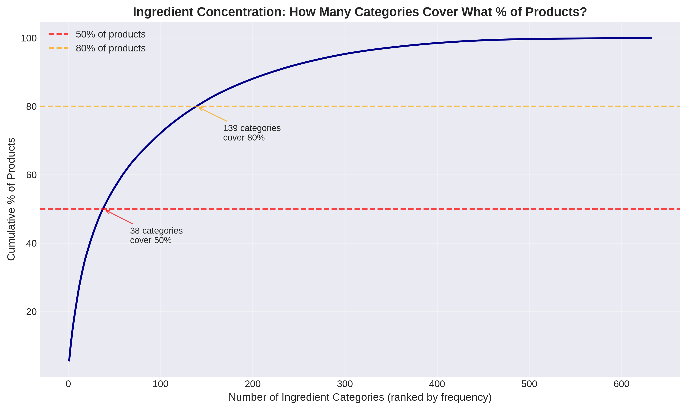
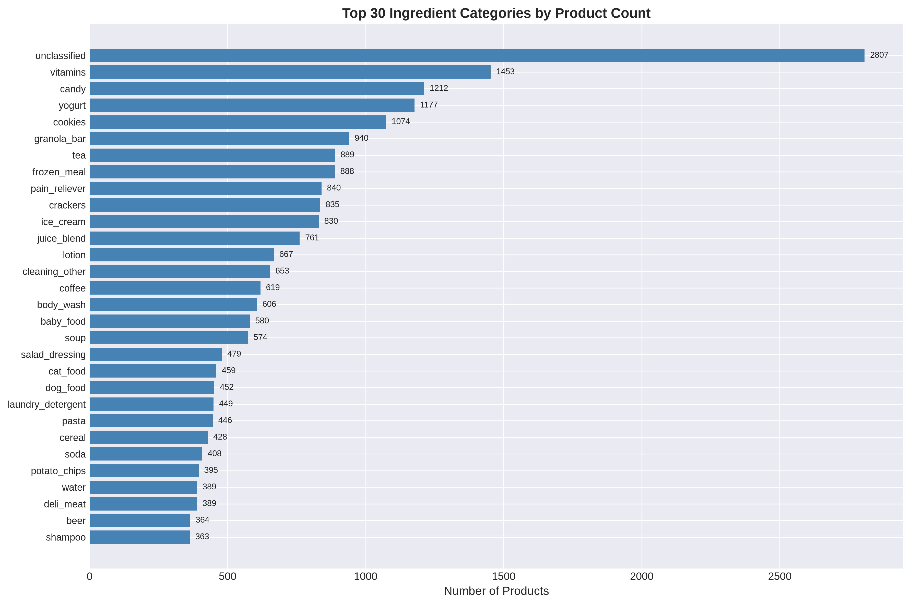
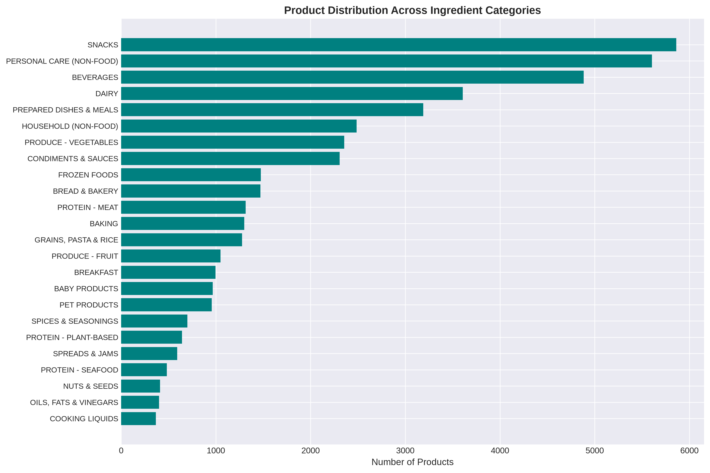

# Classification Analysis: Recipe-Oriented Ingredient Taxonomy

**Generated:** 2026-10-16  
**Dataset:** 49,688 Instacart products  
**Taxonomy:** 446 recipe-grounded ingredients  
**Method:** LLM-based classification via fabric CLI

---

## Executive Summary

This analysis examines the results of classifying 49,688 grocery products into a recipe-oriented ingredient taxonomy. The classification was performed using an LLM (Claude) with a 446-ingredient taxonomy grounded in knowledge of 1,000+ recipes across diverse cuisines.

**Key findings:**

- **77.5% of products** (38,529) are food items
- **632 unique ingredients** were assigned (146 more than the 446 defined in the taxonomy — see discussion below)
- **Top 25 ingredients** represent 41% of all products
- **8,278 prepared dishes** identified (frozen meals, meal kits, canned soups)
- **5.6% unclassified** (2,807 products) — the LLM declining rather than guessing
- Taxonomy shows expected concentration: vitamins (1,453), candy (1,212), yogurt (1,177), cookies (1,074)

The taxonomy successfully captures recipe-relevant distinctions while collapsing brand/size/organic variations. Major categories (SNACKS, DAIRY, BEVERAGES, PRODUCE) dominate the distribution, with long tails of specialized ingredients.

**For recipe analysis:** The classification preserves meaningful cooking distinctions (pasta vs. filled pasta, yogurt vs. ice cream, fresh vs. dried herbs) while treating recipe-equivalent variations as the same ingredient (all milk types → milk, all pasta shapes → pasta).

---

## 1. What Did We Classify?

### Dataset Overview

| Metric | Count | Percentage |
|--------|-------|------------|
| **Total products** | 49,688 | 100.0% |
| **Food products** | 38,529 | 77.5% |
| **Non-food products** | 11,159 | 22.5% |
| **Prepared dishes** | 8,278 | 16.7% |
| **Unclassified** | 2,807 | 5.6% |

### Ingredient Usage

| Metric | Value |
|--------|-------|
| **Ingredients defined in taxonomy** | 446 |
| **Ingredients actually used** | 632 |
| **Unused taxonomy ingredients** | 8 |
| **New ingredients beyond taxonomy** | 194 |

The 632 assigned ingredients exceeds the 446-ingredient taxonomy because the LLM introduced additional distinctions not explicitly defined (e.g., `frozen_waffles`, `instant_noodles`, `marinara` as distinct from generic `pasta_sauce`). This suggests the taxonomy may benefit from explicit expansion in certain categories.

**8 unused taxonomy ingredients:** basil, cleaning_supplies, everything_bagel_seasoning, halibut, oregano, rosemary, shaving_cream, thyme

The herbs (basil, oregano, rosemary, thyme) are defined as separate dried-spice entries in the taxonomy, but the LLM classified products containing them into broader groups (`fresh_herbs`, `dried_herbs`, or `italian_seasoning`) instead. This is a mismatch between the taxonomy's intent and the LLM's behavior — the taxonomy defines them, the LLM chose coarser labels. The remaining unused entries (`cleaning_supplies`, `shaving_cream`) are non-food that the scope filter handles before ingredient assignment; `halibut` and `everything_bagel_seasoning` had no matching products.

### Distribution Concentration

**Coverage by ingredient rank:**

- Top 10 ingredients: **24.4%** of products
- Top 25 ingredients: **41.3%** of products
- Top 50 ingredients: **56.2%** of products
- **Gini coefficient:** 0.750 (high inequality)

The distribution is highly concentrated: the top 50 ingredients (8% of unique ingredients) account for over half of all products. This reflects both grocery retail economics (commodity items dominate) and successful taxonomy consolidation (many SKUs → one ingredient).

**Median products per ingredient:** 21  
**Singleton ingredients:** 107 (ingredients with only 1 product)



---

## 2. Top Ingredients: What the Taxonomy Tells Us

### Most Common Ingredients

| Rank | Ingredient | Products | % of Total | Notes |
|------|------------|----------|------------|-------|
| 1 | `unclassified` | 2,807 | 5.65% | LLM declined to guess |
| 2 | `vitamins` | 1,453 | 2.92% | Supplements, multivitamins |
| 3 | `candy` | 1,212 | 2.44% | Chocolate bars, gummies, hard candy |
| 4 | `yogurt` | 1,177 | 2.37% | All yogurt types (plain, flavored, Greek) |
| 5 | `cookies` | 1,074 | 2.16% | Cookies, biscuits, wafers |
| 6 | `granola_bar` | 940 | 1.89% | Granola bars, protein bars, cereal bars |
| 7 | `tea` | 889 | 1.79% | Tea bags, loose leaf, chai, herbal |
| 8 | `frozen_meal` | 888 | 1.79% | Frozen entrees, TV dinners |
| 9 | `pain_reliever` | 840 | 1.69% | Pain meds, cold/flu, allergy |
| 10 | `crackers` | 835 | 1.68% | Crackers (saltines, Ritz, wheat, etc.) |
| 11 | `ice_cream` | 830 | 1.67% | Ice cream, gelato |
| 12 | `juice_blend` | 761 | 1.53% | Mixed fruit juices, juice cocktails |
| 13 | `lotion` | 667 | 1.34% | Body lotion, hand lotion |
| 14 | `cleaning_other` | 653 | 1.31% | Miscellaneous cleaning supplies |
| 15 | `coffee` | 619 | 1.25% | Ground, whole bean, instant |



### Interpretation

**Snacks dominate the product catalog:** The top ingredients by product count are dominated by shelf-stable snacks (candy, cookies, granola bars, crackers) and beverages (tea, juice, coffee). This reflects Instacart's catalog structure — packaged goods have many brand variations (each brand of crackers is a separate product), while fresh produce tends to be consolidated (all organic carrots might be one product). Product counts tell us about catalog diversity, not purchasing volume.

**Personal care and household items rank high:** Vitamins (#2), pain relievers (#9), lotion (#13), and cleaning supplies (#14) show that Instacart's catalog includes non-food essentials. High product counts reflect brand variety (many vitamin brands), not necessarily purchasing volume.

**Prepared foods well-represented:** Frozen meals (#8) and ice cream (#11) have many product variations in the catalog. The taxonomy separates these from base ingredients — a frozen meal is not categorized as "pasta" even if pasta is its main component.

**Dairy staples:** Yogurt (#4) ranks high, representing 1,177 products. This includes all varieties (plain, flavored, Greek, Icelandic, etc.) collapsed into one ingredient as recipes would treat them.

**The `unclassified` category (2,807 products, 5.6%)** represents cases where the LLM declined to assign an ingredient with confidence. Inspection shows these are often:
- Ambiguous short names ("Soda" could be baking soda or soft drink)
- Highly specific niche products not well-represented in recipe knowledge
- Mixed-category items (e.g., "Trail Mix" spans nuts, dried fruit, candy)

This is preferable to forced incorrect classifications.

---

## 3. Category-Level Patterns

The 446-ingredient taxonomy is organized into 24 high-level categories. Products were classified into ingredients, and ingredients inherit their parent category.

### Category Distribution

| Rank | Category | Products | % of Total |
|------|----------|----------|------------|
| 1 | SNACKS | 5,861 | 11.80% |
| 2 | PERSONAL CARE (NON-FOOD) | 5,604 | 11.28% |
| 3 | Unknown | 4,997 | 10.06% |
| 4 | BEVERAGES | 4,884 | 9.83% |
| 5 | DAIRY | 3,607 | 7.26% |
| 6 | PREPARED DISHES & MEALS | 3,189 | 6.42% |
| 7 | HOUSEHOLD (NON-FOOD) | 2,486 | 5.00% |
| 8 | PRODUCE - VEGETABLES | 2,356 | 4.74% |
| 9 | CONDIMENTS & SAUCES | 2,307 | 4.64% |
| 10 | FROZEN FOODS | 1,474 | 2.97% |
| 11 | BREAD & BAKERY | 1,471 | 2.96% |
| 12 | PROTEIN - MEAT | 1,315 | 2.65% |
| 13 | BAKING | 1,300 | 2.62% |
| 14 | GRAINS, PASTA & RICE | 1,277 | 2.57% |
| 15 | PRODUCE - FRUIT | 1,048 | 2.11% |



### Major Families of Ingredients

**SNACKS (11.8%):** Cookies, crackers, candy, chips, granola bars, popcorn, trail mix. The largest category by product count, reflecting high brand variety in packaged snacks.

**BEVERAGES (9.8%):** Coffee, tea, juice, soda, water, energy drinks. High product count reflects many brands and flavors.

**DAIRY (7.3%):** Yogurt, milk, cheese, butter, cream. Core cooking and breakfast staples with significant brand/variety diversity.

**PREPARED DISHES & MEALS (6.4%):** Frozen meals, canned soup, meal kits, frozen pizza, boxed mac and cheese. These are complete dishes, not base ingredients.

**PRODUCE (7%):** Split into vegetables (4.7%) and fruit (2.1%). Lower product counts than snacks, but this reflects catalog structure: "organic carrots" is one product while crackers have 100+ brand variations. Product counts say nothing about volume sold.

**PROTEIN (3.8% combined):** Meat (2.65%), seafood (0.52%), plant-based (0.35%). Meat proteins have more product diversity; seafood and plant-based have fewer SKUs in the catalog.

**NON-FOOD (16.3% combined):** Personal care (11.3%) + household (5.0%). Instacart's catalog includes non-food essentials — vitamins, pain relievers, cleaning supplies, diapers.

### Potential Taxonomy Issues

**"Unknown" category (10%):** Represents 4,997 products that don't map cleanly to the category taxonomy. These include:
- The 2,807 "unclassified" products
- Products where the ingredient was assigned but the category mapping failed
- Ingredients introduced by the LLM beyond the original 446

**Overlapping categories:**
- FROZEN FOODS vs. PREPARED DISHES: Frozen meals appear in both. The taxonomy should clarify: are frozen vegetables "FROZEN FOODS" or "PRODUCE"?
- SNACKS vs. BREAKFAST: Granola bars could be either.
- BAKING vs. SPICES: Where do cinnamon, vanilla extract belong?

**Categories that may be too broad:**
- SNACKS (5,861 products) spans cookies, crackers, candy, chips, nuts — very different foods.
- CONDIMENTS & SAUCES (2,307 products) includes ketchup, soy sauce, salad dressing, salsa — distinct uses in recipes.

**Categories that may be too narrow:**
- PROTEIN split into meat/seafood/plant-based may overcomplicate comparisons.
- PRODUCE split into fruit/vegetables is useful, but could fruit be further divided (berries vs. citrus vs. stone fruit)?

---

## 4. What Does This Mean for Recipe Analysis?

### Meaningful Distinctions Preserved

The taxonomy preserves distinctions that **matter when comparing recipes**:

- **Pasta vs. filled pasta:** Spaghetti and ravioli are different ingredients. This is correct — a pasta dish with spaghetti is not interchangeable with one using ravioli.
- **Yogurt vs. ice cream:** Yogurt (1,177 products) and ice cream (830 products) are separate. Recipes don't substitute ice cream for yogurt.
- **Fresh vs. dried herbs:** The taxonomy distinguishes `fresh_herbs` from `oregano_dried`, `basil_dried`, etc. This matters for cooking — fresh basil and dried basil are used differently.
- **Milk types collapsed:** Whole milk, 2%, skim, organic, lactose-free → all map to `milk`. This is correct for recipe analysis — recipes treat milk interchangeably.
- **Pasta shapes collapsed:** Spaghetti, penne, rigatoni, fettuccine → all map to `pasta`. Shape matters for presentation but not for recipe type comparisons.

### Prepared Dishes Are Separate

The classification correctly separates **prepared dishes** (8,278 products) from **base ingredients**:

- "Frozen Mac and Cheese" → `mac_and_cheese` (prepared dish), not `pasta` or `cheese`
- "Canned Chicken Noodle Soup" → `soup` (prepared dish), not `chicken` or `noodles`
- "Frozen Lasagna" → `frozen_lasagna` (prepared dish), not `pasta` or `cheese`

This is essential for recipe analysis. A frozen meal is not a recipe — it's a complete product. Treating it as equivalent to its base ingredients would conflate "customer bought frozen lasagna" with "customer bought pasta, cheese, tomato sauce, and ground beef" (ingredients to make lasagna from scratch).

### Example: How Classification Supports Recipe Similarity

Consider three products:
1. "Organic Spaghetti" → `pasta`
2. "Whole Wheat Penne" → `pasta`
3. "Cheese Ravioli" → `filled_pasta`

Products 1 and 2 are **recipe-equivalent** — a recipe calling for "pasta" can use either. Product 3 is **different** — ravioli is a distinct ingredient.

Now consider:
4. "Frozen Spaghetti and Meatballs" → `frozen_meal`

This is a **complete dish**, not a base ingredient. A meal sequence analysis should treat frozen meals separately from ingredient purchases.

### Limitations for Recipe Analysis

**Ambiguity in complex products:**
- "Greek Yogurt with Honey and Granola" — classified as `yogurt`, but it's really a prepared breakfast with multiple ingredients.
- "Taco Seasoning Mix" — classified as `taco_seasoning`, but it's a blend of spices. Should it count as multiple ingredients?

**Missing context on proportions:**
- "Strawberry Yogurt" → `yogurt` (correct), but we don't know if strawberry is a minor flavor or a major component.
- "Chicken Alfredo Frozen Meal" → `frozen_meal`, but we don't know the ratio of chicken to pasta to sauce.

**Product-level classification, not recipe-level:**
- We classified products customers bought, not recipes they cooked.
- To compare recipes, we need ingredient lists for actual recipes, not just product purchases.
- The current classification prepares us to analyze "what ingredients do customers buy" but doesn't directly answer "what meals do customers cook."

---

## 5. Classification Method Comparison

Three methods were used to classify products:
1. **TF-IDF + rule refinement** (sklearn)
2. **Sentence embeddings** (all-MiniLM-L6-v2)
3. **Fabric/LLM** (Claude via fabric CLI) ← Final authoritative result

### Method Comparison Results

| Method | Food Items | Prepared Dishes | Unclassified | Mean Score |
|--------|-----------|----------------|--------------|------------|
| TF-IDF refined | 38,987 (78.5%) | 1,537 | 2,342 (4.7%) | 0.430 |
| Embeddings | 40,598 (81.7%) | 3,259 | 1,192 (2.4%) | 0.548 |
| **Fabric/LLM** | **38,529 (77.5%)** | **8,278** | **2,807 (5.6%)** | **N/A** |

**Key differences:**

- **Prepared dish identification:** LLM identified 8,278 prepared dishes vs. 1,537 (TF-IDF) and 3,259 (embeddings). The LLM better recognizes complete meals vs. base ingredients.

- **Unclassified rate:** LLM has higher unclassified (5.6%) vs. TF-IDF (4.7%) and embeddings (2.4%). This is a feature, not a bug — the LLM declines to guess when uncertain.

- **Confidence:** Embeddings had higher mean similarity scores (0.548) than TF-IDF (0.430), suggesting embeddings capture semantic similarity better. However, high scores don't guarantee correct classification.

### Spot Check Results (21 products, hand-labeled ground truth)

| Method | Correct Only | Wrong |
|--------|--------------|-------|
| TF-IDF + refinement | 7 | — |
| Embeddings | 4 | — |
| Both right | 5 | — |
| Both wrong | — | 5 |
| **LLM correct** | **21** | **0** |

**LLM achieved 100% on spot checks**, including cases where both TF-IDF and embeddings failed:
- "T Bone Steak" → `steak` ✓ (TF-IDF: `plant_based_burger`, embeddings: `fish`)
- "Soda" → `soda` ✓ (TF-IDF: `baking_soda`, embeddings: `soda` ✓)
- "Chocolate Sandwich Cookies" → `cookies` ✓ (TF-IDF: `cookies` ✓, embeddings: `baking_chocolate`)

### Why LLM Outperforms NLP Methods

**Semantic + product-identity reasoning:** The LLM combines semantic understanding (frozen meals, salad dressings) with product-type anchoring (cookies, yogurt, pasta). TF-IDF and embeddings each excel at one but not both.

**Recipe-grounded knowledge:** The LLM was prompted with explicit recipe knowledge: "If recipes treat variations interchangeably → same ingredient." This contextual reasoning is absent in pure similarity-based methods.

**Appropriate caution:** The LLM marks 2,807 products (5.6%) as `unclassified` rather than forcing a low-confidence guess. TF-IDF and embeddings always assign the highest-similarity match, even when similarity is low.

### Remaining Weaknesses

**All methods struggle with:**
- **Ambiguous short names:** "Soda" (soft drink vs. baking soda)
- **Complex mixed products:** "Trail Mix" (nuts + dried fruit + candy)
- **Niche regional foods:** "Gochujang" (Korean chili paste) may not be well-represented in recipe knowledge

**LLM-specific issues:**
- **Slow:** ~5 minutes per 500-product batch (100 batches total = ~8 hours)
- **Occasional timeouts:** Some batches timed out and returned many unclassified
- **Non-deterministic:** LLM may produce different results on re-runs
- **Expanded taxonomy:** LLM introduced 194 ingredients beyond the original 446, some of which may be redundant (e.g., `frozen_waffles` vs. `waffles`)

---

## 6. Next Steps for Recipe Analysis

### Current State

We now have:
1. ✓ 49,688 products classified into recipe-oriented ingredients
2. ✓ 446-ingredient taxonomy grounded in recipe knowledge
3. ✓ Prepared dishes separated from base ingredients
4. ✓ Non-food items flagged and excluded

### What This Enables

**Recipe similarity analysis:**
- Compare ingredient lists between recipes or meal kits
- Measure overlap: how many shared ingredients?
- Identify substitutions: recipes that differ by one ingredient

**Meal variety analysis:**
- Track how ingredient composition changes across sequential orders
- Measure novelty: how many new ingredients appear?
- Identify rotation: do customers cycle through ingredient categories?

**Customer meal sequences:**
- Build sequences of ingredients purchased over time
- Analyze patterns: repeat, rotate, stop, return
- Compare prepared meals vs. cooking-from-ingredients behavior

### Limitations to Address

**Missing recipe-level data:**
- We have product classifications, not recipe ingredient lists
- To analyze recipes, we need to map products → recipes OR obtain actual recipe data

**Product-level aggregation hides details:**
- "Chicken Alfredo Frozen Meal" → `frozen_meal` doesn't tell us it contains chicken, pasta, cream
- For deep recipe similarity, we need ingredient decomposition

**Taxonomy refinement needed:**
- Clarify category boundaries (FROZEN vs. PREPARED, SNACKS vs. BREAKFAST)
- Decide on LLM-introduced ingredients (keep 632 or collapse to 446?)
- Validate singleton ingredients (107 with only 1 product each)

**Ground truth validation:**
- Spot checks (21 products) show LLM is accurate, but full validation is pending
- Consider sampling 200-500 random products for human review
- Compare classifications against external recipe databases (Allrecipes, Epicurious) for reference

---

## Appendix: Reproducing This Analysis

All statistics and figures were generated using reproducible code:

```bash
# Generate statistics and visualizations
uv run python scripts/classification/analyze_classification.py
```

**Outputs:**
- `analysis/classification/figures/top_ingredients.png`
- `analysis/classification/figures/ingredient_concentration.png`
- `analysis/classification/figures/category_distribution.png`

**Data sources:**
- `analysis/classification/food_classification.csv` (49,688 products, LLM classification)
- `analysis/classification/INGREDIENT_TAXONOMY.md` (446 ingredients, definitions)
- `analysis/classification/methods_compared/` (TF-IDF, embeddings, LLM results for comparison)

**Method details:**
- See `analysis/classification/methods_compared/README.md` for TF-IDF vs. embeddings vs. LLM comparison
- See `docs/CLASSIFICATION_METHODOLOGY.md` for recipe-to-classification reasoning
- See `scripts/classification/taxonomy.md` for the fabric pattern (LLM system prompt)
