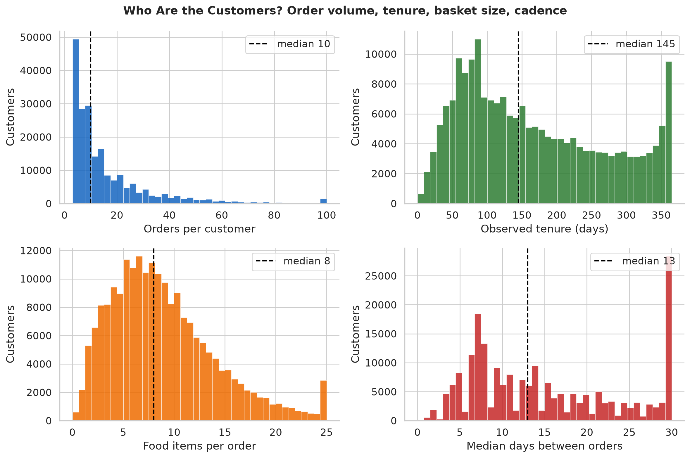
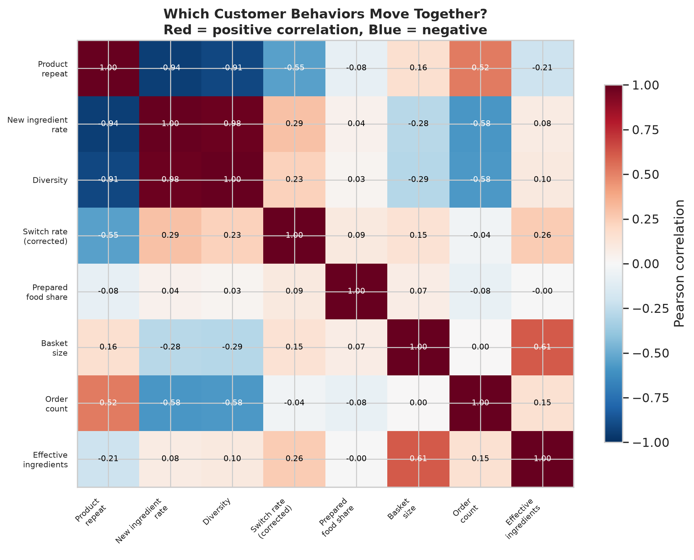
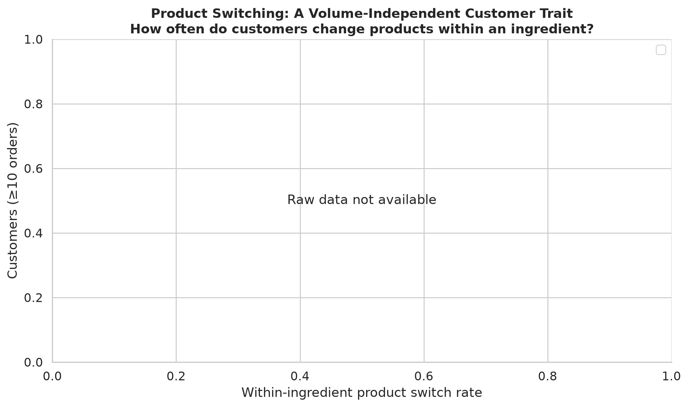

# Customers

How differently do people shop, which differences persist, and what can we learn
about distinct shopping behaviors?

- Sources: `analyze_customer_profile.py`, `analyze_customer_behavior.py`,
  `analyze_customer_extended.py`; `visualize_customers.py`
- Scope: 206k customers; behavioral metrics computed for 107k with ≥10 orders.

---

## Who the customers are

| Measure | p10 | p25 | median | p75 | p90 |
|---------|----:|----:|-------:|----:|----:|
| Orders per customer | 4 | 6 | **10** | 20 | 37 |
| Observed tenure (days) | 49 | 81 | **145** | 248 | 332 |
| Food items per order | 3 | 5 | **8** | 12 | 16 |
| Days between orders | 5 | 7 | **13** | 22 | 30 |

The median customer places 10 orders over ~5 observed months, in baskets of ~8 items,
shopping about every 13 days. Every measure is strongly right-skewed — a heavy tail
shops weekly with 37+ orders. (Tenure and order counts are window-censored; the
30-day cap on inter-order gaps makes tenure a lower bound.)

## Frequency × basket size segments

Splitting at the medians of shopping frequency and basket size gives four balanced
groups (23–27% each):

| Segment | Share | Mean orders | Mean basket | Mean cadence |
|---------|------:|------------:|------------:|-------------:|
| frequent / big-basket | 26.9% | 24 | 13 | 8 days |
| frequent / small-basket | 24.9% | 23 | 5 | 8 days |
| occasional / small-basket | 24.4% | 8 | 5 | 23 days |
| occasional / big-basket | 23.8% | 9 | 13 | 23 days |

Frequency and basket size are genuinely different axes. **Frequency drives observed
order volume**: frequent shoppers accumulate ~24 orders vs ~9, regardless of basket
size.

## Which behaviors move together

The correlation matrix reveals three distinct groups:

**One big cluster (r > 0.9):** product_repeat, new_ing_rate, and diversity move
together almost perfectly. These are not three independent traits — they're one
dimension (how much of a customer's purchasing is familiar vs new), and it correlates
±0.5–0.6 with order count. "Repeater vs explorer" is largely "high-volume vs
low-volume."

**Independent of volume:** Two behaviors stand out:
- **Product switching** (corrected, cross-order only): r = −0.04 with order count.
  Whether a customer sticks to one product per ingredient or rotates among several
  is a genuine preference that survives after volume is removed.
- **Prepared-food share**: r = −0.08 with order count, +0.07 with basket size.
  How much a customer buys prepared food is essentially unrelated to how often or
  how much they shop.

**Effective ingredients** (inverse HHI) correlates +0.61 with basket size —
mechanically, bigger baskets spread across more ingredients. This is not a behavioral
trait; it's arithmetic.

## Most variation is within customers, not between them

For both basket size and prepared-food share, the variation *within* a single
customer across their orders is almost as large as the variation *between*
customers:

| Measure | Between-customer SD | Within-customer mean SD | Ratio |
|---------|--------------------:|------------------------:|------:|
| Basket size | 5.15 | 4.20 | 1.23× |
| Prepared-food share | 0.059 | 0.056 | 1.06× |

A customer who averages 8 items per basket might place orders ranging from 3 to 15.
A customer with 5% prepared-food share has some orders with zero and some with 20%.
**Stable "customer types" are less stable than they appear** — much of what looks
like a between-customer difference is really order-to-order noise.

## Product switching: the volume-independent trait

The corrected switch rate (cross-order transitions only, excluding within-order
coexistence) has median 0.26: about 1 in 4 consecutive uses of the same ingredient
involves a different product. This varies widely across customers (p10 = 0.13,
p90 = 0.59) and is essentially independent of shopping volume.

If you want one behavioral dimension to segment customers on beyond "how much do
they buy," switch rate is the strongest candidate — it measures a genuine preference
rather than a volume artifact.

## Behavioral metric distributions

| Measure | p10 | median | p90 |
|---------|----:|-------:|----:|
| Product repeat rate | 0.35 | 0.58 | 0.79 |
| New-ingredient rate | 0.14 | 0.30 | 0.51 |
| Diversity (ings ÷ items) | 0.13 | 0.28 | 0.48 |
| Switch rate (corrected) | 0.13 | 0.26 | 0.59 |
| Prepared-food share | 0.00 | 0.03 | 0.12 |

## Split-half stability

For customers with ≥20 orders, first-half vs second-half correlations:

| Measure | r(first, second) |
|---------|------------------:|
| product_repeat | 0.81 |
| new_ing_rate | 0.81 |
| diversity | 0.82 |
| switch_rate | 0.73 |

Behavioral tendencies are moderately stable (r = 0.73–0.82). The repeat/novelty/
diversity cluster is the most stable; switch rate is somewhat less so. But recall
that within-customer variation is almost as large as between-customer — these
correlations reflect a real signal buried in substantial noise, not a clean partition
of customers into types.

## Limitations

- Tenure and order counts are window-censored (observed, not lifetime).
- Behavioral correlations are descriptive — no causal claim about why volume and
  repetition move together.
- The repeat/novelty/diversity cluster's correlation with order count means that
  apparent "behavioral types" partly reflect observation length. A customer observed
  for 50 orders will mechanically show higher repetition and lower novelty than one
  observed for 10, even if their underlying behavior is identical.
- Split-half stability uses first vs second half of observed history, which
  introduces a confound: the second half has a longer accumulated repertoire, so
  novelty is mechanically lower. The 0.81 correlation for new_ing_rate mixes
  genuine stability with this truncation effect.
- Product switching (corrected) uses the most-purchased product per order as the
  representative; when a customer buys multiple products of an ingredient in one
  order, only one is counted. This is more conservative than the uncorrected version,
  which inflated switch rates by ~10 percentage points.
- Within-vs-between variation is measured on per-order metrics. Averaging across more
  orders naturally stabilizes per-customer means, so the within-customer SD overstates
  the *predictive* uncertainty about a customer's next order relative to their
  long-run average.
