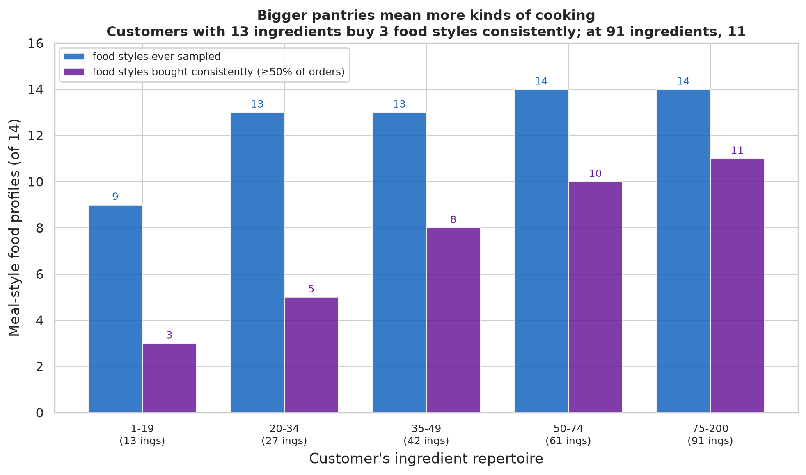
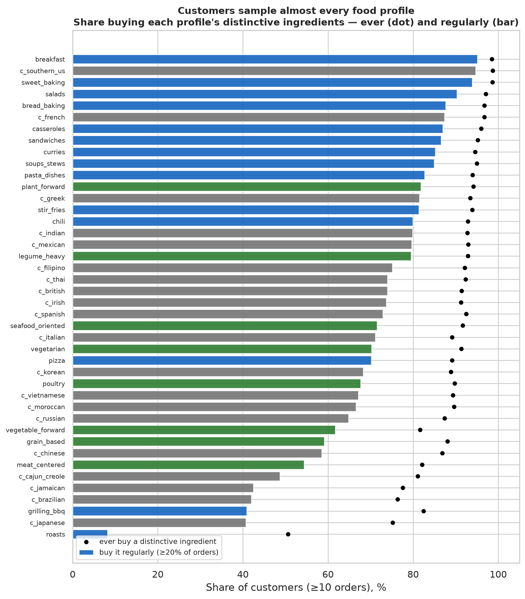
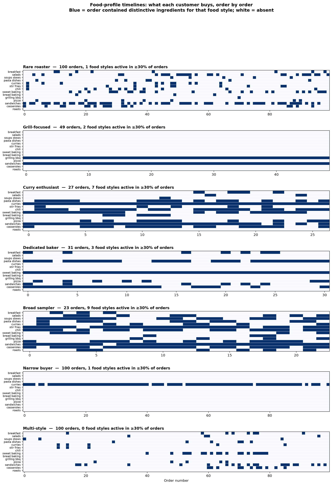

# Customers

Who are these shoppers, what kinds of food do they buy, how deeply do they engage, and
which differences between customers are real?

- Sources: `analyze_customer_profile.py`, `analyze_customer_behavior.py`,
  `analyze_customer_extended.py`; `visualize_customers.py`;
  `scripts/affinity/customer_profiles.py` (food profiles)
- Scope: 206k customers; behavioral metrics and food-profile scoring for 106k with
  ≥10 orders.

---

## What kinds of food do customers buy?

The [Food Profiles](../food_profiles/) reference maps ingredients to recognizable food
styles (curries, salads, baking, stir-fries, etc.), cuisine associations, and
composition patterns. Scoring each customer's history against those signatures — using
only the *distinctive* ingredients per profile, so staples like onions and oil don't
inflate the count — gives a first concrete picture.

### How broadly do customers sample?

Scoring customers only on ingredients that are **strongly** distinctive of each food
style (lift ≥ 5 — so baking powder doesn't count as "baking" and bananas don't count as
"banana bread"), the picture is moderate, not universal:

The median customer samples **8–11 of 14 meal styles** across their history (growing
with order count), but only buys **~4 regularly** (in ≥20% of orders). Sandwiches (90%
of customers ever) and salads (82%) are widely sampled because their distinctive
ingredients (bagels, arugula, cucumber) genuinely are popular; bread baking (28% ever,
5% regularly) and grilling (18% / 3%) are minority pursuits — just as you'd expect.

### Pantry size predicts how many food styles a customer buys consistently

| Ingredient repertoire | Median distinct ings | Styles sampled (of 14) | Bought consistently (≥50% of orders) |
|---|---:|---:|---:|
| 1–19 ingredients | 13 | 3 | 0 |
| 20–34 | 27 | 6 | 1 |
| 35–49 | 42 | 8 | 1 |
| 50–74 | 61 | 10 | 2 |
| 75+ | 91 | 12 | 2 |

**34% of customers have zero food styles they buy consistently** at the ≥50%-of-orders
bar — they sample but don't specialize. Even among the broadest shoppers (91
ingredients), the median consistently buys only 2 food styles. The median customer's
strongest single food style appears in **20% of their orders** (p75 = 40%).

Bigger pantries mean more styles sampled and a modestly stronger lean — but the dominant
pattern is diffuse purchasing, not clear specialization.

### Which food styles are most widely bought?

| Profile | Ever buy its distinctive ingredients | Buy them regularly (≥20% of orders) |
|---|---:|---:|
| Sandwiches | 90% | 71% |
| Salads | 82% | 55% |
| Casseroles | 81% | 49% |
| Chili | 76% | 41% |
| Curries | 74% | 43% |
| Sweet baking | 71% | 31% |
| Stir-fries | 69% | 31% |
| Breakfast | 67% | 29% |
| Pizza | 67% | 28% |
| Pasta | 62% | 25% |
| Soups & stews | 58% | 23% |
| Bread baking | 28% | 5% |
| Grilling & BBQ | 18% | 3% |
| Roasts | 3% | 0.2% |

Sandwiches and salads are the most widely purchased food styles. Bread baking, grilling,
and roasting are genuine minority behaviors — their ingredient signatures (bread flour,
steak, roast cuts) are specific enough that only customers who buy them register.

### What individual shopping histories look like

Each panel is one real customer, with orders across the top and food styles down the
side — blue means the order contained strongly distinctive ingredients (lift ≥ 5) for
that style. Some patterns:

- **Grill-focused** (49 orders): a solid **grilling_bbq** band and almost nothing else
  — a genuinely specialized customer.
- **Curry enthusiast** (27 orders): curries, chili, and stir-fries visible; most other
  rows sparse.
- **Dedicated baker** (31 orders): sweet baking and sandwiches show up; most cooking
  styles are absent.
- **Broad sampler** (23 orders, 9 styles active): many rows have dots — this customer
  genuinely buys distinctive ingredients across food styles.
- **Narrow buyer** (100 orders): one dense row (casseroles) and white everywhere else
  — 100 orders but nearly no food-profile signal beyond one style.
- **Multi-style** (100 orders): scattered dots across several styles, no single
  dominant pattern — diffuse purchasing over a long history.

These are illustrations, not a sample the statistics depend on. The quantitative
findings above hold across all 106,246 customers; the timelines show what those numbers
look like as real shopping histories.

---

## How engaged are customers?

| Order count | Customers | Median tenure (days) | Median basket (items) |
|---|---:|---:|---:|
| 10–14 orders | 33,886 | 181 | 8.5 |
| 15–19 | 20,227 | 234 | 8.5 |
| 20–29 | 22,375 | 281 | 9.0 |
| 30–49 | 18,698 | 336 | 9.0 |
| 50+ | 11,060 | 358 | 8.0 |

The median customer (across all 206k) places **10 orders** over **~5 months**, shopping
every **~13 days** with **8 items** per basket. Every engagement measure is right-skewed:
a heavy tail shops weekly with 37+ orders across nearly a year. But basket size is
remarkably stable — even the heaviest shoppers average 8–9 items per trip. **Frequency
is what varies, not basket size.**

---

## How many ingredients does a customer use?

| Orders | Median distinct ingredients | p25 | p75 |
|---:|---:|---:|---:|
| 10–14 | 42 | 30 | 57 |
| 20–29 | 66 | 49 | 87 |
| 50+ | 107 | 79 | 138 |

Repertoire grows steadily with order count but never saturates — at 50+ orders the
median customer has tried 107 of 543 available ingredients. The p25–p75 range is wide:
some customers at the same history length have tried twice as many ingredients as
others. About **a quarter** of what looks like product variety collapses at the
ingredient level (the median customer buys 45 distinct products but only 34 distinct
ingredients — see [ingredients](../ingredients/)).

---

## What is real versus what is noise

### Order-to-order variation is nearly as large as customer differences

For basket size, the variation *within* a single customer across their orders is almost
as large as the variation *between* customers. The intraclass correlation (ICC — the
fraction of total variation that is between customers rather than within) is **0.60**:
a customer averaging 8 items per basket places individual orders from 3 to 15.

| Measure | Between-customer SD | Within-customer mean SD | ICC |
|---|---:|---:|---:|
| Basket size | 5.15 | 4.20 | 0.60 |

### Many "personality" metrics really measure history length

Repeat rate, novelty, and diversity move together almost perfectly (r > 0.9) and
correlate 0.5–0.6 with the number of observed orders. More orders mechanically mean
higher repeat rates and lower novelty — this is arithmetic, not behavior. "Repeater
vs explorer" is largely "observed a lot vs observed a little." Treat these three as
one observation-length-confounded measure, not three personality traits.

The one behavioral metric that doesn't follow this pattern is **product switching**
within an ingredient (r = −0.04 with order count): whether a customer sticks to one
yogurt brand or rotates is unrelated to how much they shop. It's the cleanest candidate
for a genuine individual trait, though this data can't confirm it's stable over time.

### Split-half stability

For customers with ≥20 orders, first-half vs second-half correlations of behavioral
metrics run 0.73–0.82 — moderate stability, but inflated because the second half has a
mechanically larger accumulated repertoire for everyone. Read as an upper bound on true
individual stability.

---

## Limitations

- **Censoring.** Order counts and tenure are observed, not lifetime. Everything is
  conditioned on a truncated window.
- **Repertoire metrics are mechanically tied to order count.** More observed orders →
  higher repeat, lower novelty, by construction. Their correlation with order count is
  mostly this artifact, so "repeater vs explorer" and "high-volume vs low-volume" are
  nearly the same axis.
- **Food-profile scoring uses recipe-derived signatures.** "Touching a cuisine's
  distinctive ingredients" is a lower bar than cooking that cuisine, and distinctive
  ingredients are not exclusive (one ingredient can signal several profiles). The
  pantry-breadth and intensity results describe what's in the cart, not what's on the
  plate.
- **ICC is approximate** under the badly unbalanced design (order counts range 10 to
  100+). The qualitative finding — within ≈ between — is robust; the exact numbers are
  descriptive, not from a clean random-effects model.
- **Split-half stability is inflated** by the shared time trend in novelty (everyone's
  second half has lower novelty). The rank-order (who explores more keeps exploring more)
  is real; the magnitude is an upper bound.
