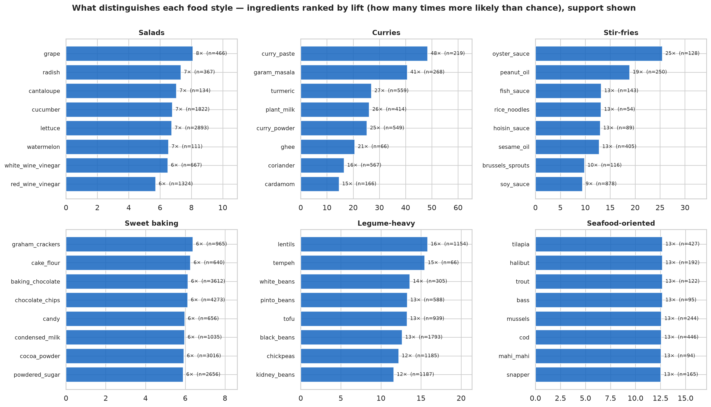
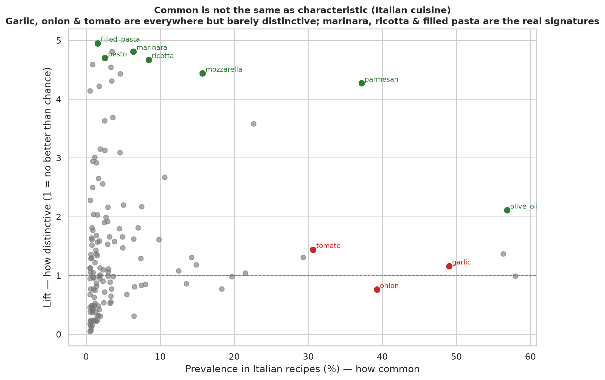
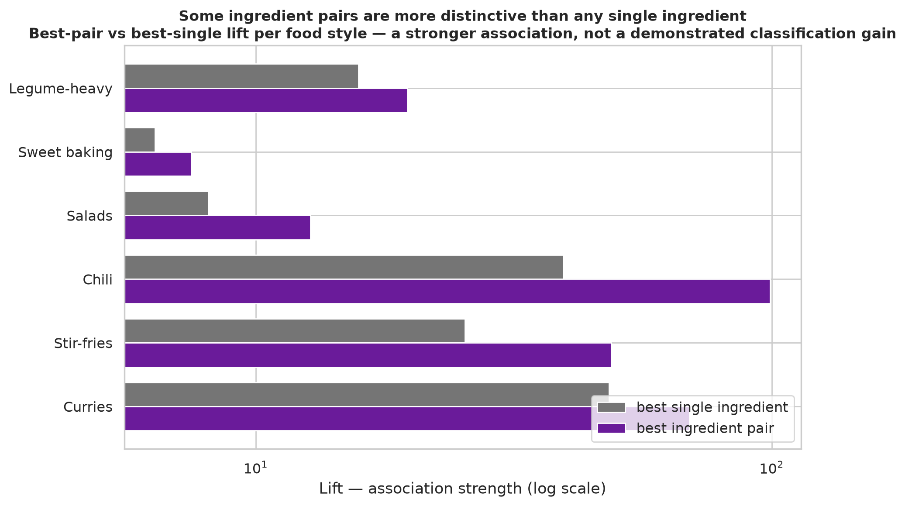
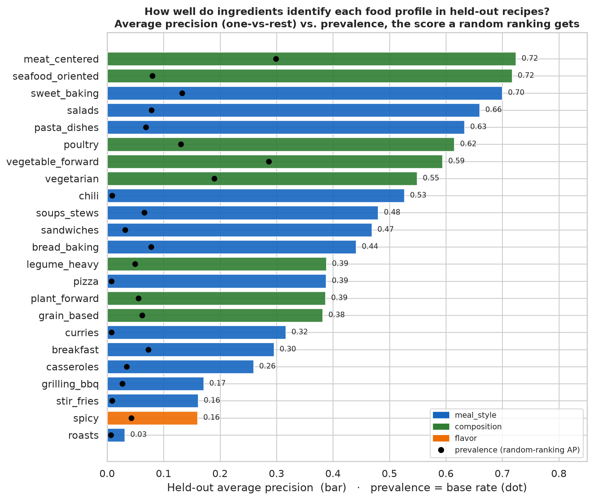
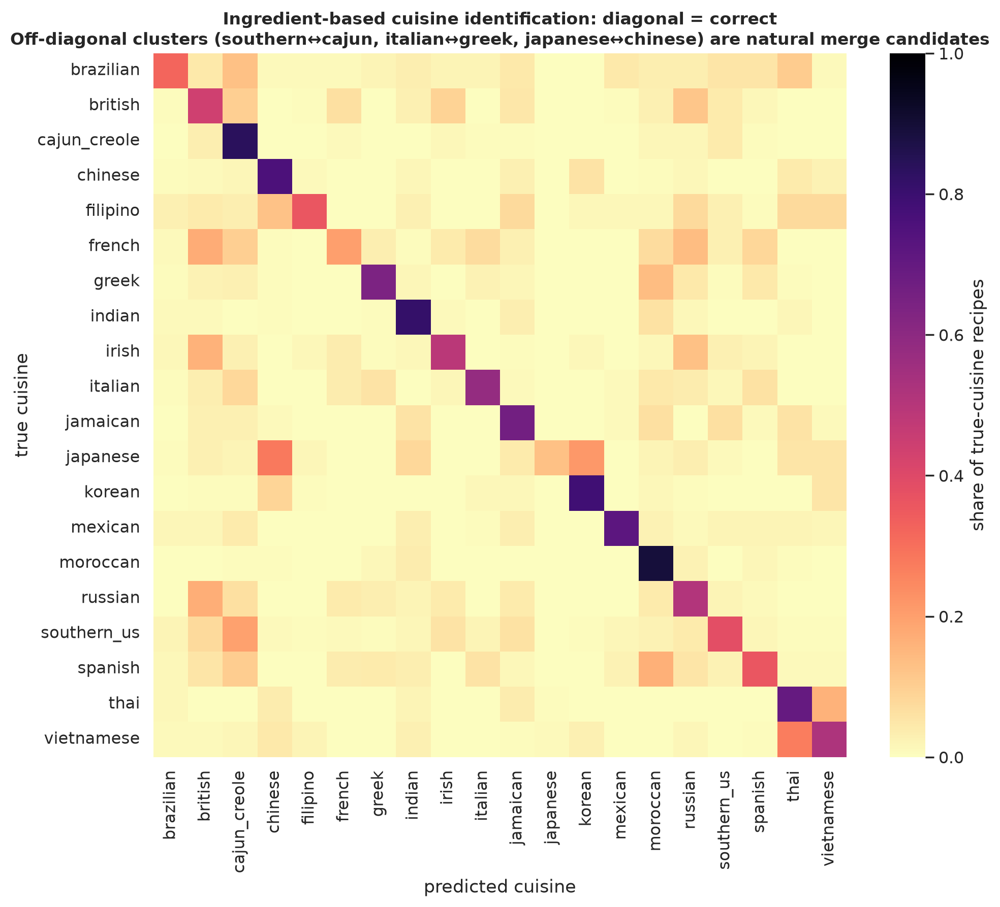

# Food Profiles

Can you tell what *kind* of food someone is cooking from the ingredients alone — not the
exact recipe, but the style: a curry, a salad, a baking project, something seafood-based?
This analysis builds a reference that maps our 543 ingredients to recognizable **food
profiles**, then tests how reliably those profiles can actually be identified from
ingredient evidence.

A food profile is a food *style* (curry, salad, pasta, stir-fry, baking), a *composition*
pattern (legume-heavy, seafood-oriented, vegetable-forward), or — more weakly — a
*cuisine* (Italian, Indian, Thai). They overlap by design: one dish can be a curry, Indian,
and legume-heavy at once. These are associations between ingredients and food types —
**not** a claim about what any customer enjoys eating. That comes later, and only with
care.

- Sources: `scripts/affinity/` (`ingredient_map.py`, `build_associations.py`,
  `evaluate.py`, `customer_profiles.py`, `visualize_profiles.py`); reference data in
  `data/affinity/`; customer summaries in this directory.
- Evidence: two public recipe corpora — **Food.com** (231,637 recipes, dish/composition
  tags) for food styles, **What's Cooking / Yummly** (39,774 recipes, 20 cuisines) for
  cuisine. Full methodology: [Food Profiles reference →](../../docs/AFFINITY_REFERENCE.md).

---

## How it works, briefly

Each profile is a label that already exists in a recipe corpus, so its ingredient
associations are **measured, not assigned**. Recipe ingredients (free text like "ground
cumin", "parmigiano reggiano") are normalized onto our 543 slugs, and for each
(profile, ingredient) we compute how common the ingredient is *within* the profile
(prevalence), how common it is overall (base rate), and the ratio — **lift**, how many
times more likely than chance. Lift is what separates a *characteristic* ingredient from
a merely *common* one.

Two numbers frame everything: the reference covers ingredients making up **90% of
Instacart food purchase volume**, but only **65% of the 543 ingredients** appear in any
profile — the missing third is snacks and convenience items (granola bars, deli meat,
chips) that simply aren't recipe ingredients and carry no cooking signal.

## What distinguishes each food style

Ranked by lift, the signatures are sharp and sensible. Curries are defined by
`curry_paste` (48×), `garam_masala` (41×), and coconut milk (which lives under
`plant_milk`, 26×). Chili by `kidney_beans` (39×) and `pinto_beans` (28×). Legume-heavy
meals by `lentils`, `tofu`, and a wall of beans. Seafood splits into specific fish
(`tilapia`, `halibut`, `trout`). Sweet baking by `cake_flour`, `cocoa_powder`, and
`chocolate_chips`. None of these required hand-tuning — they fall out of the recipe
statistics.

## Common is not the same as characteristic

The single most important methodological point. In Italian recipes, **garlic, onion, and
tomato are everywhere** — but they're everywhere in *most* cuisines too, so their lift is
near 1: common, not distinctive. The real Italian signatures are the lower-prevalence,
high-lift ingredients: `marinara`, `ricotta`, `filled_pasta`, `pesto`. Ranking by raw
frequency would surface garlic and miss ricotta; ranking by lift does the opposite. Any
detector built on this reference must weight by distinctiveness, not popularity.

## Some ingredient pairs are more distinctive than any single ingredient

Specific pairs reach a higher association strength (lift) with a food style than any
single ingredient does: curry_paste + turmeric hits ~85× within curries vs. ~48× for the
best single ingredient. This is consistent with the published cuisine-network work that
inspired looking at combinations. But a higher *maximum lift* is not the same as better
*classification* — rarer pairs naturally reach higher lift on thinner support, and the
held-out evaluation here uses single ingredients only. Whether adding pairs actually
improves profile detection is an open question we have not tested. Pair evidence is also
thin (many high-lift pairs rest on 15–40 recipes; coffee + kidney_beans hits 110× in
chili on just 16), so treat it as a candidate pool to be filtered by support, not as a
demonstrated gain.

## Which profiles are actually recognizable?

A list of associated ingredients proves nothing until you test it. Recipes were split
train/test, signatures learned from the training half only, and held-out recipes
classified one-vs-rest. The bars are **average precision** (how well the profile's score
ranks true positives ahead of the rest — not classification accuracy); the dots are each
profile's **prevalence**, which is the average precision a random ranking would score.
The gap between bar and dot is what the ingredient signature actually buys.

**Detected well:** seafood (AP 0.72), meat (0.72), sweet baking (0.70), salads (0.66),
pasta (0.63). **Rare but far above their base rate:** chili (AP 0.53 on a 0.9% base
rate), pizza, curries — modest absolute precision but a large gain over prevalence, which
reflects a few near-decisive ingredients (kidney beans, curry paste). A big ratio over
prevalence does not imply high absolute precision; it means the signature ranks the rare
positives well. **Weak — the honest negatives:** roasts (0.03), spicy (0.16), stir-fries
(0.16), grilling (0.17). Roasting and grilling are *methods* with few distinctive
ingredients, and the "spicy" tag is detected only through the presence of chili/heat
ingredients, which ingredients can't translate into how hot a dish actually tastes.

## Which cuisines share ingredient evidence

On a 20-way cuisine task, the ingredient classifier reaches **57.7% accuracy** (macro-F1
0.48), about 2.9× the 19.7% majority-class baseline (always guessing Italian, the most
common label) — from ingredients alone. The mistakes are not random: Southern US ↔
Cajun/Creole, Italian ↔ Greek/Spanish, Japanese ↔ Chinese, French ↔ British. These are
pairs whose dishes draw on overlapping ingredients, so **ingredient evidence alone
struggles to separate them** — which is a statement about detectability with this
taxonomy, not about whether the cuisines differ or whether the distinction matters to
anyone.

Measured signature overlap (Jaccard of distinctive ingredients) tells the same story:
`vegetarian ≈ plant_forward` (0.52), `Thai ≈ Vietnamese` (0.46), `British ≈ Irish`
(0.38). The practical reading is about *evidence*, not taxonomy: where two profiles share
most of their distinctive ingredients, a detector will struggle to tell them apart, so a
broader grouping may be the honest unit when evidence is thin — while finer distinctions
should be kept wherever the ingredients support them, not permanently discarded.

One overlap needs care: `curries ≈ Indian` (0.49) is *not* evidence that Indian and Thai
cuisines are the same thing. Curry is a **food style that spans cuisines** (Indian, Thai,
and others); cuisine and food style are complementary dimensions, and a dish can score on
both. The overlap means curry ingredients and Indian ingredients coincide heavily — not
that regional cuisines should collapse.

## What this means for grocery baskets

The reference is built on recipes, and **a grocery basket is not a recipe.** A single
order mixes several meals and a week of restocking, so the honest target is "this basket
shows *evidence consistent with* curries and salads," never "this basket is a curry."
Three cautions carry forward:

- **Staples dominate and don't discriminate.** Most of a basket is milk, bananas, and
  onions. A detector has to lean on the sparse, distinctive ingredients, which may appear
  in only a few items.
- **Normalizing to ingredients loses cuisine-fine detail** (cilantro, basil, and mint all
  become `fresh_herbs`; chipotle and poblano become `hot_pepper`), and the grocery
  taxonomy has no slug for some signatures at all (olives, lemongrass, capers). That caps
  Mediterranean/Greek and some Asian detection regardless of method.
- **Purchases are evidence of food choices, not proof of enjoyment**, and a future
  customer layer should separate three distinct questions rather than collapse them:
  *strength* — which food styles are consistently represented in a customer's purchases
  (repeated buying of distinctive ingredients is itself evidence of a persistent
  preference); *stability* — how consistently that evidence appears across their observed
  history; and *evolution* — whether the mix of food styles shifts over time beyond what
  stable purchase frequencies and sampling variation would produce. A frequency-preserving
  baseline is the right tool for the third question (as the sequence analysis showed, it
  deflates temporal stories that are really just stable habits) — but it is not required
  to establish that a preference *exists*.

## Do customers specialize, or sample broadly?

Scoring each customer's purchase history (`scripts/affinity/customer_profiles.py`, 106,246
customers with ≥10 orders) against the profile signatures gives a first, deliberately
conservative answer. To avoid the trap where staples make everyone look omnivorous, a
customer only "touches" a profile through its **distinctive** ingredients (lift ≥ 2) — so
buying onions and oil counts for nothing; buying curry paste, miso, or kidney beans
counts.

Even so, breadth is near-complete. The median customer buys the distinctive ingredients
of **18–20 of 20 cuisines** and does so **regularly (in ≥20% of their orders) for ~15 of
them**; meal styles and composition patterns are touched almost completely too. Nearly
every profile reaches 75–99% of customers. The exceptions are the weakly-detectable ones
from the recipe evaluation — roasts (50%), Japanese (75%) — not evidence of specialization
so much as thin signatures.

The obvious objection is the observation window: a customer with 100 orders will touch
more profiles than one with 10, mechanically. But breadth is already near-complete for
customers with just 10–14 orders (median 18 of 20 cuisines) and barely rises with more
history — so this is genuine breadth, not a counting artifact. **Grocery baskets are
omnivorous**: a model assigning each customer to one or two cuisines would be describing
noise, not behavior.

Since breadth is near-universal, the more revealing question is how many food styles
each customer *leans into consistently*:

Two cautions keep this honest. "Touching a cuisine's distinctive ingredients" is a lower
bar than *cooking that cuisine* — distinctive ingredients are not exclusive, and one
ingredient can be distinctive for several profiles. And this measures *whether* a profile
appears, not *how much*: the interesting customer-level signal for a future layer is not
breadth (nearly everyone is broad) but **intensity and tilt** — which profiles a customer
leans into relative to the broad baseline, and whether that tilt is stable or shifts over
time. Breadth answers your first question; strength and evolution are the next ones.

## Limitations

- Associations are measured from recipe corpora with their own biases (Food.com is
  US-home-cook-skewed; What's Cooking is a cuisine-balanced competition set, so its
  `P(profile|ingredient)` overstates real-world distinctiveness — use lift). Lift
  magnitudes are **not comparable across the two corpora**.
- Sensory-flavor profiles (savory, creamy, herbal, citrusy, smoky) are carried as
  definitions only — ingredients can't establish how a dish tastes — and are not scored.
- Combination evidence is lower-confidence than single-ingredient evidence.
- Detectability is measured on **complete recipe ingredient lists**; grocery baskets are
  partial and multi-meal, so these numbers are an upper reference, not demonstrated
  basket performance. Lift is an association statistic, not a calibrated probability that
  a basket contains a given food style.
- This phase measures ingredient→profile associations and their detectability on recipes.
  It does **not** profile customers or infer taste; that is the next layer.
