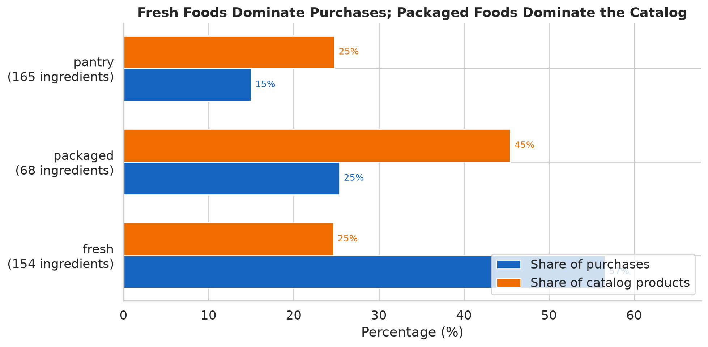
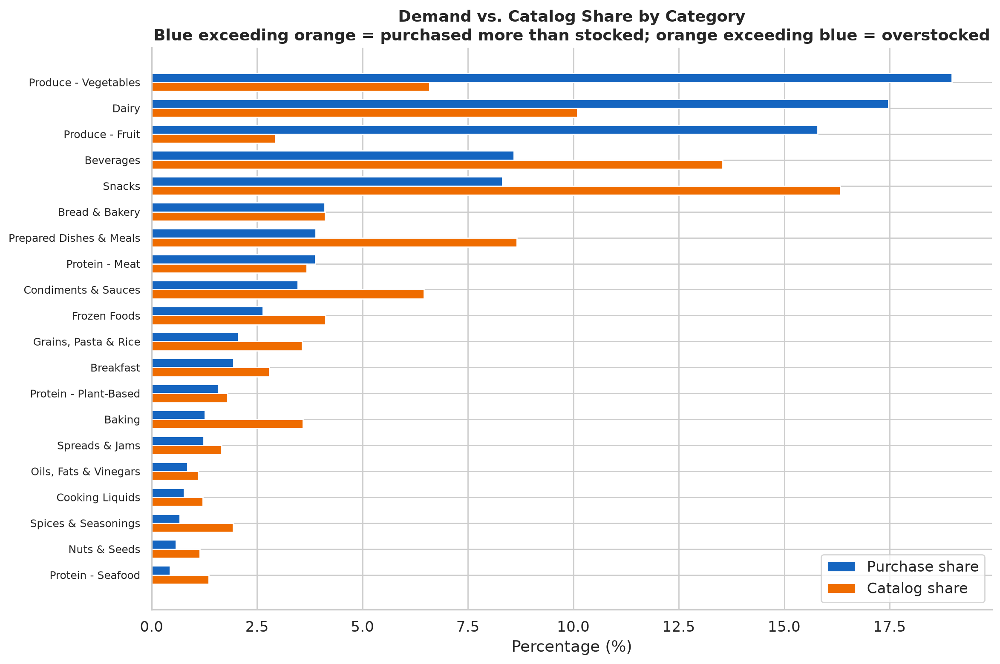
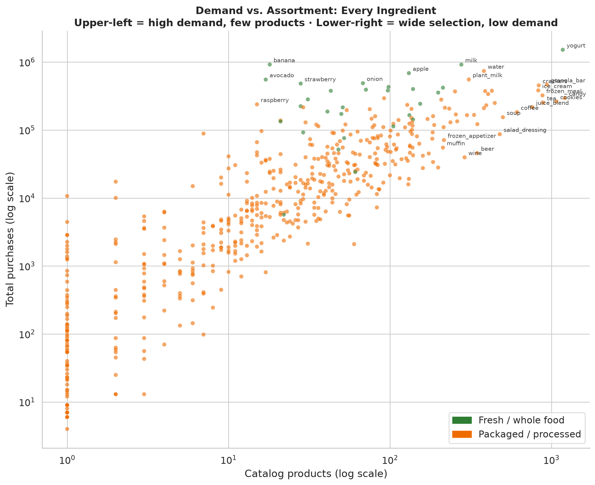
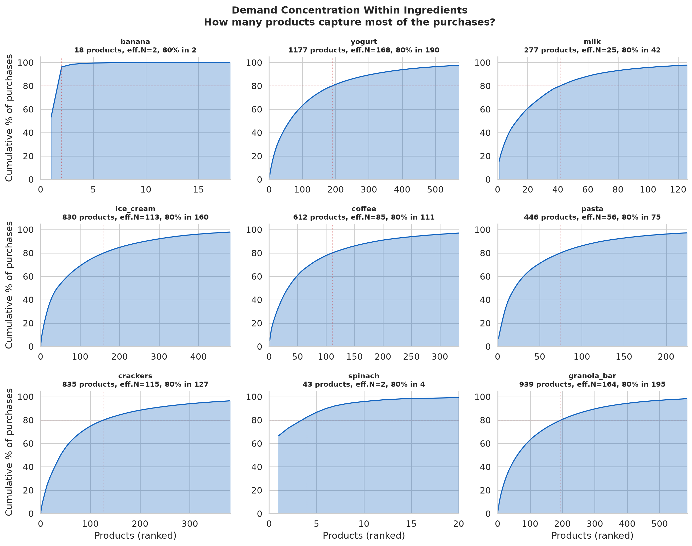
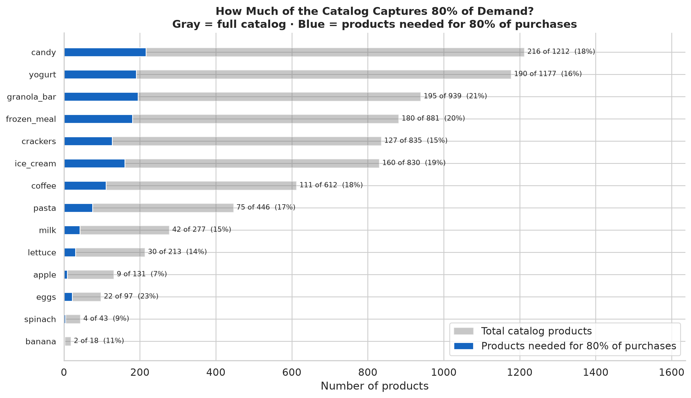
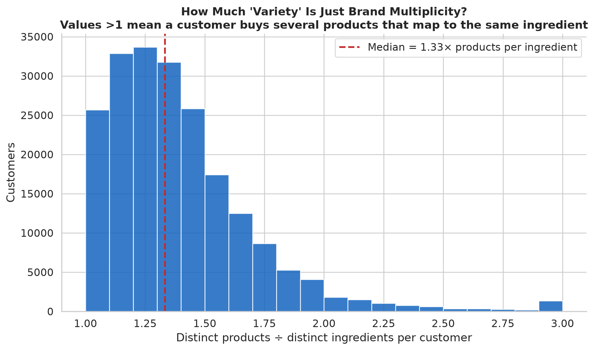

# Ingredients: What the Catalog Offers vs. What Customers Buy

What does the Instacart grocery catalog look like, and what do people actually put
in their carts? The answer depends on whether you count products (distinct SKUs) or
purchases (items bought). The two orderings disagree sharply and consistently: the
catalog is wide where branding is the product; the cart is deep where the food is.

- Sources: `analyze_ingredient_lens.py` → `all_ingredients.csv`,
  `ingredient_concentration.csv`, `fresh_vs_packaged.csv`, `category_summary.csv`,
  `per_customer_repertoire.parquet`;
  `visualize_ingredient_lens.py` → all figures below.
- Scope: 35,722 classified food products, 543 ingredients, 30.4M food purchase events,
  206k customers.
- Classification: [food_classification.csv](../../data/food_classification.csv)
  maps each product to an ingredient (a recipe role, not a SKU). See
  [taxonomy](../../data/INGREDIENT_TAXONOMY.md).

## The big picture

| | Fresh | Packaged | Pantry |
|---|---:|---:|---:|
| **Share of purchases** | **57%** | 25% | 15% |
| **Share of catalog products** | 25% | **45%** | 25% |
| **Ingredients** | 154 | 68 | 165 |

Fresh foods (produce, dairy, meat, seafood) are **57% of everything customers buy
but only 25% of the products the catalog offers**. Packaged foods (snacks, beverages,
frozen, breakfast, prepared meals) are the mirror: 45% of the catalog but 25% of
purchases. Pantry staples (grains, baking, condiments, oils, spices) sit in between,
roughly proportional.

The same pattern holds at the category level:

Produce — vegetables (19% of purchases, 7% of catalog) and fruit (16% of purchases,
3% of catalog) — is the starkest mismatch. Snacks are the opposite: 16% of the
catalog but 8% of purchases. The catalog is built for variety where branding
differentiates products; customer carts concentrate where the food itself is the
product.

## What is an ingredient?

An ingredient is the recipe-level role a product plays, with brand, size, and flavor
stripped away. "Organic 2% Milk," "Whole Milk," and a store-brand gallon all map to
`milk`; "Chobani Blueberry 5.3oz" and "Fage Plain" both map to `yogurt`.

How many products collapse into one ingredient varies wildly:

| Ingredient | Catalog products | What people actually buy (top products) |
|-----------|-----------------:|----------------------------------------|
| banana | 18 | Banana · Bag of Organic Bananas · Organic Banana |
| yogurt | 1,177 | Total 2% Strawberry · plain Greek · fruit-on-bottom cups |
| milk | 277 | Organic Whole Milk · Reduced Fat 2% Milk · Whole Milk |
| candy | 1,212 | Dark Chocolate Peanut Butter Cups · 85% Cacao Bar · Milk Chocolate Almonds |

## What customers buy ≠ what the catalog stocks

Rank ingredients by **purchase volume** and by **catalog product count** — the two
orderings disagree:

| Ingredient | % of purchases | Catalog products | % of catalog |
|-----------|---------------:|-----------------:|-------------:|
| banana | 3.0% | 18 | 0.1% |
| avocado | 1.8% | 17 | 0.05% |
| strawberry | 1.6% | 28 | 0.1% |
| spinach | 1.2% | 43 | 0.1% |
| milk | 3.0% | 277 | 0.8% |
| — | | | |
| candy | 1.0% | 1,212 | 3.4% |
| granola_bar | 1.5% | 939 | 2.6% |
| crackers | 1.5% | 835 | 2.3% |
| ice_cream | 1.3% | 830 | 2.3% |

16 of the top 20 ingredients by purchase volume are fresh whole foods. Bananas alone
are 3% of all food purchases from 18 products; candy is 1% from 1,212.

Every ingredient plotted:

The upper-left quadrant (high demand, few SKUs) is dominated by fresh produce:
banana, avocado, strawberry, raspberry, onion. The lower-right (wide selection, lower
demand per SKU) is packaged categories: candy, cookies, frozen meals, crackers. The
cloud shows a weak positive relationship — more products does predict more purchases
— but the outliers in both directions carry the story.

## How concentrated is demand within each ingredient?

An ingredient may have hundreds of products, but customers may overwhelmingly buy a
few. The concentration curves below show cumulative purchase share vs product rank for
nine ingredients spanning different structures:

**Concentrated** ingredients have a dominant product or two. ("Effective number of
products" is the inverse-HHI count — how many equally-popular products would give the
same concentration; an ingredient where one SKU dominates scores near 1, one spread
evenly across 100 SKUs scores near 100.)

- **spinach**: 43 products, but one (Organic Baby Spinach) is 67% of purchases;
  2 products capture 80%. Effective number of products: 2.
- **banana**: 18 products, one is 53%. Eff.N = 2.
- **milk**: 277 products but the top product is 16%. Eff.N = 25; 42 products
  capture 80%.

**Distributed** ingredients spread demand across many products:
- **yogurt**: 1,177 products, top product is only 2%. Eff.N = 168; you need 190
  products for 80% of volume. Yogurt is the ultimate brand-variety category.
- **granola_bar**: 939 products, top is 2.4%, eff.N = 164.
- **ice_cream**: 830 products, top is 3.6%, eff.N = 113.

The pattern: fresh/staple ingredients concentrate on a few dominant SKUs; flavored
and branded categories distribute demand across the long tail.

## Most catalog variety goes unbought

Across all 543 ingredients, **6,677 products — 19% of the food catalog — account
for 80% of all purchases**. The rest of the catalog (81% of products) splits the
remaining 20% of demand.

Every point below the diagonal represents unused assortment: products the catalog
carries but that contribute little to volume. Fresh ingredients hug the bottom-left
(small catalog, almost all of it purchased). Packaged categories stretch along the
x-axis (large catalog, most of it low-volume).

Virtually every product in the catalog *was* purchased at least once (only 3 of
35,722 classified products had zero purchases in the dataset). The issue is not zero
demand — it is extreme skew: a few products per ingredient drive most volume, and the
long tail of variants contributes very little each.

## A quarter of product variety collapses at the ingredient level

The median customer buys **45 distinct products but only 34 distinct ingredients** — a
**1.33× multiplier**. About 24% of a customer's apparent product variety represents
different brands, sizes, flavors, or formulations of the same ingredient rather than
different foods. This dissolves at the ingredient level: four yogurt brands and three milks read as variety
in product data and as habit in ingredient data.

## What an ingredient actually contains

For ingredients with substantial assortment, the top products by purchase volume vs
the long tail look very different:

**Yogurt** (1,177 products, eff.N=168): The top sellers are plain Greek yogurts and a
few flavored varieties. The tail is hundreds of specialty flavors, sizes, and dietary
variants — each individually uncommon but collectively 80% of the assortment.

**Frozen meals** (881 products, eff.N=100): Mac & cheese, pad thai, and burritos lead.
The tail is brand × flavor × dietary combinations — a long tail of options that
customers spread across rather than concentrating on.

**Banana** (18 products, eff.N=2): Organic vs conventional, single vs bunch. Almost
nothing to differentiate — the food *is* the product.

This contrast — between ingredients where the food sells itself and ingredients where
the brand does — is the fundamental structure of the grocery catalog.

## Organic penetration

Product names that include "organic" account for **33.5% of all food purchases** on
this platform — far above the ~6% US grocery organic share reported by USDA for the
same period, consistent with Instacart's urban, convenience-oriented customer base.

Organic penetration varies enormously by ingredient:

| Ingredient | Organic share | Total purchases |
|-----------|-------------:|----------------:|
| zucchini | **94%** | 139k |
| kale | 86% | 196k |
| arugula | 83% | 97k |
| spinach | **76%** | 378k |
| avocado | **75%** | 553k |
| carrot | 70% | 393k |
| apple | **66%** | 688k |
| strawberry | **66%** | 483k |
| milk | **60%** | 918k |
| banana | **55%** | 921k |
| eggs | 52% | 382k |
| yogurt | 25% | 1.5M |
| ice_cream | 6% | 383k |
| soda | 1% | 339k |
| candy | 1% | 296k |

Fresh produce and dairy are overwhelmingly organic on this platform; packaged
snacks and beverages are not. (These are Instacart-specific rates and should not be
generalized to all US grocery shopping; the platform's customer base skews toward
demographics that over-index on organic.)

**Source data:** `organic_penetration.csv` — organic share for all 543 ingredients,
derived from "organic" appearing in product names. This is an approximation: some
organic products may not include the word in their name, and some non-organic products
might (e.g., "organic-style" marketing). For high-penetration ingredients the signal
is strong; for low-penetration ones it is a lower bound.

## Plant milk vs dairy milk

Plant milk (almond, oat, soy, coconut, etc.) is **38% of the combined plant + dairy
milk market** on this platform — 554k purchases vs 918k for dairy milk. Plant milk
also has a larger catalog (308 products vs 277) despite lower volume, suggesting
brand proliferation in a newer category. Again, this reflects Instacart's customer
base; national plant-milk share was ~15% of retail milk sales in 2017.

## How many products does a grocery store need?

6,677 products — 19% of the food catalog — capture 80% of all purchase volume.
Small-format grocers like Trader Joe's (typically ~4,000 SKUs) and Aldi (~1,500 food
SKUs) operate within this range. The data doesn't prove that a 6,700-product store
would satisfy all customers — the long tail serves real niches — but it quantifies
what a curated assortment needs to cover to capture most demand.

## Limitations

- This is an Instacart product catalog, not a complete inventory of what every grocery
  store stocks. Assortment here means "products available on the platform," and may
  differ from physical store shelf space.
- "Fresh vs packaged" is classified by ingredient taxonomy category, not by a nutrition
  or processing label. Edge cases exist (frozen fruit, shelf-stable milk).
- 2,807 products (5.6%) are unclassified — the LLM declined low-confidence guesses.
  These are excluded from ingredient-level analysis.
- Purchase volume reflects the Instacart customer base (likely skewed toward
  convenience-oriented urban shoppers) and the 2017 dataset vintage. Organic shares
  and plant-milk ratios here should not be read as nationally representative.
- Organic tagging is based on "organic" appearing in the product name. This is
  approximate — a lower bound on true organic purchases (some products don't
  advertise organic in the name) and potentially an upper bound for a few cases
  (marketing language). It is not based on USDA certification data.
- An ingredient collapses real variation: `yogurt` includes Greek, Icelandic, dairy-free,
  and fruit-on-bottom. The taxonomy is a best effort, not ground truth.
