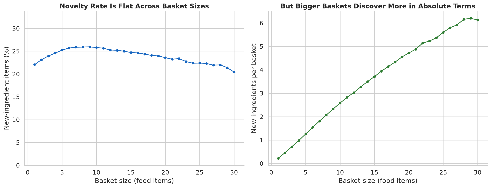
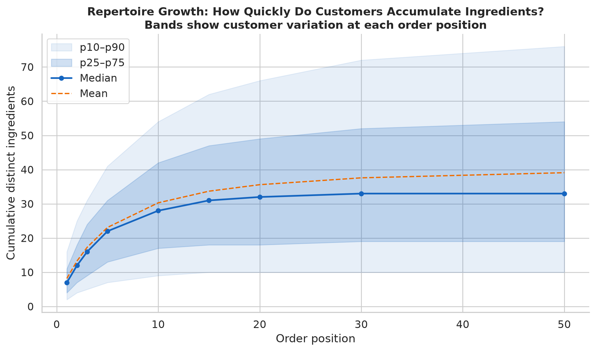
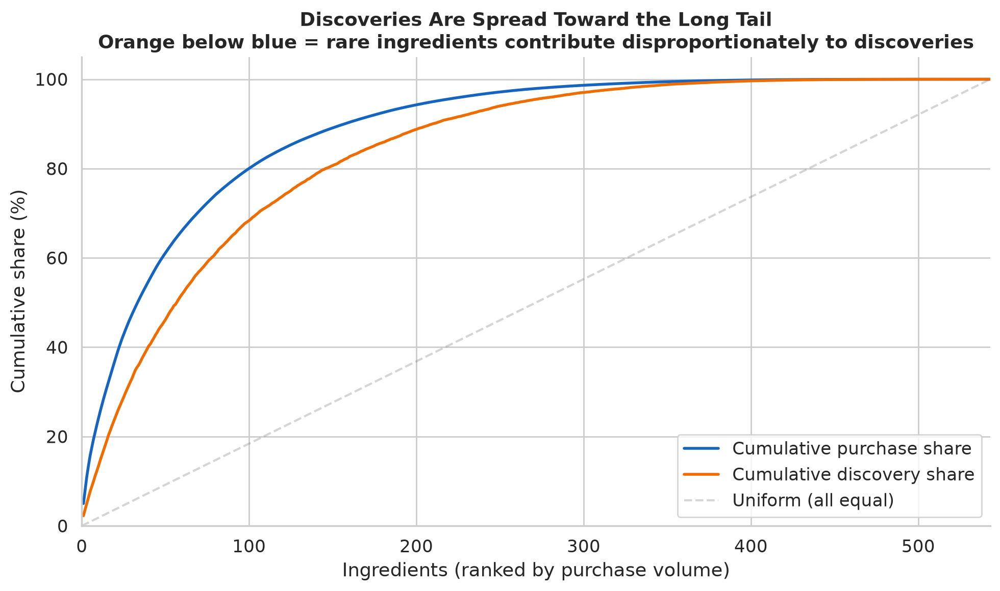
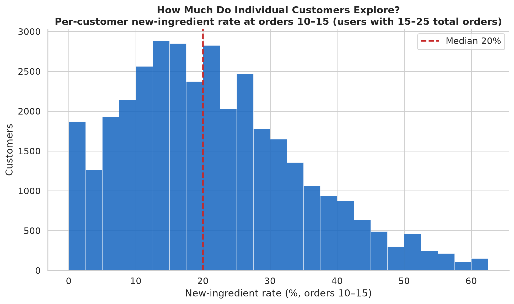

# Novelty & Exploration

How much of grocery shopping involves trying something new, what kinds of new things
do customers buy, and how does that vary across customers and food categories?

"New" here means new to the customer's *observed* history — first appearance in the
dataset. The dataset does not contain a customer's complete lifetime purchasing
history, so a first observed purchase is not necessarily a first-ever purchase.

- Sources: `analyze_novelty.py`, `analyze_exploration.py`,
  `analyze_novelty_extended.py`; `visualize_novelty.py`, `visualize_audit.py`
- Scope: 30.4M food item-events, 206k customers, 543 ingredients.

---

## Three kinds of "new"

Deduplicate to one item per (customer, order, product). For orders n ≥ 2, classify
each item by the customer's prior observed history:

- **familiar product** — this exact product appeared in an earlier order
- **familiar ingredient, new product** — the product is new, but its ingredient isn't
- **new ingredient** — this ingredient has never appeared for this customer

| Weighting | familiar product | familiar ingredient | new ingredient |
|-----------|-----------------:|--------------------:|---------------:|
| Item-weighted | 63.9% | 11.6% | 24.4% |
| Order-weighted | 64.9% | 10.5% | 24.6% |
| Customer-weighted | 50.5% | 11.0% | 38.5% |

The three categories are mutually exclusive and sum to 100%. Item- and order-weighting
agree (~24–25% new ingredient); customer-weighting is higher (38.5%) because lighter
buyers, who explore proportionally more, count equally.

**None of these pooled numbers is a stable exploration rate** — they average over
early orders where novelty is inflated by truncation (see next section).

## The truncation artifact

The dataset starts mid-history, so a customer's first observed order is 100% "new" by
construction. Apparent novelty decays as the observed window lengthens:

| Order position | new-ingredient share | familiar-product share |
|---------------:|---------------------:|-----------------------:|
| 1 | 100.0% | 0.0% |
| 2 | 63.4% | 28.1% |
| 5 | 35.6% | 51.5% |
| 10 | 22.5% | 64.5% |
| 20 | 13.7% | 74.5% |
| 50 | 7.6% | 82.7% |
| 100 | 5.3% | 86.8% |

**Late-history exploration is ~5–7%, not ~22%.** At orders 50+, about one item in fifteen is a new-to-observed-history ingredient,
though the rate is still declining (5.3% at order 100). Part of this decline is
mechanical: as the observed repertoire grows, fewer catalog ingredients remain to
discover. Whether exploration would plateau at some floor given a longer window
cannot be determined from this data. Any statement about exploration must condition
on order position or restrict to late-history customers.

## Where novelty happens: categories

Not all categories are explored the same way. The blue portion is new-ingredient
novelty (a food type the customer hasn't bought before); the orange is new-product
novelty (a new product for a familiar ingredient — a different brand, flavor, or size).

**Spices and baking** have the highest novelty rates (75–81%) because they're
purchased infrequently: each purchase is likely the first observed occurrence.
**Dairy and produce-fruit** have the lowest (30–33%) because staples like milk,
bananas, and yogurt are bought almost every order.

The categories where **product-only novelty** (orange bar) is largest relative to
ingredient novelty (blue) are the ones with wide brand assortment: **frozen foods**
(16% product-only), **snacks** (15%), **breakfast** (15%). In these categories,
customers already know the ingredient (ice cream, granola bars, cereal) but try
different products. Produce-fruit has only 7% product-only novelty — bananas are
bananas regardless of brand.

## Novelty versus basket size

The new-ingredient *rate* is remarkably flat across basket sizes: ~23–26% regardless
of whether the basket has 2 items or 25. Bigger baskets discover more new ingredients
in absolute terms (a 20-item basket encounters ~4.7 new ingredients vs ~0.5 for a
2-item basket), but not at a higher *rate per item*.

This means customers don't make bigger baskets by adding more new items — they scale
up familiar purchases and new items alike. Larger baskets provide more opportunity for
discovery, but not a disproportionate amount.

## Repertoire growth

Cumulative distinct ingredients by order position, with percentile bands across
customers:

| Order | Median ingredients | p25–p75 | Customers reaching it |
|------:|-------------------:|--------:|----------------------:|
| 1 | 7 | 5–11 | 203k |
| 5 | 23 | 16–31 | 137k |
| 10 | 35 | 25–47 | 71k |
| 20 | 50 | 37–66 | 28k |
| 50 | 75 | 59–93 | 4k |

The repertoire grows steadily but never saturates — at order 50, customers have
encountered 75 of 543 catalog ingredients (median). The p25–p75 band is wide: by
order 20, the most varied quartile has tried 66+ ingredients while the narrowest
has tried 37 or fewer. Customer variation is real, even at comparable history lengths.

Yet within-order diversity is flat at ~8 distinct ingredients regardless of order
position. The repertoire grows by slow accumulation — a trickle of new items into
otherwise familiar baskets — not by baskets becoming more varied.

## What gets discovered: popular versus rare ingredients

When a customer first encounters an ingredient, is it usually a common one or
something unusual? The orange curve (cumulative discovery share) lags below the
blue curve (cumulative purchase share): the top 20 ingredients by volume account
for **37% of all purchases but only 24% of discoveries**. Conversely, the long tail
of less-common ingredients contributes disproportionately to first-time encounters.

This is partly mechanical — common ingredients are discovered early and then repeat,
while rare ingredients are discovered later, if at all. But it means the discovery
frontier is tilted toward the catalog's variety, not its volume.

## How much do individual customers explore?

Measured at a comparable point in their observed history (orders 10–15, among
customers with 15–25 total orders): the median customer's new-ingredient rate is
**20%**, but the distribution is wide — p10 is 6% and p90 is 41%.

Some of this variation reflects basket size and shopping frequency, not just a
preference for exploration. But even after controlling for history length, the
spread is substantial: some customers are encountering a new ingredient in nearly
half their items while others are below 6%.

## Exploration slows, but it's a stable trait

For customers with ≥20 orders, the new-ingredient rate falls from **34% in the first
half of their history to 15% in the second**, and **97.7% of customers slow down**.
But the first-half/second-half correlation is 0.66 — a customer who explores more
than average early still does so late. Exploration is a persistent individual
trait layered on a near-universal decline.

## Brand multiplier

The median customer buys **45 distinct products but only 34 distinct ingredients**
(1.33×). About a quarter of apparent product variety is the same ingredient in
different packaging — four yogurt brands and three milks read as variety in product
data and as habit in ingredient data. (Full treatment in
[ingredients →](../ingredients/).)

## Exploration breadth

Across all observed history, the median customer's new-ingredient discoveries span
**12 food categories and 34 distinct ingredients**. Exploration is broad — customers
don't discover new ingredients only in one or two favorite categories. This is
consistent with the flat-across-basket-size finding: exploration is distributed across
the basket, not concentrated in a single adventurous category.

## Limitations

- Truncation can be conditioned around but not removed; the ~5–7% late-history rate
  is a lower bound if customers also explored before the observed window.
- "New to the observed history" ≠ "new to the customer." Some first-observed purchases
  are routine items the customer bought before the dataset began.
- "Familiar ingredient, new product" mixes brand switches, size changes, and genuine
  flavor exploration — the data carries product names, not structured attributes.
- Novelty rates by category are inflated for infrequently purchased categories
  (spices, baking) because almost every purchase is the first observed occurrence.
  This reflects purchase frequency, not necessarily a higher propensity to explore
  those categories.
- Customer-level novelty rates are sensitive to basket size, observation length, and
  the mix of categories purchased. The controlled comparison (orders 10–15, similar
  history lengths) reduces but does not eliminate these confounds.
- Order position, not calendar time — see [sequences](../sequences/) §10 for the
  order-gap-to-days mapping.
