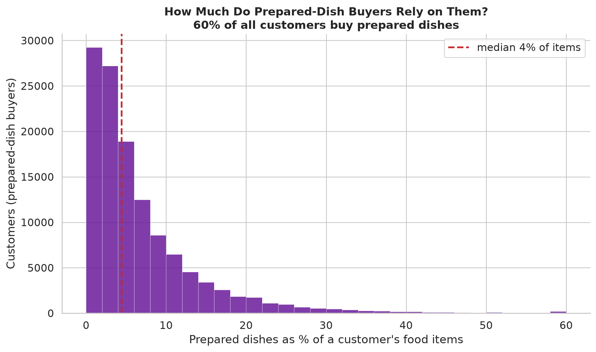

# Prepared Dishes

Prepared meals are the most meal-subscription-relevant slice of grocery behavior, so
they get their own study: who buys them, how much they rely on them, which dishes are
popular down to the individual product, and how they reorder.

- Source: `analyze_prepared_foods.py` → `prepared_food_audit.csv`,
  `prepared_topics.csv`, `prepared_products.csv`, `prepared_engagement*.csv`.

## What counts as a prepared dish

A prepared dish is a **pre-made meal that still needs warming or cooking** — a frozen
dinner, pizza, lasagna, pot pie, mac & cheese, deli-prepared meal. Not a snack, not a
drink, not a cooking ingredient. We define it as the 17 meal types in the taxonomy's
*Prepared Dishes & Meals* section, **not** the raw per-product `is_prepared_dish`
flag, which was too broad (it also marked snacks, soda, coffee, even produce).
Condensed / cream-of soups are a cooking base, so they were split into
`condensed_soup` and excluded; ready-to-eat soup remains a dish. [Taxonomy](../classification/INGREDIENT_TAXONOMY.md)

## Reach and reliance

**59.6% of customers (122,794 of 206,062) buy at least one prepared dish** — a
majority, but far below the ~90% you get if snacks count.

Among buyers:

| Measure | p10 | median | p90 |
|---------|----:|-------:|----:|
| Prepared dishes as % of food items | 1.0% | **4.4%** | 15.7% |
| Orders containing a prepared dish | 7.7% | **30%** | 78% |
| Distinct prepared dish types bought | 1 | **2** | 5 |

For the typical buyer, prepared meals are an occasional convenience — about one item
in twenty, under a third of orders — not a dietary base. A heavy-tail minority leans
on them (top decile: ~16% of items). Reliance does **not** rise with overall purchase
volume (correlation of prepared-item-share with order count = −0.21): heavy grocery
shoppers do not buy proportionally more prepared meals.

## Which dish types are popular

| Dish type | Customers | Items | Repeat-buyers\* |
|-----------|----------:|------:|---------------:|
| frozen_meal | 54,229 | 323,757 | 62% |
| frozen_pizza | 41,479 | 166,969 | 59% |
| soup (ready-to-eat) | 41,033 | 154,365 | 50% |
| mac_and_cheese | 35,777 | 118,454 | 54% |
| deli_prepared | 31,445 | 122,057 | 53% |
| frozen_appetizer | 25,452 | 71,095 | 47% |
| chicken_nuggets | 21,925 | 69,636 | 54% |
| frozen_burrito | 13,635 | 51,054 | 53% |
| instant_ramen | 9,284 | 21,592 | 39% |
| frozen_lasagna | 8,191 | 20,700 | 45% |
| instant_soup / canned_chili / pot_pie / meal_kit / hot_pocket | 2k–7k each | — | 32–43% |

\*share of a type's buyers who bought it in ≥2 separate orders. The category is
dominated by the **freezer** (meals, pizza, appetizers, burritos, lasagna); frozen_meal
and frozen_pizza are the stickiest (59–62% come back).

## Down to the individual dish

Because a dish type collapses hundreds of products, here are the specific products
customers actually buy within the three largest types:

- **frozen_meal:** Macaroni & Cheese, Pad Thai, Pesto Tortellini Bowls, Beans & Rice
  Cheddar Burrito, Broccoli & Cheddar Bake — comfort and single-serve ethnic bowls.
- **soup:** Organic Chicken Noodle, Organic Creamy Tomato, Organic Lentil (plain and
  vegetable), Traditional Chicken Noodle — classic ready-to-eat cans/boxes.
- **deli_prepared:** Classic Chicken Salad, Avocado Roll, Sesame Seaweed Salad,
  Tabouleh — the grab-and-go deli case (sushi, salads).

`prepared_products.csv` has the full ranking with per-product buyer counts.

## How prepared dishes reorder

| Group | P(next order) | Lift above chance |
|-------|--------------:|------------------:|
| Prepared dishes | 26.9% | **1.38×** |
| Base ingredients | 28.7% | 1.28× |

A specific prepared dish recurs in the next order slightly *less* often than a
base-ingredient product on the raw rate (26.9% vs 28.7%), but more relative to its own
frequency baseline (1.38× vs 1.28×) — i.e. prepared dishes are bought less regularly
but, when a customer does repeat one, it is somewhat more concentrated in time. Within
a dish type, buyers also buy several products at once more than with staples
(simultaneous coexistence 16% of prepared-dish orders vs 8% for base ingredients; see
[substitution](../sequences/)). These are descriptions of timing, not of preference.

## What it might mean for a meal service

- Prepared-meal demand is a **minority, occasional** grocery behavior (60% reach, ~4%
  of items for the median buyer). A prepared-only service is serving the heavy tail,
  not the median grocery shopper.
- Repeat buying happens at the **specific-dish** level, and customers often buy
  several products of a dish type at once — both repeat favorites and variety appear,
  though grocery data can't say whether this would hold for a meal service.
- Frozen dominates; deli-prepared is the main non-frozen channel.

## Limitations

- Even restricted to the meal list, grocery frozen dinners / canned chili are not a
  clean proxy for chef-prepared meal kits — treat generalizations as hypotheses.
- Reach counts anyone who bought ≥1 prepared dish in the observed window.
- The ready-to-eat / cooking-base soup split is drawn by product name and has edge
  cases.
