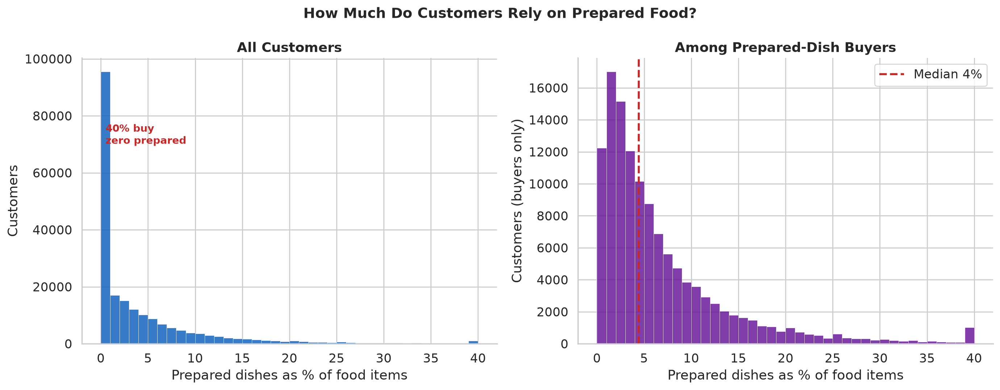
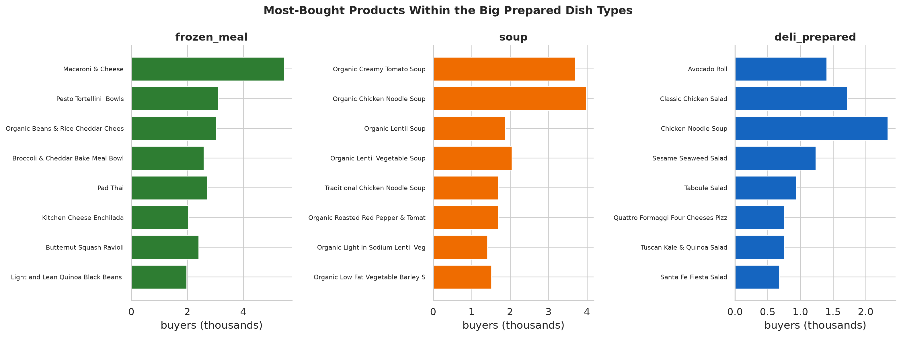
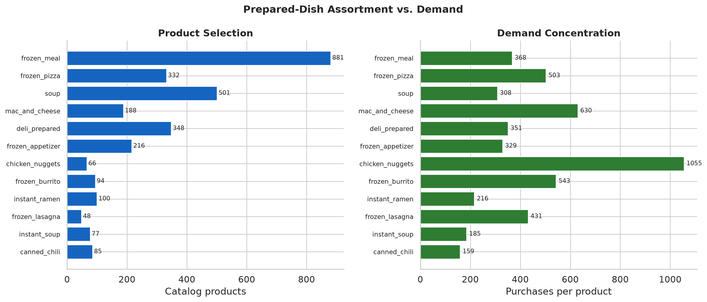
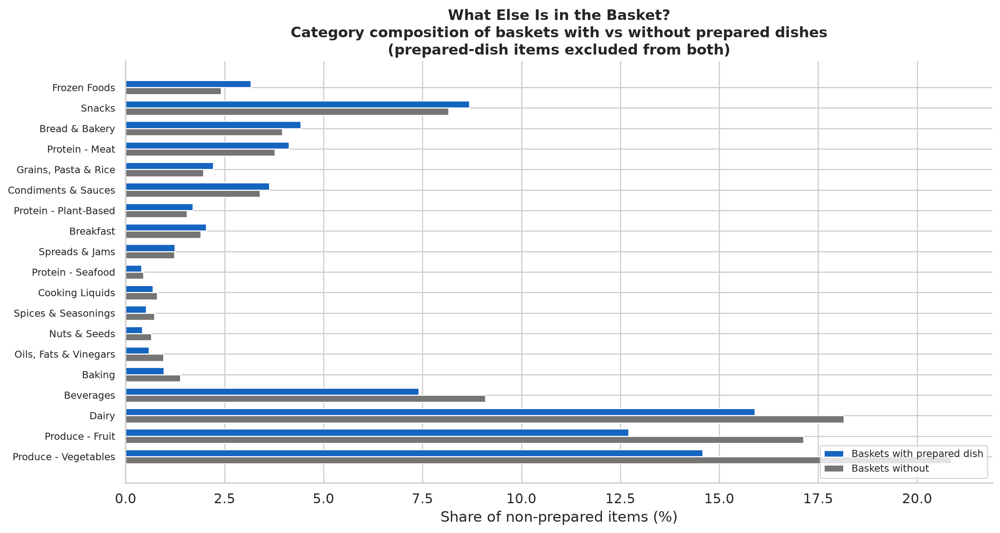

# Prepared Dishes

How much of grocery purchasing involves prepared food, what kinds do customers buy,
and how does it fit into their overall grocery shopping?

- Sources: `analyze_prepared_foods.py`, `analyze_prepared_extended.py`,
  `visualize_prepared.py`
- Scope: 30.4M food item-events, 3.3M baskets, 206k customers.
- Definition: 17 meal types in the taxonomy's *Prepared Dishes & Meals* section —
  frozen dinners, pizza, soup (ready-to-eat), mac & cheese, deli-prepared meals, etc.
  Not snacks, not drinks, not cooking ingredients.
  [Taxonomy →](../classification/INGREDIENT_TAXONOMY.md)

---

## What counts as a prepared dish

A prepared dish is a **pre-made meal that needs warming or minimal cooking** — a
frozen dinner, pizza, lasagna, pot pie, burrito, deli meal. The classification uses
the 17 ingredient types under the taxonomy's "Prepared Dishes & Meals" section, which
is narrower than the per-product `is_prepared_dish` flag (which also catches snacks,
coffee, and produce). Condensed/cream-of soups are classified as cooking bases, not
prepared dishes; ready-to-eat soup is included.

## How much purchasing involves prepared food

Three measures, three different numbers:

| Measure | Value |
|---------|------:|
| **Customers** who buy ≥1 prepared dish | **60%** (122,794 of 206,062) |
| **Baskets** containing ≥1 prepared item | **21%** (688k of 3.3M) |
| Prepared items as **% of all food purchases** | **3.9%** |

**79% of baskets have zero prepared items.** When present, it's usually one (13%) or
two (4%). Prepared food is a minority behavior at the basket level even among
customers who buy it: the median buyer's prepared-item share is 4.4% of their food
purchases, in about 30% of their orders.

## Who buys prepared food

40% of customers buy zero prepared dishes in the observed window. Among buyers:

| Measure | p10 | median | p90 |
|---------|----:|-------:|----:|
| Prepared as % of items | 1.0% | **4.4%** | 15.7% |
| Orders with prepared dish | 7.7% | **30%** | 78% |
| Distinct dish types | 1 | **2** | 5 |

A heavy-tail minority leans on them (top decile: ~16% of items). Reliance does
**not** increase with overall purchase volume (correlation −0.21): heavy grocery
shoppers do not buy proportionally more prepared meals.

## Which dish types dominate

| Dish type | Customers | Purchases | Repeat-buyers |
|-----------|----------:|----------:|--------------:|
| frozen_meal | 54,229 | 323,757 | 62% |
| frozen_pizza | 41,479 | 166,969 | 59% |
| soup | 41,033 | 154,365 | 50% |
| mac_and_cheese | 35,777 | 118,454 | 54% |
| deli_prepared | 31,445 | 122,057 | 53% |
| frozen_appetizer | 25,452 | 71,095 | 47% |
| chicken_nuggets | 21,925 | 69,636 | 54% |

**Frozen dominates.** Frozen meals and pizza are the highest-reach and stickiest
categories (59–62% of buyers return). Deli-prepared is the main non-frozen channel.
Below the big categories, there's a long tail of frozen burritos, lasagna, instant
ramen, pot pies, and meal kits.

## Down to the individual product

- **frozen_meal:** Mac & Cheese, Pad Thai, Pesto Tortellini Bowls — comfort and
  single-serve ethnic bowls.
- **soup:** Organic Chicken Noodle, Organic Creamy Tomato — classic ready-to-eat.
- **deli_prepared:** Classic Chicken Salad, Avocado Roll, Sesame Seaweed Salad —
  grab-and-go deli case.

## Assortment versus demand

Chicken nuggets have the most concentrated demand: 1,055 purchases per product from
only 66 catalog items. Frozen meals have the widest selection (881 products) but only
368 purchases per product — demand is spread across a large assortment. Instant ramen
has wide assortment (100 products) but the lowest per-product demand (216).

## What else is in a prepared-food basket?

Baskets containing prepared dishes are **larger** (median 12 items vs 7). The
composition of the *rest of the basket* barely changes:

- Produce, dairy, and fruit are slightly lower in prepared-food baskets (the basket
  is bigger, so these categories' shares dilute slightly).
- Spices and cooking liquids drop by 0.2 percentage points — a tiny signal consistent
  with less from-scratch cooking, but within noise.
- Snacks, bread, and protein are marginally higher.

**The honest reading:** baskets with prepared food look almost exactly like baskets
without, except bigger. Cross-sectional basket comparisons cannot establish whether
prepared items replace or supplement other foods — the same customer may shop
differently on different occasions, and prepared-food buyers may differ from
non-buyers in ways not visible here.

## How prepared dishes reorder

| Group | P(next order) | Lift above chance |
|-------|--------------:|------------------:|
| Prepared dishes | 26.9% | **1.38×** |
| Base ingredients | 28.7% | 1.28× |

Prepared dishes recur less often in raw terms (26.9% vs 28.7%) but are more
concentrated in time relative to their frequency baseline (1.38× vs 1.28× lift).
When a customer repeats a prepared dish, they tend to repeat it in a cluster rather
than spread evenly across their orders.

## Limitations

- "Prepared dish" is defined by the taxonomy's 17 meal types. Grocery frozen dinners
  and canned chili are not a clean proxy for chef-prepared meal kits or restaurant
  meals. Treat generalizations as hypotheses.
- Reach counts anyone who bought ≥1 prepared dish in the observed window — it
  measures exposure, not commitment.
- The ready-to-eat vs cooking-base soup split is drawn by product name and has edge
  cases (cream-of-mushroom soup can be either).
- Basket composition comparisons are confounded by basket size: prepared-food baskets
  are larger, so category *shares* mechanically shift even if absolute item counts
  don't change. The near-identical shares are a stronger finding than they might
  appear — the bigger basket has more of everything.
- This is Instacart-specific. Prepared-food purchasing through a delivery platform
  may differ from in-store grocery shopping.
