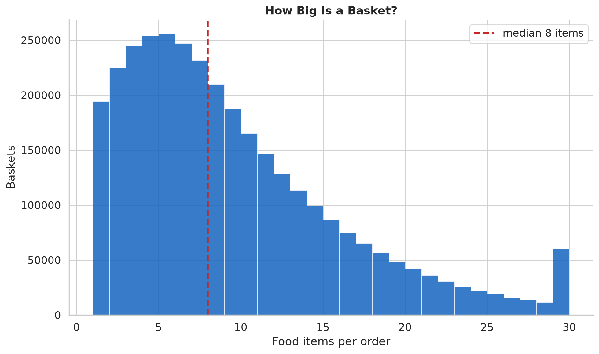

# Basket Contents

## Research question

How big is a basket, how varied is it, and what is actually in it — fresh food,
packaged goods, prepared meals?

## Method

Over all 3.3M orders / 30.4M food item-events, measure items per order, distinct
ingredients per order, department composition (share of all food items), and the
prepared-dish presence. Streams the purchase table in user-id bursts.

## How big and how varied

- **Median basket: 8 food items** (mean 9.2; p10–p90: 2–18).
- **Median 7 distinct ingredients per basket** (mean 8.2).

A basket is small and mostly non-repetitive within itself — a customer rarely buys
the same ingredient twice in one order, so distinct-ingredients (7) tracks item count
(8) closely. Basket variety is also flat over a customer's lifetime (~8 distinct
ingredients per order at order 1 and at order 50 alike) — see the
[exploration report](EXPLORATION.md).

## What's in the basket

| Department | Share of food items |
|------------|--------------------:|
| produce | **31.2%** |
| dairy eggs | 17.2% |
| snacks | 9.2% |
| beverages | 8.3% |
| frozen | 7.3% |
| pantry | 5.9% |
| bakery | 3.8% |
| canned goods | 3.5% |
| deli | 3.4% |
| dry goods pasta | 2.8% |
| meat seafood | 2.4% |

**Fresh dominates.** Produce alone is nearly a third of all food items; produce +
dairy + meat/seafood + deli (fresh departments) are over half the basket. Packaged
categories — snacks, beverages, frozen, pantry — fill most of the rest. This is the
same story the ingredient-volume view tells
([ingredients & categories](INGREDIENTS.md)): the cart is deep on fresh staples even
though the catalog is wide on packaged variety.

**Prepared dishes are a small slice.** Prepared meals are **3.9% of food items**, and
**20.8% of baskets contain at least one** prepared dish. Most baskets are raw-
ingredient grocery runs; prepared meals ride along in one basket in five. (Prepared
dish = the taxonomy's meal list; see [prepared dishes](PREPARED_FOODS.md).)

## Limitations

- Department is the product's retail department, not a nutrition or
  fresh/processed judgment; "fresh" here is produce/meat/dairy/deli by department.
- Item counts are food items only (non-food household/pet products are excluded),
  so basket sizes are smaller than a customer's full cart.
