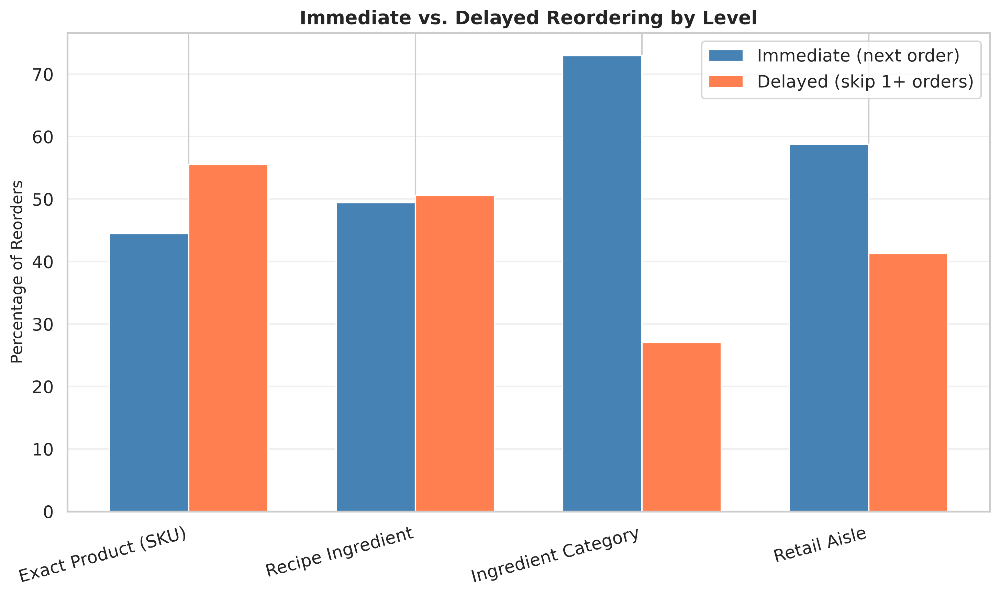
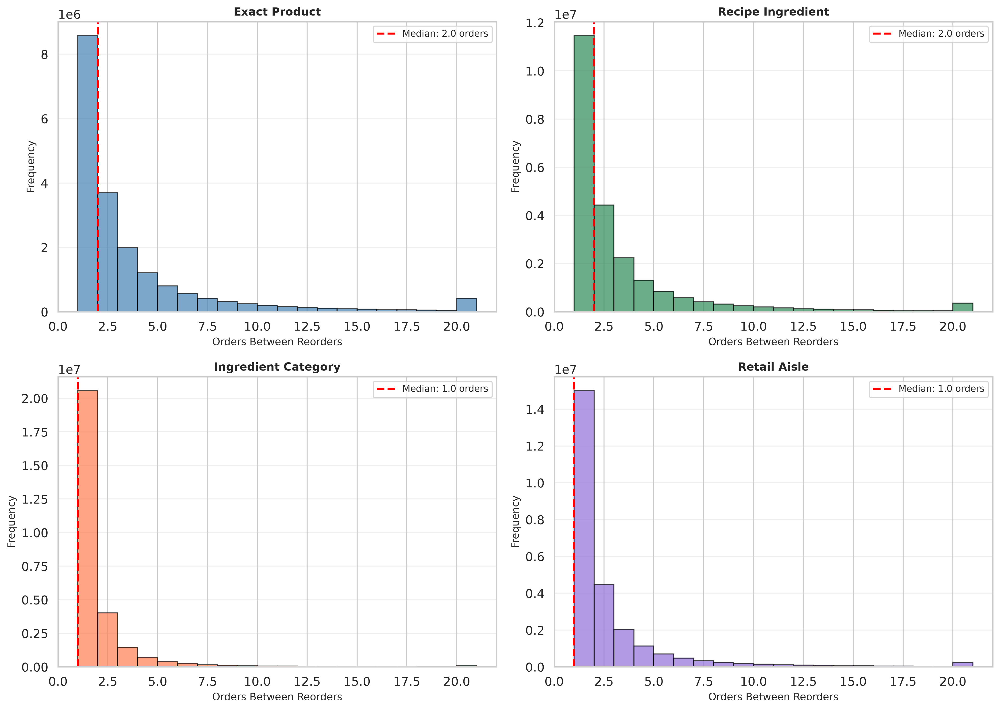
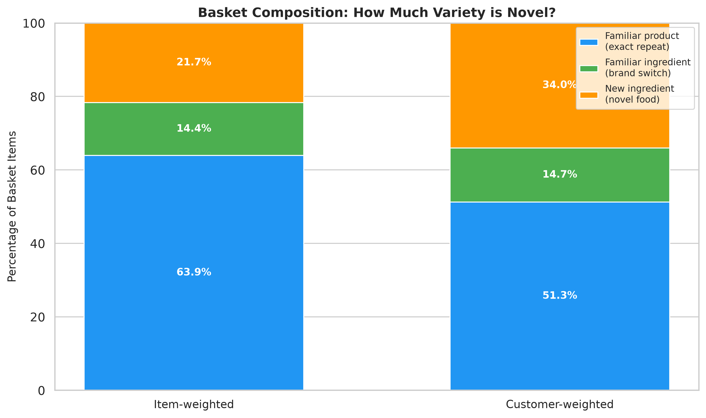
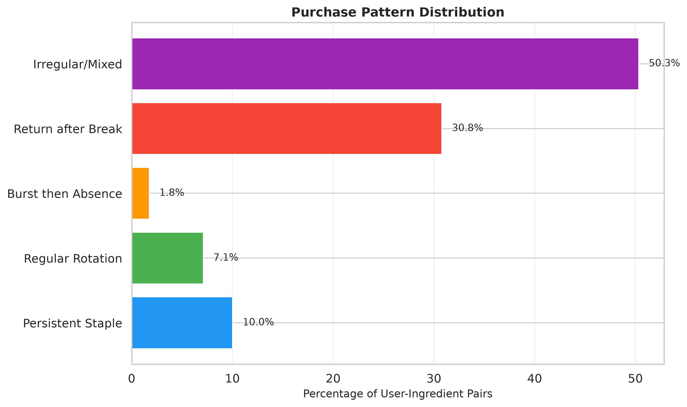
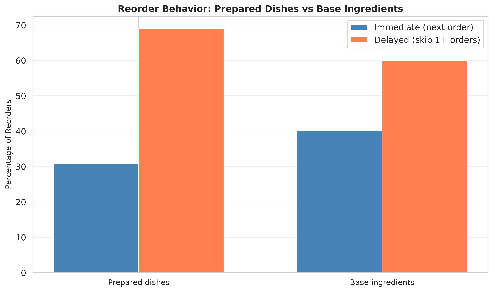

# Sequence Analysis: Understanding Food Selection Patterns

**How do customers select and reorder foods over time? What reveals variety-seeking versus loyalty, brand switching versus dietary change, and exploration versus repetition?**

This analysis uses the Instacart dataset joined to LLM-based ingredient classifications to study purchasing sequences at multiple levels: exact products, recipe ingredients, ingredient categories, and retail aisles. The goal is to understand patterns that may inform meal subscription services about customer retention, variety needs, and menu design.

---

## Table of Contents

1. [Overview](#overview)
2. [Methodology](#methodology)
3. [Multi-Level Reorder Analysis](#multi-level-reorder-analysis)
4. [Basket Composition](#basket-composition)
5. [Purchase Patterns](#purchase-patterns)
6. [Prepared Foods](#prepared-foods)
7. [Key Findings](#key-findings)
8. [Meal Subscription Implications](#meal-subscription-implications)
9. [Limitations](#limitations)

---

## Overview

### The Question

When a customer stops buying a product, are they:
- **Switching brands** (different product, same ingredient)?
- **Substituting ingredients** (different ingredient, same category)?
- **Rotating through familiar options** (temporary break, will return)?
- **Actually changing preferences** (moving to new ingredient categories)?

The answer matters for meal subscription services trying to balance **familiarity** (comfort, reliability) with **variety** (novelty, exploration).

### The Approach

We analyze 197,523 customers with 4+ orders across 32M food purchases, classified into 632 ingredients across 25 categories using LLM-based recipe taxonomy.

Four levels of analysis:
1. **Product** (SKU): Exact brand and variant
2. **Ingredient** (recipe): Recipe-level food type (e.g., all milk varieties → "milk")
3. **Category** (family): Broader food family (e.g., milk, yogurt, cheese → "DAIRY")
4. **Aisle** (retail): Store organization (baseline comparison)

---

## Methodology

### Data

- **Dataset**: Instacart Online Grocery Shopping Dataset 2017
- **Customers**: 197,523 with 4+ orders
- **Orders**: Prior + train sets (test has no item labels)
- **Products**: 49,688 unique SKUs
- **Classifications**: 38,529 food items (77.5%) mapped to 632 ingredients in 25 categories

### Classification

Products classified using Claude via fabric CLI with recipe-grounded taxonomy:
- `"Organic 2% Milk"` → ingredient: `milk`, category: `DAIRY`
- `"Light Strawberry Yogurt"` → ingredient: `yogurt`, category: `DAIRY`
- `"Smart Ones Mini Rigatoni"` → ingredient: `frozen_meal`, category: `PREPARED_FOODS`

See [CLASSIFICATION_ANALYSIS.md](../classification/CLASSIFICATION_ANALYSIS.md) for details.

### Sequence Analysis

For each customer, track purchases across orders:
- **Immediate reorder**: Item appears in order N and N+1
- **Delayed reorder**: Item appears in order N, skips 1+ orders, then reappears
- **Never reordered**: Item purchased only once (in observed history)

**Key distinction**: "Eventually reordered" (delayed) is not the same as "immediately repeated". Both are reorders, but they reveal different behaviors.

### Batched Processing

Memory-efficient implementation using polars:
- Process 5,000 users per batch
- Accumulate statistics incrementally
- Avoids loading entire dataset into memory

---

## Multi-Level Reorder Analysis

> ⚠️ **Superseded — read [REORDER_PROBABILITY_AUDIT.md](REORDER_PROBABILITY_AUDIT.md).**
> The "Immediate Reorders" figures below come from a metric that (a) conditioned
> on a repeat existing rather than measuring next-order probability, and (b)
> double-counted multi-product orders at coarse levels. The corrected analysis
> finds next-order probabilities of 29% (product) → 59% (category), and — crucially
> — that category persistence is only **1.04× above chance** while product
> persistence is **1.29× above chance**. The "category loyalty" conclusion below
> does **not** survive the correction. Numbers retained here only for provenance.

### Results (superseded)

| Level | Immediate Reorders | Delayed Reorders | Median Gap |
|-------|-------------------|------------------|------------|
| **Category** | 73.0% | 27.0% | 1 order |
| **Aisle** | 58.7% | 41.3% | 1 order |
| **Ingredient** | 49.4% | 50.6% | 2 orders |
| **Product** | 44.5% | 55.5% | 2 orders |



### Interpretation

**Customers are loyal to ingredient categories but flexible on specifics:**

1. **Category loyalty** (73% immediate): Customers consistently return to the same food families. If they buy dairy, they keep buying dairy.

2. **Ingredient variety** (49% immediate): Within categories, customers rotate. They buy milk, then yogurt, then cheese, then milk again.

3. **Brand switching** (44% immediate): Significant product-level variation. Customers change brands, sizes, and variants frequently even while staying loyal to the ingredient.

4. **Gap between ingredient and product**: The 5-percentage-point difference (49.4% vs 44.5%) represents pure brand/variant switching while maintaining ingredient loyalty.

### Visual Evidence



**Median gaps**:
- **Category**: 1 order - customers don't skip food families
- **Ingredient**: 2 orders - moderate rotation within categories
- **Product**: 2 orders - but with higher variance (brand experimentation)

---

## Basket Composition

**How much of each order is familiar versus novel?**

### Results

For orders 2+ (30.2M items across 197K customers):

| Composition | Item-weighted | Customer-weighted |
|-------------|---------------|-------------------|
| **Familiar product** (exact repeat) | 63.9% | 51.3% |
| **Familiar ingredient, new product** (brand switching) | 14.4% | 14.7% |
| **New ingredient** (novel food) | 21.7% | 34.0% |



### Interpretation

**Novelty drives variety more than brand switching:**

1. **Novel ingredients (21.7%) > brand switches (14.4%)** - Customers try genuinely new foods more often than they just change brands of familiar ones. But repetition still dominates: 78.3% are familiar ingredients (63.9% exact + 14.4% switches).

2. **Individual customers explore more than volume suggests**: Customer-weighted shows 34.0% new ingredients vs 21.7% item-weighted. Heavy buyers stick to routines; lighter buyers explore more.

3. **Understanding the weighting**:
   - **Item-weighted**: Counts every purchase (heavy buyers with large orders dominate the average)
   - **Customer-weighted**: Average each customer's percentages first, then average those (every customer has equal voice)

The difference (34% vs 22% novel) reveals that people who buy less try more new things, while high-volume buyers are more repetitive.

---

## Purchase Patterns

**What patterns do customers exhibit over time?**

### Pattern Classification

For user-ingredient pairs with 2+ purchases (users with 10+ orders):

- **Persistent Staple**: Purchased in >50% of orders with runs of 3+ consecutive
- **Regular Rotation**: Appears every few orders with consistent gaps (2-5 orders)
- **Burst then Absence**: Multiple purchases early, then stops
- **Return after Break**: Purchases, gap of 5+ orders, resumes
- **Irregular/Mixed**: Doesn't fit clear patterns

### Results

Total user-ingredient pairs analyzed: 3,401,385

| Pattern | Count | Percentage |
|---------|-------|------------|
| **Irregular/Mixed** | 1,711,844 | 50.3% |
| **Return after Break** | 1,047,207 | 30.8% |
| **Persistent Staple** | 341,011 | 10.0% |
| **Regular Rotation** | 241,767 | 7.1% |
| **Burst then Absence** | 59,556 | 1.8% |



### Interpretation

**Customers don't follow simple routines:**

1. **Half are irregular** (50.3%): Most user-ingredient pairs don't fit clean patterns. Purchasing is complex and context-dependent.

2. **Returns are more common than staples** (30.8% vs 10.0%): Customers take long breaks from ingredients and come back. This is 3x more common than persistent staples.

3. **True staples are rare** (10.0%): Very few ingredients are bought consistently across >50% of orders.

4. **Rotation is uncommon** (7.1%): Few customers settle into predictable 2-5 order cycles.

**Meal subscription insight**: Don't expect customers to fall into fixed routines. They explore, pause, and return. Menu systems should accommodate irregular patterns, not force regularity.

---

## Prepared Foods

**Do prepared dishes behave differently from base ingredients?**

### Results

| Group | Immediate Reorders | Delayed Reorders |
|-------|-------------------|------------------|
| **Prepared dishes** (1,749 products) | 30.9% | 69.1% |
| **Base ingredients** (36,780 products) | 40.1% | 59.9% |



### Interpretation

**Prepared dishes show MORE variety-seeking than base ingredients:**

1. **Lower immediate reorders** (30.9% vs 40.1%): Customers rotate through prepared dishes more than through staples like milk or eggs.

2. **No "prepared food fatigue"**: Reorder rates are similar, just with more rotation. Customers return to prepared dishes, but less immediately.

3. **Meal subscription insight**: Customers likely want variety in prepared meals more than in ingredient staples. Menu rotation and novelty are important.

**Prepared ingredients analyzed**: frozen_meal, soup, pizza, mac_and_cheese, burrito, sandwich, salad_kit, meal_kit, lasagna, ravioli, wings, nuggets, and 6 others.

---

## Key Findings

### 1. Loyalty Exists at the Category Level, Not Product Level

Customers are remarkably consistent about food *categories* (DAIRY, PRODUCE, PROTEIN) but highly variable about specific *products* and even *ingredients* within those categories.

**What this means**: "Variety" doesn't require crossing food families. Rotating milk → yogurt → cheese feels varied even though all are dairy.

### 2. Brand Switching is Frequent

The gap between ingredient-level (49% immediate) and product-level (44% immediate) reordering reveals substantial brand and variant switching.

**What this means**: Customers don't need new foods; they want familiar foods presented differently.

### 3. Prepared Foods Show Higher Rotation

Prepared dishes have lower immediate reorder rates (31% vs 40%) than base ingredients, indicating customers want more variety in "what's for dinner" than in pantry staples.

**What this means**: Meal services should emphasize menu rotation and diverse presentations of familiar ingredients rather than introducing genuinely unfamiliar foods.

### 4. Novelty Drives Variety More Than Brand Switching

Novel ingredients (21.7%) are more common than brand switches (14.4%). Customers try genuinely new foods more often than they just change brands. However, 78.3% of purchases are still familiar ingredients (63.9% exact + 14.4% switches).

**What this means**: Customers explore new foods regularly, not just different presentations. But repetition dominates volume.

### 5. Returns After Breaks are More Common Than Staples

30.8% of user-ingredient patterns show long gaps (5+ orders) followed by resumption. Only 10.0% are persistent staples bought in >50% of orders.

**What this means**: Temporary absences aren't churn signals. Customers take breaks and come back. Don't over-react to pauses.

### 6. Most Patterns are Irregular

50.3% of user-ingredient pairs don't fit clean categories. Purchasing is complex, context-dependent, and doesn't settle into simple routines.

**What this means**: Don't force customers into fixed schedules or expect predictable behavior. Accommodate irregularity.

---

## Meal Subscription Implications

### For Menu Design

1. **Rotate presentations, not ingredients**: Offer familiar ingredients (chicken, pasta, tomatoes) in different recipes rather than exotic foods.

2. **Emphasize variety within stability**: Customers want novelty but not dietary upheaval. "New" should mean "new combination" more often than "new food."

3. **Plan for rotation**: Expect customers to skip meals they've had recently. Bring back popular dishes after a gap.

### For Retention

1. **Category consistency matters**: Don't let weeks pass without offering core categories a customer likes (e.g., if they consistently order chicken-based meals, always have options).

2. **Product variety compensates for ingredient repetition**: Same ingredient + different preparation = perceived variety.

3. **Temporary absence ≠ churn**: Customers who stop ordering prepared foods often return. Don't over-react to short gaps.

### For Recommendations

1. **Recommend within familiar categories**: Suggest new chicken recipes to chicken buyers, not quinoa bowls.

2. **Use ingredient similarity**: "You liked chicken parmesan" → "Try chicken marsala" is safer than "Try tofu stir-fry."

3. **Highlight rotation**: "You haven't had this in 5 weeks" may be compelling for returning favorites.

---

## Limitations

### Data Constraints

1. **Grocery ≠ Meals**: Instacart customers buy ingredients and prepared foods separately. Meal subscriptions deliver complete composed dishes.

2. **No recipe decomposition**: We classify "frozen lasagna" as `frozen_meal`, not as beef + pasta + cheese + sauce. Real meal analysis needs ingredient breakdowns.

3. **Limited history**: Customers have 4-30 orders. Long-term patterns (seasonal, annual) aren't visible.

4. **No outcomes**: We observe purchasing, not satisfaction, retention, or churn.

### Analysis Constraints

1. **First purchase ≠ First exposure**: Dataset starts mid-customer-history. "New" ingredients may be familiar from before our observation window.

2. **Product ambiguity**: Some products span categories (is a breakfast burrito a burrito or breakfast food?).

3. **Sample bias**: Analysis uses customers with 4+ orders (more engaged than average).

### Inference Limits

**We can show**: Customers rotate through prepared foods frequently while maintaining category loyalty and accepting brand switches.

**We cannot show**: Whether this causes satisfaction, predicts retention, or generalizes to meal subscriptions.

---

## Next Steps

### Completed
- ✓ Multi-level reorder statistics (4 levels: product, ingredient, category, aisle)
- ✓ Interval distributions and gap analysis
- ✓ Basket composition (familiar products, brand switching, new ingredients)
- ✓ Pattern classification (staples, rotation, bursts, returns, irregular)
- ✓ Prepared food comparison (prepared dishes vs base ingredients)
- ✓ Visual comparisons across levels
- ✓ Example sequence timelines

### Recommended Future Work
- Ingredient co-occurrence analysis (which ingredients appear together?)
- Customer segmentation (repeaters vs rotators vs explorers)
- Sequence transition analysis (what follows what?)
- Recipe decomposition for prepared foods
- Temporal patterns (weekly cycles, seasonality)
- Comparison to actual meal subscription data (if available)

---

## Files and Reproducibility

### Analysis Scripts

All analysis code is in `scripts/sequence_analysis/`:
- `analyze_ingredient_sequences.py` - Multi-level reorder statistics
- `analyze_basket_composition.py` - Familiar vs novel breakdown
- `analyze_patterns.py` - Pattern classification
- `analyze_prepared_foods.py` - Prepared vs base comparison
- `generate_ingredient_figures.py` - Reorder visualizations
- `visualize_patterns.py` - Pattern and composition charts
- `generate_sequence_examples.py` - Example customer timelines

### Running the Analysis

```bash
# Full sequence analysis (4 levels)
python scripts/sequence_analysis/analyze_ingredient_sequences.py

# Basket composition
python scripts/sequence_analysis/analyze_basket_composition.py

# Pattern classification
python scripts/sequence_analysis/analyze_patterns.py

# Prepared food comparison
python scripts/sequence_analysis/analyze_prepared_foods.py

# Generate all figures
python scripts/sequence_analysis/generate_ingredient_figures.py
python scripts/sequence_analysis/visualize_patterns.py
python scripts/sequence_analysis/generate_sequence_examples.py
```

### Output Files

- `reorder_summary.csv` - Aggregate statistics by level
- `reorder_intervals_*.csv` - Detailed gap distributions (large, not committed)
- `basket_composition_summary.csv` - Familiar vs novel percentages
- `pattern_distribution.csv` - Pattern prevalence
- `prepared_vs_base.csv` - Prepared food comparison
- `BASKET_COMPOSITION.md` - Detailed basket analysis
- `PATTERN_ANALYSIS.md` - Detailed pattern analysis
- `PREPARED_FOODS.md` - Detailed prepared food analysis
- `figures/` - All visualizations

---

*This analysis uses LLM-based ingredient classifications to reveal purchasing patterns invisible at the product or aisle level. The taxonomy enables recipe-oriented analysis that bridges grocery data and meal subscription questions.*
