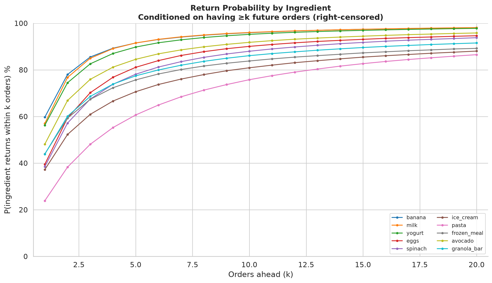
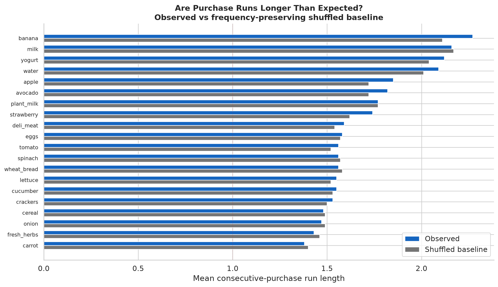
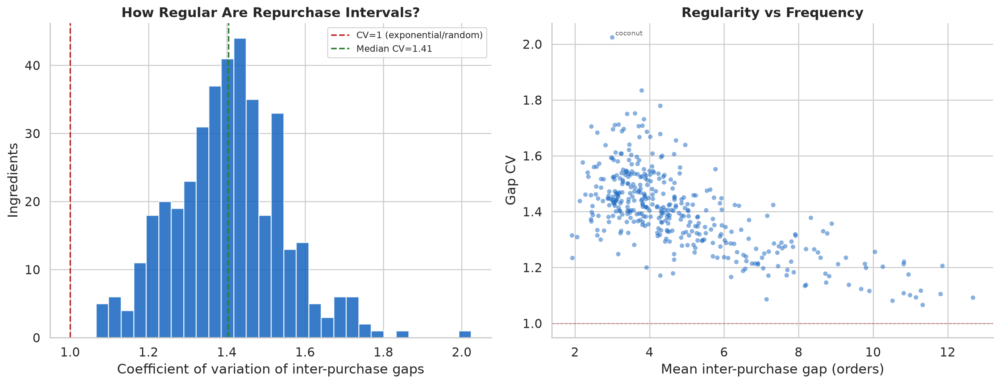
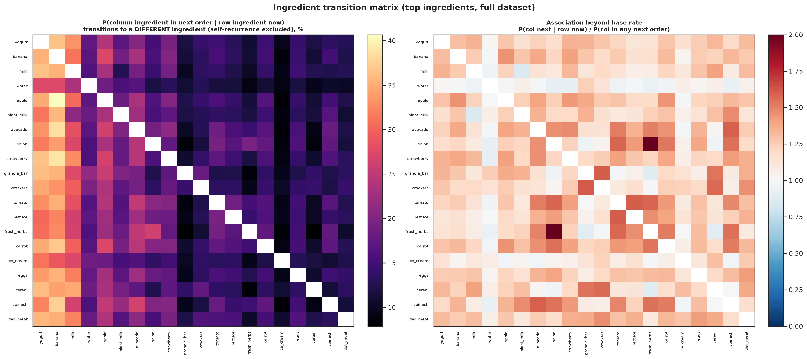

# Sequences

What patterns exist in the order of food purchases that cannot be explained simply by
how frequently customers buy those foods?

The shuffle and random baselines here test **temporal concentration** — whether a
value clusters in time beyond what a customer's purchase frequency alone implies.
That is not the same as loyalty, preference, or predictability, and we do not read
it as such. Observations are stated first; possible explanations are flagged.

- Sources: `analyze_reorder.py`, `analyze_patterns.py`, `analyze_substitution.py`,
  `analyze_calendar_time.py`, `analyze_sequences.py`, `analyze_lift_decomposition.py`;
  `visualize_behavior.py`, `visualize_sequences.py`, `generate_pattern_gallery.py`.
- The reorder baseline is validated by a brute-force permutation check built into
  `analyze_reorder._validate()` (run as an assert).

---

## 1. Does recent history help predict the next order?

Tested on 5M predictions (50k customers × 100 ingredients, scored on both present and
absent ingredients in the held-out last order): **overall purchase frequency is the
best simple predictor.** Adding recency (boosting probability for recently-purchased
ingredients) makes predictions worse, not better.

| Model | Log-loss | Brier score |
|-------|--------:|------------:|
| Overall frequency | **0.183** | **0.050** |
| Frequency + recency | 0.200 | 0.052 |
| Binary recency only | 0.212 | 0.057 |

The frequency model already captures most of what's predictable about the next order:
a customer's long-run purchase rate for each ingredient is a well-calibrated
probability. Recency adjustments shift probability toward recently-purchased items,
which helps for items that appear but hurts for items that don't — and the latter
dominates because most ingredients are *absent* from any given order.

**Correction:** An earlier version of this test scored only ingredients *present* in
the test order, which made recency appear 33% better than frequency. That was a
scoring error — proper log-loss must penalize both false positives and false negatives.
With proper scoring, the tested recency adjustments hurt rather than help. This does
not prove that sequence information has no value — a more sophisticated model might
extract useful signal — but the simple frequency baseline is well-calibrated and hard
to beat with crude recency rules.

## 2. Next-order reordering and temporal concentration

For an occurrence of a value at order *n* (observable iff *n* < the customer's true
final order *N*), does the same value appear in order *n+1*? The baseline is a random
re-ordering of that customer's *N* baskets: if a value appears in *b* of *N* baskets
and one of them is the current order, the other *b*−1 occurrences are distributed
across the remaining *N*−1 slots, so the chance the next slot holds one is
(b−1)/(N−1). Observed and expected are summed over the **same** observable
occurrences, so the ratio (lift) is a like-for-like comparison.

| Grain | P(next) | within 5 | expected | Lift |
|-------|--------:|---------:|---------:|-----:|
| Product | 28.6% | 58.3% | 22.3% | 1.28× |
| Ingredient | 34.8% | 68.6% | 30.3% | 1.15× |
| Aisle | 43.3% | 77.1% | 39.7% | 1.09× |
| Category | 58.8% | 88.2% | 56.4% | 1.04× |

A specific product recurs in the next order ~29% more often than a reshuffle of the
same customer's baskets. The excess shrinks toward zero as the grain broadens: broader
grains have higher raw reorder rates but near-1 lift — a wide bucket refills often
simply because it holds more products, which is arithmetic, not behavior.

**Where the product/ingredient lift gap comes from** (`lift_decomposition.csv`): for
(customer, ingredient) pairs using a single product it is zero by construction (both
grains 1.20×). It lives entirely in multi-product pairs (product 1.35× vs ingredient
1.11×): individual products arrive in temporal bunches within a stable ingredient.

## 3. Return probability over time

How quickly does an ingredient return after its last purchase?

Return probability within *k* orders, conditioned on having ≥*k* future orders
(right-censored). The curves separate into three tiers:

- **Staples** (banana, milk, yogurt, eggs): 55–60% return in the next order, 90%+
  within 5 orders. These are near-constant fixtures.
- **Regular but not every-order** (avocado, spinach, granola_bar): 38–50% next-order,
  75–90% within 5. Present in most shopping trips but not all.
- **Occasional** (ice_cream, pasta, frozen_meal): 25–40% next-order, 60–80% within 5.
  Purchased intermittently.

The spread across ingredients is large; the shape (rapid initial return, then slow
climb) is universal. Most of this is explained by purchase frequency — frequent items
return faster — but §1's prediction test shows that recent timing adds information
beyond the rate.

## 4. Purchase runs and streaks

Are consecutive-purchase runs (buying the same ingredient in 3+ successive orders)
longer than a frequency-preserving shuffle would produce?

Barely. Banana's mean run is 2.3 orders vs 2.1 shuffled; yogurt 2.1 vs 2.0; most
ingredients are within 5% of their shuffled baseline. The temporal concentration
that reorder lift detects (§2) manifests as very mild streakiness — runs are slightly
longer than random, but the effect is small enough that most "streaks" in the data
would also appear in a customer-frequency-preserving reshuffle.

For context: banana's 25% of runs reaching 3+ orders vs 23% shuffled means about
1 in 10 observed "streaks" is above what frequency alone predicts.

## 5. Regularity of repurchase intervals

The coefficient of variation (CV) of inter-purchase gaps measures how regular
repurchase timing is. For continuous random arrivals CV = 1 (exponential); CV < 1 is
more regular; CV > 1 is more irregular (bursty). For discrete gaps in finite
histories, the expected CV under random placement depends on the ingredient's
frequency — sparse ingredients have higher expected CV — so 1.0 is an approximate
reference, not an exact null.

The median CV across ingredients is **1.41**. Under random placement of the same number
of purchases in the same history length, the expected CV is typically 0.5–0.8
(depending on frequency), so the observed 1.41 is genuinely above random — repurchase
intervals are more irregular than chance. Purchases come in bursts interspersed with
longer gaps. More-frequently-purchased ingredients tend to be slightly more regular,
but almost nothing reaches CV < 1.

This is consistent with §4's run-length finding: purchases are mildly streaky
(slightly above-random runs) but not periodic. "Regular rotation" as a pattern label
describes a small minority of ingredient histories.

## 6. Within an ingredient: coexistence vs. transitions

Two behaviors must be separated: buying several products of one ingredient **in the
same order** (coexistence) versus using different products **across orders**
(transition).

**Coexistence (simultaneous):** 8.5% of ingredient-orders contain ≥2 products, but
concentrated in flavored categories: **yogurt 37%, ice cream 26%, pasta 13%, milk
12%** vs staples (banana, bread, eggs ~0.5%).

**Transitions (across orders), single-product subset:** the same product recurs
slightly more than a label shuffle predicts (lift 1.0–1.08). Mild temporal
concentration, not alternation. Staples have high stay rates because the customer
uses one product; discretionary categories have lower stay rates and much of their
variety is **simultaneous**, not sequential.

| Ingredient | P(stay) | expected | lift | coexistence |
|-----------|--------:|---------:|-----:|------------:|
| banana | 92.8% | 89.5% | 1.04 | 0.5% |
| bread | 98.2% | 97.9% | 1.00 | 0.5% |
| eggs | 86.5% | 81.5% | 1.06 | 0.7% |
| milk | 86.1% | 80.2% | 1.08 | 12% |
| yogurt | 77.1% | 71.2% | 1.08 | 37% |
| ice_cream | 64.4% | 59.5% | 1.08 | 26% |
| pasta | 60.8% | 56.7% | 1.07 | 13% |

## 7. Which ingredients follow which

P(ingredient in column appears in order *n+1* | row ingredient in order *n*), top
ingredients, full dataset. The diagonal (excluded) is next-order self-recurrence.
Off the diagonal, the strongest associations above base rate are recognizable kitchen
clusters: onion ↔ fresh_herbs (~2.0×), lettuce ↔ tomato (~1.6×, salad), crackers ↔
granola_bar (snacking). These are population-level conditional rates normalized by
each column's base rate; they describe co-timing, not causation — many of these pairs
also co-occur within the same basket (see [basket analysis](../basket/)), so a
cross-order association may partly reflect ingredients that travel in the same
shopping trip.

## 8. Pattern labels and what they measure

Sorting (customer, ingredient) pairs (≥2 purchases, ≥10-order customers) into
staple / return / burst / rotation requires precedence (staple > return > burst >
rotation > irregular). This forces one label per pair and hides overlap. The more
informative view is each rule evaluated **independently**, next to a frequency-
preserving random null:

| Rule (independent) | Observed | Random null |
|--------------------|---------:|------------:|
| return after break (gap ≥5) | 59.8% | 68.6% |
| rotation (regular gaps) | 7.4% | 5.5% |
| persistent staple | 9.2% | 9.2% |
| burst then absence | 3.4% | 0.3% |

"Returns" and "staples" occur at or below their random rates — a reshuffle produces
as many. **Burst-then-absence** is the one rule clearly above chance (3.4% vs 0.3%):
ingredients bought a few times early, then absent for the rest of the observed window.
99% of these end well before the customer's last order.

This establishes that early-cluster-then-absence is a real temporal pattern. It does
**not** establish abandonment — we observe only a slice of each customer's history
and cannot see what happens after the window ends.

## 9. Purchase histories (examples)

Real customers, ingredient (row) × order (column). Dense rows are staples, broken
rows show gaps, rows starting partway are later discoveries, rows that stop are items
not seen again in the window. These are illustrations, not a sample the quantitative
results depend on.

The same view grouped by pattern label. Bearing in mind §8's caveat that most labels
mostly track frequency, this gives a visual feel for what each label looks like as a
sequence.

## 10. An order-gap is not a clock

Cadence varies widely, so order-gaps don't map to fixed time:

| Order gap | Median days | p10–p90 |
|----------:|------------:|--------:|
| 1 | 8 | 3–30 |
| 5 | 37 | 15–88 |
| 10 | 71 | 32–147 |

Median cadence is 13 days (p10–p90 of customers: 5–30). A 5-order gap spans 15–88
days depending on the customer. The 30-day cap on `days_since_prior_order` makes
long day-gaps lower bounds.

## Summary: what the sequence adds

1. **Overall frequency is hard to beat** — adding simple recency adjustments to
   frequency makes next-order prediction worse under proper scoring. More
   sophisticated sequence models might do better, but the frequency baseline is
   well-calibrated.
2. **Product-level temporal concentration is real but small** — reorder lift 1.28×,
   run lengths 5–10% above shuffled. The signal is consistent but modest.
3. **Most apparent "patterns" are consequences of frequency** — staples and returns
   match their random-baseline rates. Burst-then-absence is the exception.
4. **Repurchase timing is bursty, not periodic** — gap CV > 1 for nearly all
   ingredients. "Regular rotation" is rare.
5. **Within-ingredient product switching is mild** — products come in temporal bunches
   (lift 1.04–1.08), with most variety being simultaneous, not sequential.
6. **Ingredient transitions reflect co-timing more than sequential dependency** — the
   strongest cross-ingredient associations are kitchen clusters that also co-occur
   within baskets.

## Limitations

- The shuffle/random nulls preserve each customer's purchase frequencies but not
  cross-customer structure; they isolate temporal concentration only.
- `P(within k)` conditions on ≥k observable future orders; eventual return is a
  right-censored lower bound. There is no post-window observation, so nothing here
  speaks to churn.
- The transition matrix uses a population base-rate normalization, not a per-customer
  one; strong associations are co-timing at the population level.
- All comparisons report descriptive lift (observed/expected) without p-values. Given
  event counts in the tens of millions, virtually any nonzero lift clears statistical
  significance; the question is practical magnitude, not sampling noise.
- "Return after break" is sensitive to its gap threshold: 75% of pairs qualify at
  gap≥3, dropping to 29% at gap≥10. The reported 58% (gap≥5) should be read alongside
  the threshold-sensitivity figures in the data, not as a stable rate.
- The prediction test uses crude probability models (binary recency, raw frequency).
  A proper recommender would do better than either; the test establishes that sequence
  information *helps*, not how much a tuned model could extract.
- Run-length and gap-regularity comparisons use a sampled shuffled baseline (50k
  pairs per chunk) rather than an exact expectation. The sample is large enough for
  stable estimates but introduces minor sampling noise.
